# Лабораторная работа №1. Усредняющий фильтр Гаусса

**Вариант 3.** Усредняющий фильтр Гаусса с переменным размером ядра и параметрами гауссианы.

**Цель работы:** научиться реализовывать один из простых алгоритмов обработки изображений.

**Задание:**
1. Реализовать фильтр Гаусса в двух вариантах: с использованием встроенных функций библиотеки (OpenCV) и нативно на Python.
2. Сравнить быстродействие реализованных вариантов.
3. Оформить отчёт и выложить исходный код на GitHub.

---

## 1. Теория

### 1.1. Линейная фильтрация и свёртка

Линейный фильтр заменяет значение каждого пикселя взвешенной суммой значений пикселей в его окрестности. Веса задаются **ядром** (маской) $K$ размера $k_y \times k_x$ (обычно нечётного, чтобы у ядра был центр):

$$
I'(x, y) = \sum_{i=-r_y}^{r_y} \sum_{j=-r_x}^{r_x} K(i, j)\, I(x + j,\ y + i), \qquad r_x = \tfrac{k_x - 1}{2},\ r_y = \tfrac{k_y - 1}{2}.
$$

Если сумма весов ядра равна 1, фильтр сохраняет среднюю яркость изображения - такой фильтр называют **усредняющим** (сглаживающим).
Простейший пример - box-фильтр, где все веса одинаковы ($1/k^2$). Его недостаток: дальние и ближние пиксели вносят одинаковый вклад,
поэтому появляются артефакты («квадратное» размытие, звон в частотной области).

### 1.2. Функция Гаусса

Фильтр Гаусса использует веса, убывающие с расстоянием от центра по закону нормального распределения. Двумерная функция Гаусса с независимыми параметрами по осям:

$$
G(x, y) = \frac{1}{2\pi\sigma_x\sigma_y}\exp\left(-\frac{x^2}{2\sigma_x^2} - \frac{y^2}{2\sigma_y^2}\right).
$$

Параметры фильтра:

| Параметр | Смысл |
|---|---|
| $k_x, k_y$ - размер ядра | ширина/высота окрестности (нечётные числа). Гауссиана «обрезается» этим окном |
| $\sigma_x, \sigma_y$ - СКО гауссианы | «ширина колокола»: чем больше σ, тем сильнее размытие |

На практике ядро вычисляется в дискретных точках и **нормируется** так, чтобы сумма весов была равна 1 (иначе изображение станет темнее/светлее, особенно когда окно обрезает «хвосты» гауссианы):

$$
g_i = \frac{\exp\left(-\frac{(i - c)^2}{2\sigma^2}\right)}{\sum_j \exp\left(-\frac{(j - c)^2}{2\sigma^2}\right)}, \qquad c = \frac{k-1}{2},\ i = 0..k-1.
$$

Связь параметров: почти вся масса гауссианы (99.7 %) лежит в пределах $\pm 3\sigma$, поэтому разумный размер ядра $k \approx 6\sigma + 1$.
Если окно слишком мало относительно σ, ядро вырождается в почти box-фильтр; если окно велико при малом σ - крайние веса практически нулевые и только тратят время.
Когда σ не задана ($\sigma \le 0$), она выбирается по размеру ядра (формула OpenCV):

$$
\sigma = 0.3\left(\frac{k-1}{2} - 1\right) + 0.8.
$$

Для $k \le 7$ при $\sigma \le 0$ OpenCV использует фиксированные биномиальные коэффициенты (например, $[1, 2, 1]/4$ для $k=3$), нативная реализация повторяет это поведение.

### 1.3. Сепарабельность

Функция Гаусса раскладывается в произведение одномерных функций: $G(x, y) = g_{\sigma_x}(x)\cdot g_{\sigma_y}(y)$.
Значит, двумерное ядро - внешнее произведение двух векторов, $K = g_y\, g_x^\top$, и свёртку можно выполнить в два прохода: сначала по строкам одномерным ядром $g_x$, затем по столбцам ядром $g_y$.
Это уменьшает число операций на пиксель с $k_x k_y$ до $k_x + k_y$, т.е. сложность с $O(WH k^2)$ до $O(WH k)$.

### 1.4. Обработка границ

У пикселей у края изображения окрестность выходит за его пределы. Используется отражение без дублирования крайнего пикселя (`BORDER_REFLECT_101`, режим по умолчанию в OpenCV):

```
gfedcb | abcdefgh | gfedcba
```

### 1.5. Частотная интерпретация: преобразование Фурье

Любой сигнал (строку пикселей или всё изображение) можно представить суммой синусоид разных частот. **Преобразование Фурье** переводит сигнал из пространственной области («яркость в точке $x$») в частотную («амплитуда синусоиды с частотой $f$»):

$$
X(f) = \sum_{n=0}^{N-1} x[n]\, e^{-2\pi i f n}, \qquad F(u, v) = \sum_{x}\sum_{y} I(x, y)\, e^{-2\pi i (u x + v y)}.
$$

Здесь $f$ (или $u, v$) - частота в **циклах на пиксель**, от 0 (постоянная яркость) до 0.5 (самое быстрое чередование «светлый–тёмный» через пиксель). Низкие частоты отвечают за плавные перепады яркости, высокие - за мелкие детали, резкие границы и шум. На практике спектр считают быстрым преобразованием Фурье (БПФ, FFT).

**Теорема о свёртке:** свёртка в пространственной области равна поэлементному умножению спектров:

$$
I' = K * I \quad\Longleftrightarrow\quad F'(u, v) = H(u, v) \cdot F(u, v),
$$

где $H$ - Фурье-образ ядра, его **частотная характеристика**: во сколько раз фильтр ослабляет каждую частоту.

**Фурье-образ гауссианы - снова гауссиана:**

$$
g(x) = \frac{1}{\sqrt{2\pi}\sigma} e^{-\frac{x^2}{2\sigma^2}} \quad\Longrightarrow\quad H(f) = e^{-2\pi^2\sigma^2 f^2}.
$$

Свойства фильтра Гаусса как фильтра нижних частот (ФНЧ):
- $H(f)$ монотонно и плавно убывает от 1 к 0: низкие частоты проходят, высокие (шум, мелкие детали) подавляются; ширина в частотной области обратно пропорциональна σ (σ в частотах $= \frac{1}{2\pi\sigma}$), поэтому чем больше σ, тем сильнее подавление;
- $H(f) > 0$ на всех частотах - ни одна частота не меняет знак (не инвертируется);
- у $H(f)$ нет резкого среза и боковых лепестков, поэтому **нет «звона»** (эффекта Гиббса) - колебаний около резких границ.


### 1.6. Свойства и применение

- подавляет высокочастотный (в том числе гауссов) шум, являясь фильтром нижних частот; Фурье-образ гауссианы - тоже гауссиана, поэтому фильтр не даёт «звона»;
- размывает границы объектов (в отличие от медианного фильтра, не сохраняет резкие перепады);
- используется как предобработка перед выделением границ (Canny, LoG), при построении пирамид изображений и масштабного пространства (SIFT), при уменьшении изображений (антиалиасинг).

---

## 2. Описание разработанной системы

### 2.1. Структура проекта

```
LW1/
├── gaussian_native.py    # нативная реализация (чистый Python, без NumPy/OpenCV)
├── gaussian_opencv.py    # реализация через cv2.GaussianBlur + конвертация numpy <-> list
├── main.py               # консольная программа: фильтрация изображения с заданными параметрами
├── benchmark.py          # замеры быстродействия, графики и таблицы
├── demo.py               # иллюстрации для отчёта
├── fourier.py            # частотный анализ: спектры ядер, сигнала и изображения (БПФ)
├── requirements.txt
└── images/
    ├── input/            # тестовые изображения
    └── results/          # результаты, графики, CSV с замерами
```

### 2.2. Нативная реализация (`gaussian_native.py`)

Изображение представлено вложенными списками Python: `list[list[int]]` для полутонового и `list[list[tuple]]` для цветного (каждый канал обрабатывается отдельно).
NumPy и OpenCV в этом модуле не используются - все вычисления выполняются циклами Python.

Основные функции:

| Функция | Назначение |
|---|---|
| `gaussian_kernel_1d(ksize, sigma)` | одномерное нормированное ядро; при `sigma <= 0` σ вычисляется по размеру ядра |
| `gaussian_kernel_2d(kx, ky, sx, sy)` | двумерное ядро как внешнее произведение одномерных |
| `reflect_101(i, n)` | индекс с отражением для обработки границ |
| `gaussian_blur_2d(image, ksize, sigma_x, sigma_y)` | **прямая 2D-свёртка**, $O(WH\,k_xk_y)$ |
| `gaussian_blur_separable(image, ksize, sigma_x, sigma_y, round_result=True)` | **сепарабельная свёртка** в два прохода, $O(WH(k_x+k_y))$; `round_result=False` - вернуть float без округления (для частотного анализа) |

Алгоритм прямой свёртки:
1. Построить ядро $K$ размера $k_y \times k_x$.
2. Заранее вычислить для каждого столбца $x$ список индексов соседей с учётом отражения (чтобы не вызывать `reflect_101` во внутреннем цикле).
3. Для каждой строки $y$ выбрать $k_y$ строк-соседей, для каждого $x$ - накопить сумму $\sum K(i,j)\cdot I$.
4. Округлить результат и ограничить диапазоном $[0, 255]$.

Алгоритм сепарабельной свёртки:
1. Построить одномерные ядра $g_x$ и $g_y$.
2. Горизонтальный проход: каждую строку свернуть с $g_x$, результат сохранить во **float** (без промежуточного округления, чтобы не накапливать ошибку).
3. Вертикальный проход: каждый столбец промежуточного результата свернуть с $g_y$, округлить и ограничить $[0, 255]$.

### 2.3. Реализация на OpenCV (`gaussian_opencv.py`)

Функция `gaussian_blur_opencv` вызывает `cv2.GaussianBlur(image, (kx, ky), sigmaX, sigmaY, borderType=cv2.BORDER_REFLECT_101)` с теми же параметрами.
Внутри OpenCV также использует сепарабельную фильтрацию, но на C++ с SIMD-инструкциями, многопоточностью и целочисленной (fixed-point) арифметикой для 8-битных изображений.

### 2.4. Консольная программа (`main.py`)

```
python main.py <изображение> [-k KX [KY]] [-s SX [SY]] [-m opencv|native2d|separable|all] [-g] [-o папка]
```

- `-k` - размер ядра: одно нечётное число (квадратное ядро) или два (по X и Y);
- `-s` - σ: одно число или два ($\sigma_x$, $\sigma_y$); `0` - вычислить по размеру ядра;
- `-m` - метод (по умолчанию все три);
- `-g` - обработать в оттенках серого.

Программа сохраняет результат каждого метода, печатает время фильтрации и максимальное/среднее отклонение нативных вариантов от OpenCV. Пример:

```
> python main.py images/input/town.jpg -k 9 5 -s 3 1.5 -g
images/input/town.jpg: 800x1000, ksize=(9, 5), sigma=(3.0, 1.5)
  OpenCV (cv2.GaussianBlur)              5.31 мс  -> images/results	own_opencv_k9x5_s3_1.5.png
  Python, 2D-свёртка                  3367.44 мс  -> images/results	own_native2d_k9x5_s3_1.5.png
  Python, сепарабельная свёртка       1492.67 мс  -> images/results	own_separable_k9x5_s3_1.5.png
  |native2d - opencv|: max=1, mean=0.0122
  |separable - opencv|: max=1, mean=0.0122
```

Здесь время OpenCV - однократный «холодный» вызов (включает инициализацию библиотеки), поэтому для сравнения быстродействия используется отдельный бенчмарк с прогревом и повторами.

### 2.5. Методика замеров (`benchmark.py`)

- Тестовое изображение - `town.jpg` (вечерний город), переведённое в оттенки серого; из него вырезается центральный квадрат и масштабируется до нужного размера.
- Каждый вариант сначала выполняется один раз «вхолостую» (прогрев), затем замеряется N раз (OpenCV - 200, Python - 3), берётся **медиана**.
- Замеряется только сама фильтрация: преобразование `numpy → list` для нативной версии в замер не входит.
- Эксперимент 1: размер изображения 32…512 при ядре 5×5. Эксперимент 2: размер ядра 3…31 на изображении 128×128 (σ вычисляется по размеру ядра).
- Конфигурация: Intel Core (10-е поколение, 8 потоков), Windows 10, Python 3.12.6, OpenCV 4.13.0.

### 2.6. Запуск

```bash
pip install -r requirements.txt
python main.py images/input/town.jpg -k 7 -s 2          # фильтрация
python demo.py                                           # иллюстрации (~1 мин)
python fourier.py                                        # спектры (преобразование Фурье)
python benchmark.py                                      # замеры (~1-2 мин)
```

---

## 3. Результаты работы и тестирования

### 3.1. Вид ядра при разных σ

При фиксированном размере ядра 15×15 рост σ «расплющивает» колокол: вес центрального пикселя падает, а вклад соседей растёт. При σ = 0.5 почти весь вес приходится на центр (фильтр практически ничего не делает), при σ = 4 ядро близко к равномерному.

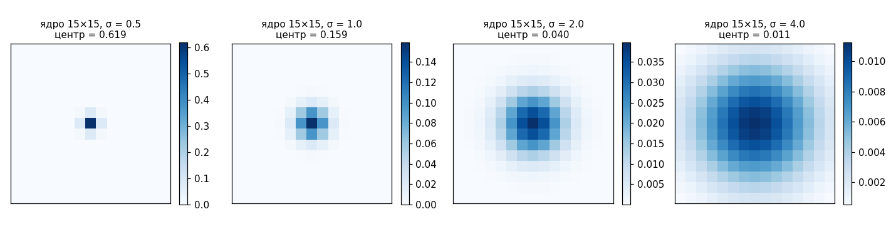

### 3.2. Влияние размера ядра и σ

Фотография солиста музыкальной группы на концерте (`rubezh_vekov.jpg`, уменьшена до 600×799) с добавленным гауссовым шумом (σ шума = 25) обработана нативной реализацией с разными параметрами:

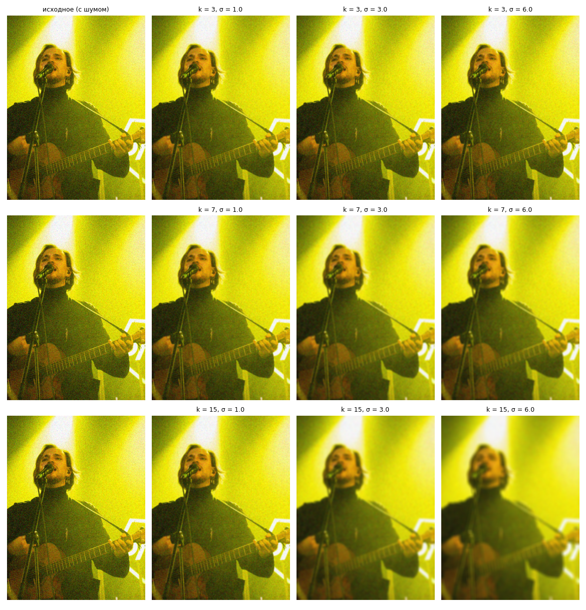

Закономерности:
- **при малом ядре (k = 3) увеличение σ почти ничего не меняет** - окно обрезает гауссиану, и ядро вырождается в усреднение по 3×3;
- **при малом σ (σ = 1) увеличение ядра не влияет на результат** - веса за пределами $\pm 3\sigma$ практически нулевые;
- сильное размытие требует одновременно большого σ и достаточного окна ($k \gtrsim 6\sigma$): k = 15, σ = 3 убирает шум, но уже размывает детали; k = 15, σ = 6 - сильная потеря деталей;
- оптимальный компромисс «шум/детали» для этого изображения - около k = 7, σ = 1…2: шум на однотонном жёлтом фоне сцены заметно подавлен, а струны, лады и черты лица ещё различимы.


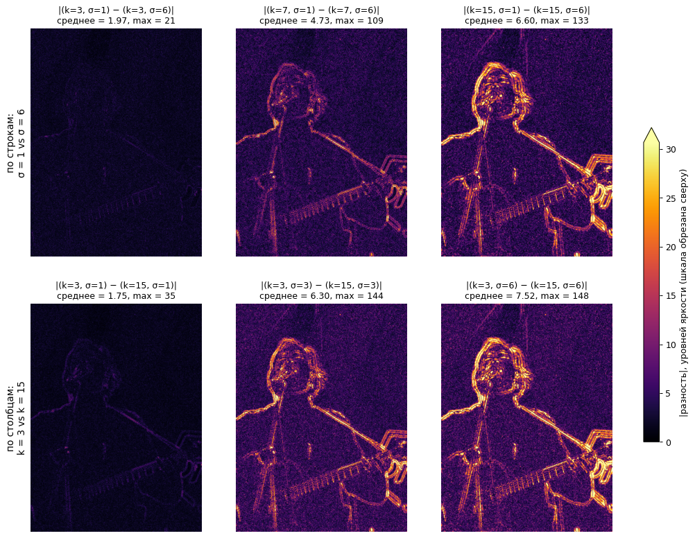

| Сравнение | Что меняется | Средняя \|разность\| | Максимальная \|разность\| |
|---|---|---|---|
| k = 3: σ = 1 vs σ = 6 | σ при малом окне | 1.97 | 21 |
| k = 7: σ = 1 vs σ = 6 | σ при среднем окне | 4.73 | 109 |
| k = 15: σ = 1 vs σ = 6 | σ при большом окне | 6.60 | 133 |
| σ = 1: k = 3 vs k = 15 | окно при малой σ | 1.75 | 35 |
| σ = 3: k = 3 vs k = 15 | окно при средней σ | 6.30 | 144 |
| σ = 6: k = 3 vs k = 15 | окно при большой σ | 7.52 | 148 |

Что видно на картах:
- **Влияние одного параметра зависит от другого.** Изменение σ почти ничего не даёт при k = 3: средняя разность 1.97, карта почти чёрная. При k = 15 тот же переход σ = 1 → 6 даёт уже 6.60. Симметрично: увеличение окна почти не влияет при σ = 1 (1.75), но сильно влияет при σ = 6 (7.52). Это численно подтверждает правило $k \approx 6\sigma + 1$: параметр начинает работать, только если второй ему «не мешает».
- **Почему при k = 3 и при σ = 1 разность всё-таки не нулевая.** При k = 3 ядро для σ = 1 равно [0.27, 0.45, 0.27], а для σ = 6 - [0.33, 0.34, 0.33]: веса немного меняются, хотя окно то же. При σ = 1 окно k = 3 обрезает гауссиану на ±1σ, а k = 15 вмещает её полностью. Эти различия малы и проявляются в основном как слабый «шумовой» фон.
- **Где сосредоточена разность.** Яркие линии повторяют контуры: силуэт, волосы, стойку микрофона, гриф и струны гитары, светящуюся надпись на сцене. На однотонных областях (фон, кофта) результаты почти совпадают: там размывать нечего, и любые параметры дают одно и то же среднее. Сильнее всего параметры фильтра влияют на **резкие границы и мелкие детали**, то есть на высокие частоты (см. п. 3.6).
- Наибольшая разница - между k = 3 и k = 15 при σ = 3 и σ = 6 (6.3–7.5 в среднем, до 148 на границах). Это противопоставление «почти не размыто» и «сильно размыто».

### 3.3. Анизотропный фильтр (разные параметры по осям)

Независимые $k_x, k_y, \sigma_x, \sigma_y$ позволяют размывать изображение вдоль одной оси (эффект «смаза» в движении). На фото вечернего города (`town.jpg`) горизонтальное размытие стирает вертикальные детали (шпиль, опоры), но сохраняет горизонтальные провода, а вертикальное - наоборот:

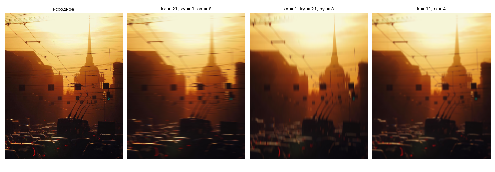

### 3.4. Корректность: сравнение с OpenCV

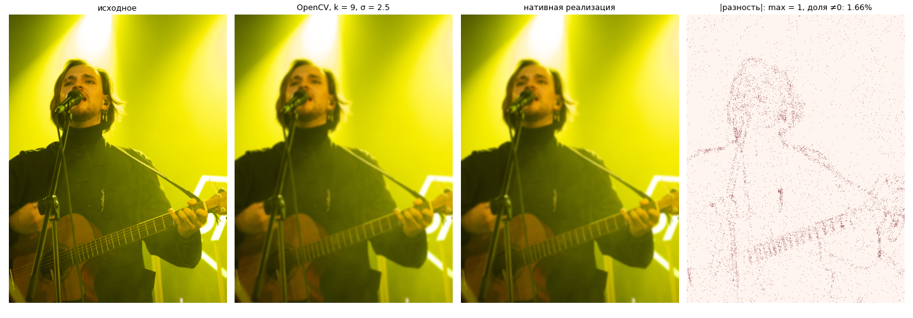

| Параметры | max \|разность\| | средняя \|разность\| |
|---|---|---|
| `town.jpg`, полутон 128×128, k = 5, σ = auto | 0 | 0 |
| `town.jpg`, полутон 128×128, k = 9×5, σ = 3 / 1.5 | 1 | 0.018 |
| `town.jpg`, полутон 800×1000, k = 9×5, σ = 3 / 1.5 | 1 | 0.012 |
| `town.jpg`, цветное 640×800, k = 7, σ = 2 | 1 | 0.013 |
| `rubezh_vekov.jpg`, цветное 601×800, k = 9, σ = 2.5 | 1 | 0.006 |

Результаты совпадают с точностью до одного уровня яркости у 1–2 % пикселей (на рисунке - 1.66 % пикселей фото солиста хотя бы в одном канале). Расхождение объясняется тем, что OpenCV для 8-битных изображений считает свёртку в целочисленной арифметике с фиксированной точкой (веса округляются до 1/256 и т.п.), а нативная версия - в числах с плавающей точкой. Для биномиальных ядер (k ≤ 7, σ = auto), чьи веса точно представимы, результаты совпадают побитово.

### 3.5. Быстродействие

**Зависимость от размера изображения** (ядро 5×5):

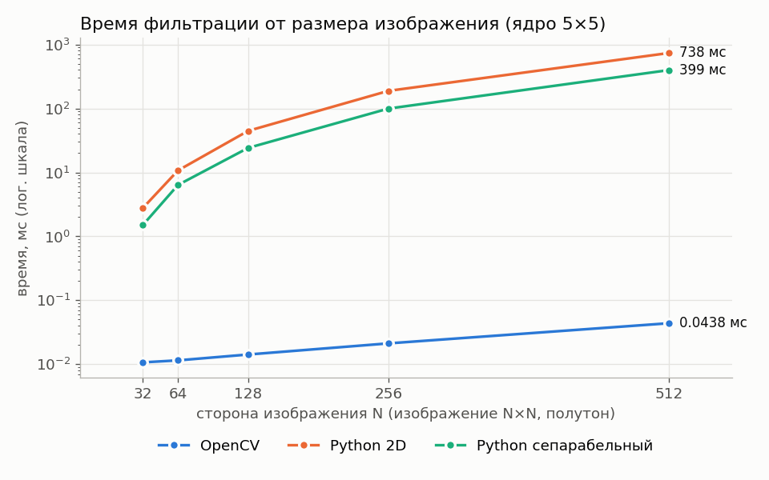

| N×N | OpenCV, мс | Python 2D, мс | Python сепараб., мс | 2D / OpenCV | сепараб. / OpenCV |
|---|---|---|---|---|---|
| 32 | 0.011 | 2.8 | 1.5 | 260× | 141× |
| 64 | 0.012 | 10.7 | 6.4 | 933× | 554× |
| 128 | 0.014 | 44.6 | 24.2 | 3144× | 1702× |
| 256 | 0.021 | 188.6 | 99.6 | 8895× | 4700× |
| 512 | 0.044 | 737.7 | 398.7 | 16843× | 9102× |

**Зависимость от размера ядра** (изображение 128×128):

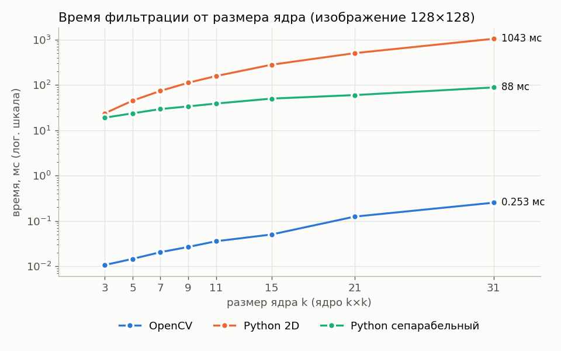

| k | OpenCV, мс | Python 2D, мс | Python сепараб., мс | 2D / OpenCV | сепараб. / OpenCV |
|---|---|---|---|---|---|
| 3 | 0.011 | 23.7 | 19.0 | 2214× | 1773× |
| 5 | 0.015 | 45.1 | 23.6 | 3087× | 1619× |
| 7 | 0.020 | 73.8 | 29.3 | 3602× | 1431× |
| 9 | 0.027 | 111.7 | 33.6 | 4182× | 1260× |
| 11 | 0.036 | 156.7 | 38.8 | 4389× | 1087× |
| 15 | 0.050 | 279.2 | 49.9 | 5550× | 992× |
| 21 | 0.125 | 502.7 | 59.8 | 4025× | 479× |
| 31 | 0.253 | 1043.2 | 88.1 | 4123× | 348× |

Исходные данные замеров: [benchmark_size.csv](images/results/benchmark_size.csv), [benchmark_ksize.csv](images/results/benchmark_ksize.csv).

Закономерности:
- **время нативных реализаций растёт линейно с числом пикселей**: при увеличении стороны в 2 раза (площади в 4 раза) время растёт ≈ в 4 раза (189 → 738 мс для 2D-свёртки);
- **2D-свёртка растёт квадратично по размеру ядра** (k = 3 → 31: в 44 раза, $(31/3)^2 \approx 107$ с учётом накладных расходов на пиксель), **сепарабельная - линейно** (в 4.6 раза). При k = 31 сепарабельный вариант быстрее прямого в 11.8 раза;
- при малых ядрах (k = 3) выигрыш сепарабельности невелик (9 vs 6 операций на пиксель + накладные расходы на второй проход);
- **OpenCV быстрее чистого Python в 140–17000 раз**. На малых изображениях время OpenCV (~10 мкс) определяется накладными расходами вызова, поэтому отношение растёт с размером изображения; с ростом ядра растёт и время OpenCV, поэтому отношение к сепарабельной версии снижается.

### 3.6. Частотный анализ (преобразование Фурье)

Скрипт `fourier.py`. Фильтрация выполняется нативной сепарабельной реализацией (для анализа - с параметром `round_result=False`, без округления до 8 бит, иначе шум квантования «поднимает» спектр на высоких частотах), спектры - `numpy.fft`. Параметры фильтра: $k = 13$, $\sigma = 2$ ($k \approx 6\sigma + 1$).

**Частотная характеристика ядер.** Слева - веса ядер, справа - их Фурье-образы $H(f)$. Для сравнения взят box-фильтр шириной 7 - той же дисперсии ($\frac{w^2 - 1}{12} = \sigma^2$), т.е. той же «силы» размытия.

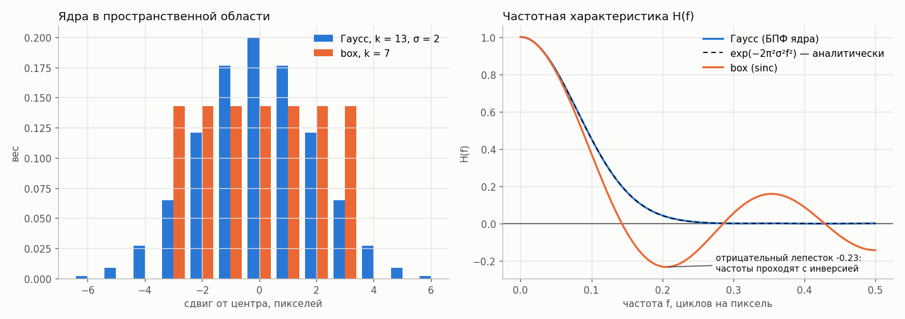

- БПФ дискретного гауссова ядра совпадает с аналитической формулой $e^{-2\pi^2\sigma^2 f^2}$ с точностью **0.0017** (кривые на графике сливаются): Фурье-образ гауссианы действительно гауссиана;
- характеристика Гаусса положительна и монотонно убывает; при $f \approx 0.094$ она равна 0.5, к $f = 0.25$ - почти 0;
- у box-фильтра - sinc: он обращается в ноль при $f = 1/7$, а затем «пропускает» высокие частоты обратно, с отрицательным лепестком **−0.23** (частота проходит с ослаблением всего в 4 раза и с инверсией фазы).

**Одномерный сигнал до и после фильтра.** Тестовый сигнал (512 отсчётов): ступеньки (крупные объекты) + мелкая текстура-синусоида с $f = 0.3$ + слабый шум. Он обработан фильтром Гаусса и, для сравнения, идеальным ФНЧ с той же частотой среза $f_c = 0.094$ (где у Гаусса $H = 0.5$).

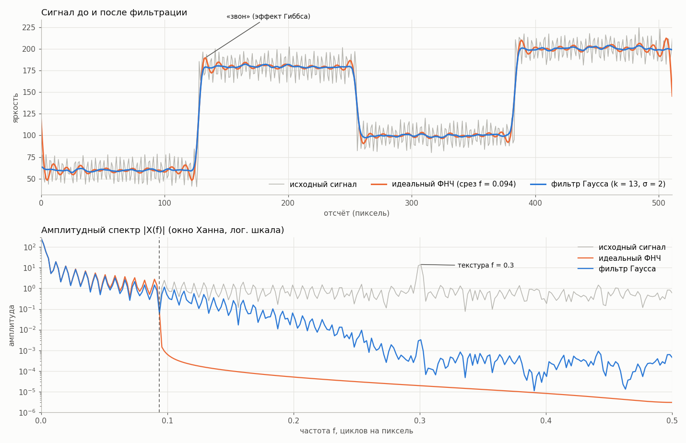

- **во временной (пространственной) области**: оба фильтра убрали шум и текстуру, оставив ступеньки. Но идеальный ФНЧ даёт колебания возле каждого перепада - «звон», - а фильтр Гаусса плавно сглаживает перепад без выбросов. На «чистых» ступеньках (без шума) выброс за пределы исходных уровней: **Гаусс - 0**, идеальный ФНЧ - **11.1** уровня яркости (~9 % от высоты ступеньки 120, классическое значение эффекта Гиббса);
- **в частотной области**: спектр исходного сигнала содержит низкие частоты (ступеньки), пик на $f = 0.3$ (текстура) и равномерный «пол» шума. После фильтра Гаусса спектр совпадает с исходным на низких частотах и плавно уходит вниз на 3–4 порядка - пик текстуры подавлен в ~4000 раз. Идеальный ФНЧ обрезает спектр «стеной» на $f_c$ - именно эта резкость и порождает звон.

**Двумерный спектр изображения.** Фото солиста (полутон, 600×799). Спектры показаны в логарифмической шкале $\log(1 + |F|)$, центр картинки - нулевая частота, к краям - частота растёт до 0.5. Перед БПФ применено окно Ханна, чтобы убрать «крест» от разрыва на краях изображения (БПФ считает изображение периодическим).

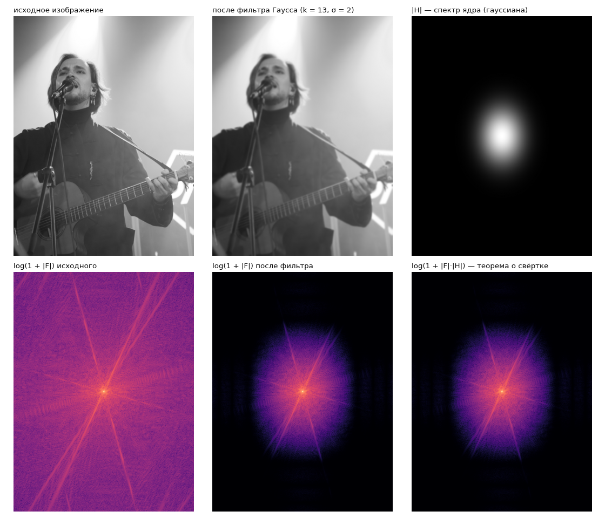

- у исходного изображения энергия есть на всех частотах; яркие лучи из центра - резкие прямые границы (стойка микрофона, гриф, ремень гитары): каждая прямая граница даёт в спектре луч, перпендикулярный ей;
- после фильтра остаётся только «пятно» низких частот в центре - спектр умножился на гауссиану $|H|$ (справа вверху). Пятно вытянуто по вертикали только из-за того, что изображение не квадратное: по оси с бо́льшим числом пикселей шаг по частоте мельче;
- спектр, предсказанный по теореме о свёртке ($|F| \cdot |H|$, справа внизу), визуально совпадает с реальным спектром результата;
- доля энергии (без постоянной составляющей) на частотах $|f| > 0.1$: **0.64 % до фильтра → 0.03 % после** (в ~20 раз меньше).

**Проверка теоремы о свёртке численно.** Для каждого кольца одинаковой частоты $|f|$ посчитано отношение $|F_{после}| / |F_{до}|$ (медиана по кольцу) и сопоставлено с $e^{-2\pi^2\sigma^2 f^2}$:

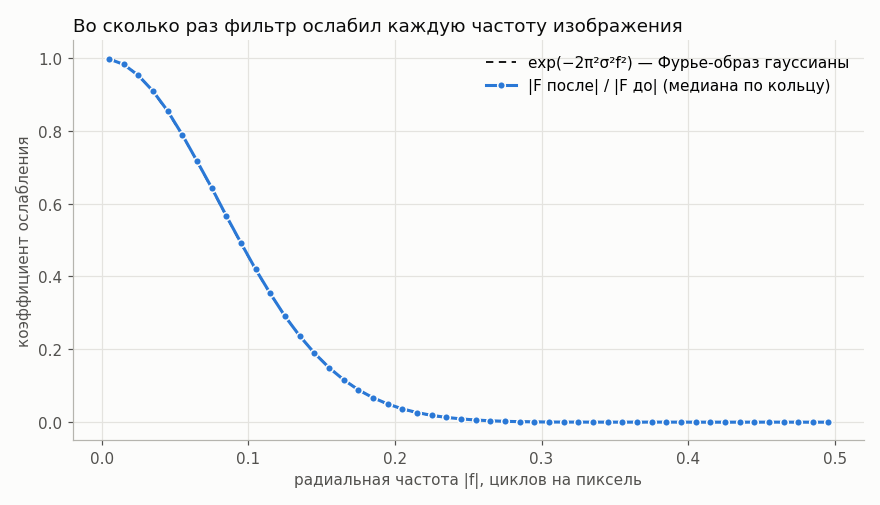

Экспериментальные точки ложатся на теоретическую гауссиану: максимальное отклонение при $|f| < 0.2$ - **0.002**. То есть нативный фильтр в частотной области делает ровно то, что предсказывает теория, - умножает спектр изображения на гауссиану.

---

## 4. Выводы

1. Реализован усредняющий фильтр Гаусса с переменным размером ядра ($k_x$, $k_y$) и параметрами гауссианы ($\sigma_x$, $\sigma_y$) в трёх вариантах: через `cv2.GaussianBlur` и нативно на чистом Python - прямой 2D-свёрткой и сепарабельной свёрткой. Поддерживаются полутоновые и цветные изображения, независимые параметры по осям и автоматический выбор σ по размеру ядра.
2. Нативная реализация совпадает с OpenCV с точностью до ±1 уровня яркости (у 1–2 % пикселей), что объясняется fixed-point арифметикой OpenCV; при биномиальных ядрах результат совпадает побитово.
3. Степень сглаживания определяется в первую очередь σ, а размер ядра должен быть согласован с ним ($k \approx 6\sigma + 1$): слишком маленькое окно обрезает гауссиану, слишком большое - лишь замедляет работу.
4. Использование сепарабельности гауссианы снижает сложность с $O(k^2)$ до $O(k)$ на пиксель и даёт ускорение почти в 12 раз уже при k = 31, поэтому на практике фильтр Гаусса всегда реализуют двумя одномерными проходами.
5. Библиотечная реализация OpenCV быстрее нативной на Python на 3–4 порядка (до ~17000 раз для 512×512) благодаря компилируемому C++ коду, SIMD-векторизации, многопоточности и целочисленной арифметике. Чистый Python пригоден для понимания алгоритма, но не для практической обработки изображений.
6. Частотный анализ подтвердил теорию: Фурье-образ гауссова ядра совпадает с гауссианой $e^{-2\pi^2\sigma^2 f^2}$ (отклонение 0.002), а спектр отфильтрованного изображения равен спектру исходного, умноженному на эту гауссиану. Поскольку частотная характеристика Гаусса положительна и плавно убывает, фильтр подавляет высокие частоты (шум, мелкие детали; доля высокочастотной энергии снизилась в ~20 раз) без «звона»: в отличие от идеального ФНЧ (выброс ~9 % высоты перепада) и box-фильтра (отрицательные лепестки sinc), Гаусс не даёт выбросов около резких границ.

---

## 5. Использованные источники


1. Gonzalez R. C., Woods R. E. Digital Image Processing. 4th ed. - Pearson, 2018. - Гл. 3 «Intensity Transformations and Spatial Filtering» (свёртка, сглаживающие фильтры), гл. 4 «Filtering in the Frequency Domain» (преобразование Фурье, теорема о свёртке, «звон» идеального ФНЧ).
3. Шапиро Л., Стокман Дж. Компьютерное зрение. - М.: БИНОМ. Лаборатория знаний, 2006. - «Фильтрация и улучшение изображений».
4. Oppenheim A. V., Schafer R. W. Discrete-Time Signal Processing. 3rd ed. - Pearson, 2010. - Дискретное преобразование Фурье, оконные функции, эффект Гиббса.
5. Gaussian blur - Wikipedia. - https://en.wikipedia.org/wiki/Gaussian_blur
6. Separable filter - Wikipedia. - https://en.wikipedia.org/wiki/Separable_filter