# Лабораторная работа №2. Трекинг объекта на видео по ключевым точкам

**Цель работы:** реализовать простейший алгоритм трекинга объекта на видео на основе ключевых точек.

**Задание:**
1. Реализовать программу: на вход подаётся видео, первый кадр которого - крупное изображение объекта; на каждом кадре, где объект виден, вокруг него рисуется рамка с подписью. Для плоского прямоугольного объекта рамка должна максимально соответствовать его реальному положению и границам.
2. Протестировать алгоритм на трёх вариантах тестового видео.
3. Записать своё видео с похожим объектом и протестировать на нём.
4. Оформить отчёт и выложить исходный код на GitHub.

---

## 1. Теоретическая база

### 1.1. Ключевые точки и дескрипторы

**Ключевая точка** - точка изображения, окрестность которой заметно отличается от соседних окрестностей и которую можно надёжно найти повторно на другом снимке той же сцены: углы, концы линий, центры пятен.

Хорошая ключевая точка обладает повторяемостью (находится при изменении ракурса, масштаба, освещения) и локализуемостью (её положение определяется точно).

**Дескриптор** - вектор, описывающий окрестность точки. Он строится так, чтобы быть инвариантным к повороту, масштабу и (частично) к освещению: тогда одна и та же физическая точка объекта на разных кадрах получает близкие дескрипторы, и соответствия ищутся простым сравнением векторов.

**детектор** (где точки) → 

**дескриптор** (как выглядит окрестность) → 

**сопоставление** (какие точки соответствуют друг другу) → 

**геометрическая модель** (как объект преобразовался).

### 1.2. Используемые детекторы

| Метод | Детектор | Дескриптор | Метрика | Особенности |
|---|---|---|---|---|
| **SIFT** | экстремумы разности гауссиан (DoG) в масштабном пространстве | гистограммы направлений градиента 4×4×8 = 128 float | L2 | инвариантен к масштабу и повороту, устойчив к освещению и умеренной перспективе; вещественный дескриптор; скорость оценивается экспериментально |
| **ORB** | FAST по пирамиде + мера углов Харриса | rBRIEF, 256 бит, повёрнутый по ориентации точки | Хэмминг | очень быстрый, бинарный дескриптор; хуже переносит перспективу и масштаб |
| **AKAZE** | детерминант Гессе в нелинейном масштабном пространстве (диффузия) | M-LDB, бинарный | Хэмминг | края не размываются, что улучшает локализацию; средняя скорость |
| **BRISK** | AGAST по масштабному пространству | бинарный, попарные сравнения на концентрических окружностях | Хэмминг | быстрый детектор, устойчив к повороту |

**Работа SIFT:**

1. **Происк заметных деталей разного размера.** Алгоритм создаёт версии изображения с разной степенью размытия и вычитает соседние версии. На полученных изображениях он ищет точки, которые выделяются среди соседей по положению и уровню размытия. Это помогает находить детали, даже если объект стал больше или меньше в кадре.
2. **Выброс ненадёжных точек.** Слишком слабые детали отбрасываются. Точки на ровных границах тоже исключаются: вдоль такой границы трудно точно определить положение точки.
3. **Учитывание поворота.** Для каждой точки определяется основное направление изменения яркости вокруг неё. Дальше окрестность описывается относительно этого направления, чтобы её можно было узнать после поворота объекта.
4. **Составление числового описания.** Область вокруг точки делится на 4×4 ячейки. В каждой ячейке оценивается, насколько сильно яркость меняется в каждом из 8 направлений. Получается 4×4×8 = **128 чисел** - дескриптор точки. Значения приводятся к общему масштабу, чтобы описание меньше зависело от контраста.

Затем дескрипторы сравниваются между кадрами: похожие описания помогают найти одну и ту же деталь объекта на разных изображениях.

### 1.3. Сопоставление и ratio-тест Лоу

Для каждого дескриптора кадра ищутся два ближайших дескриптора эталона $d_1 \le d_2$ (kNN, $k=2$). Соответствие принимается, только если

$$
\frac{d_1}{d_2} < r, \qquad r \approx 0.7\ldots0.8.
$$

Если точка неуникальна (повторяющаяся текстура) или не принадлежит объекту, то первое и второе расстояния близки, и такое соответствие отбрасывается. Лоу показал, что порог 0.8 убирает ~90 % ложных соответствий, теряя < 5 % верных. Для ускорения поиска ближайших соседей используется **FLANN**: KD-деревья для вещественных дескрипторов (SIFT) и LSH-хеширование для бинарных (ORB, AKAZE и BRISK).

### 1.4. Гомография

Все точки плоского объекта при любом положении камеры-обскуры связаны с их изображением **гомографией** - проективным преобразованием плоскости, задаваемым матрицей $3 \times 3$ с точностью до масштаба (8 степеней свободы):

$$
\begin{pmatrix} x' \\ y' \\ w' \end{pmatrix} = H \begin{pmatrix} x \\ y \\ 1 \end{pmatrix}, \qquad
(u, v) = \left(\frac{x'}{w'}, \frac{y'}{w'}\right).
$$

Гомография описывает сдвиг, поворот, масштаб и перспективное искажение одновременно, поэтому перенос четырёх углов эталона через $H$ даёт точную рамку объекта - четырёхугольник, а не прямоугольник, выровненный по осям. Каждое соответствие даёт 2 уравнения, значит, минимально нужно 4 пары точек.

### 1.5. RANSAC

Среди соответствий после ratio-теста всё равно остаются выбросы (точки фона, похожие на точки объекта), а метод наименьших квадратов к ним крайне чувствителен. **RANSAC**:

1. случайно выбрать минимальную выборку - 4 соответствия;
2. построить по ней гомографию $H$;
3. посчитать инлаеры - соответствия с ошибкой перепроецирования $\lVert H p_i - q_i \rVert < \varepsilon$;
4. повторять, запоминая модель с наибольшим числом инлаеров; в конце уточнить её по всем инлаерам.

Число итераций для вероятности успеха $p$ при доле выбросов $e$: $N = \dfrac{\log(1-p)}{\log\big(1-(1-e)^4\big)}$. В работе используется **MAGSAC++** (`cv2.USAC_MAGSAC`) - современный вариант RANSAC, который не требует точно подбирать порог $\varepsilon$: он взвешивает точки по правдоподобию, маргинализируя порог.

### 1.6. Подходы к трекингу

- **Tracking-by-detection** - объект ищется на каждом кадре заново, сопоставлением с эталоном. Ошибка не накапливается, после потери объекта (перекрытие, уход из кадра) он находится автоматически. Минус - детектирование на каждом кадре дороже.
- **Покадровое отслеживание** (оптический поток Лукаса–Канаде, KLT) - точки переносятся с предыдущего кадра на текущий. Быстро, но ошибки накапливаются (дрейф), а потерянный объект надо обнаруживать отдельно.

В итоговой реализации объединены оба подхода: каждый кадр сначала сопоставляется с эталоном, а при неудаче используются оптический поток и краткосрочное предсказание рамки. Успешное сопоставление с эталоном заново привязывает трек к исходному изображению.

---

## 2. Работа программы

На вход допускаются только видео из папки `/videos`:

### 2.1. Алгоритм и рамка

Первый кадр служит эталоном. Для этих четырёх роликов он содержит крупное изображение объекта, поэтому используется целиком.

При инициализации программа один раз вычисляет ключевые точки и дескрипторы эталона, запоминает их координаты и четыре угла эталонной области. Эталон в ходе отслеживания не заменяется.

Далее каждый кадр обрабатывается в следующем порядке. Ниже описан режим `hybrid`; в `detect` запасные шаги 5–6 отключены, а в `flow` отключён только прогноз из шага 6.

1. **Подготовка изображения.**

    - Кадр переводится в оттенки серого.
    - Если большая сторона превышает 960 px, изображение уменьшается с сохранением пропорций. Коэффициент уменьшения запоминается. Эталон подготавливается таким же способом.

2. **Поиск ключевых точек и вычисление дескрипторов.**

    - Выбранный метод (SIFT/ORB/AKAZE/BRISK) находит точки текущего кадра и строит их дескрипторы.
    - Если дескрипторов нет или точек меньше 15, поиск по эталону считается неудачным и программа переходит к запасным способам определения положения.

3. **Поиск соответствий с эталоном.**

    - Для каждого дескриптора текущего кадра FLANN выполняет kNN-поиск с `k=2`: находит два ближайших дескриптора эталона.
    - Ratio-тест Лоу сравнивает расстояния до первого и второго кандидата. Если `d1 < 0.75*d2`, сохраняется одна пара: точка текущего кадра и лучший кандидат на эталоне. Иначе соответствие для этой текущей точки не добавляется.
    - Если осталось меньше 15 пар, поиск по эталону считается неудачным.

4. **Оценка гомографии и проверка рамки (`detect`).**

    - По оставшимся парам соответствующих точек методом MAGSAC++ оценивается гомография - матрица H, которая переводит координаты эталона в координаты текущего кадра. Порог задан равным 4 px в масштабе обработки, максимум итераций - 5000, доверительная вероятность - 0.999.
    - Через H переносятся четыре угла эталонной области - получается предполагаемая рамка объекта.
    - Проверяется, что есть минимум 15 инлаеров и они составляют не меньше 25% всех переданных пар. Матрица и углы должны иметь конечные координаты; также проверяются положение углов относительно камеры, выпуклость, сохранение направления обхода, площадь и соотношение длин сторон рамки.
    - Если проверки пройдены, положение принято. Если нет H или нарушена хотя бы одна проверка, программа пробует шаг 5.
    - После успешного обнаружения, если поток включён, внутри рамки выбираются до 400 точек Shi–Tomasi для дальнейшего сопровождения. Это отдельный набор точек: сохраняются их текущие координаты и соответствующие координаты на эталоне, полученные через обратную H. Если подходящих точек меньше 12, поток не подготавливается.

5. **Запасная попытка через оптический поток (`flow`).**

    - Шаг выполняется только при неудаче поиска по эталону, если поток включён и остались сохранённые точки для сопровождения. Иначе программа сразу переходит к шагу 6.
    - Пирамидальный метод Лукаса–Канаде оценивает смещения окрестностей этих точек между предыдущим и текущим кадрами. Используются окна 21×21 пиксель; дескрипторы и FLANN для этого переноса не нужны.
    - Затем кадры меняются местами и положения точек оцениваются обратно. Оставляются только точки, для которых оба переноса успешны, а ошибка возврата меньше 1 px.
    - По сохранившимся парам «координаты на эталоне → новые положения точек» снова оценивается H. Требуются минимум 12 инлаеров, их доля не меньше 50% и прохождение геометрических проверок рамки.
    - При успехе положение принимается, а точки сохраняются для следующего кадра. При сильном сокращении их числа набор заново подготавливается внутри принятой рамки. При неудаче сохранённые точки потока сбрасываются и выполняется шаг 6.

6. **Краткосрочный прогноз (`predict`).**

    - Если ни поиск по эталону, ни поток не дали принятой рамки, используется последнее известное положение её углов и сохранённая скорость движения.
    - Скорость каждого угла умножается на 0.8, затем прибавляется к его последнему положению. Прогноз разрешён максимум на 15 кадров подряд и только пока хотя бы половина площади рамки остаётся внутри изображения.
    - Если раньше принятой рамки не было, прогноз отключён, исчерпан его лимит или рамка слишком сильно вышла из кадра, результат выдаётся без рамки.
    - Источник `predict` означает предполагаемое положение: объект на текущем изображении этим шагом не обнаруживается.

7. **Сохранение состояния и отрисовка.**

    - После принятого измерения `detect` или `flow` обновляются положение и оценка скорости углов, счётчик последовательных прогнозов сбрасывается.
    - Текущий кадр сохраняется как предыдущий для следующего прохода. Координаты принятой или предсказанной рамки переводятся обратно в исходное разрешение.
    - Измеренная рамка рисуется зелёным, предсказанная - жёлтым с пометкой `predicted`. Если рамки нет, она не рисуется.
    - На следующем кадре программа снова начинает с поиска по эталону, независимо от результата предыдущего кадра.

Результат - четырёхугольная рамка по проекции углов эталона, а не прямоугольник по осям кадра. Рамка зелёная, верхняя сторона эталона выделена красным, рядом стоит подпись объекта. Предсказанная рамка жёлтая и помечена `predicted`. При потере объекта за пределами допустимого прогноза рамка не рисуется. 

В исследованиях применяются три режима:

| Режим | Поиск по эталону | Оптический поток | Прогноз |
|---|---|---|---|
| `detect` | на каждом кадре | нет | нет |
| `flow` | на каждом кадре | при неудаче детектора | нет |
| `hybrid` | на каждом кадре | при неудаче детектора | до 15 кадров подряд |

Поток Лукаса–Канаде использует точки внутри рамки, проверку переноса вперёд и назад и повторную оценку гомографии. Прогноз продолжает движение углов с затуханием скорости. Он показывает предполагаемое положение; он не подтверждает, что объект найден по изображению.

### 2.2. Запуск

```powershell
pip install -r requirements.txt

# Полный прогон:
python run_experiments.py

# Примеры:
python track.py videos/my_video.mp4 --detector sift --label Book
python track.py videos/mona-lisa.avi --detector orb --no-flow
python track.py videos/my_video.mp4 --select --show --csv results/log.csv
```

## 3. Исследования и результаты

### 3.1. Протокол и метрики

Выполнен полный перебор **4 видео × 4 детектора × 3 режима = 48 запусков**. Для основных сравнений фиксирован режим `detect`: так результаты характеризуют выбранную пару детектор–дескриптор и сопоставление, без компенсации потерь потоком и прогнозом. Настройки общие для всех методов, но число точек естественно различается; сравнение не нормирует вычислительный бюджет детекторов.

Первый кадр (индекс 0) используется для эталона, сохраняется в выходном видео, но исключён из всех сводных метрик и основных графиков. Между запусками сбрасывается генератор OpenCV; вычисления OpenCV выполняются в одном потоке. Запуски последовательные. Это один полный замер на каждом сочетании, без повторов и доверительных интервалов: FPS может колебаться из-за нагрузки машины.

- **Доля кадров с рамкой** - число кадров с выданной рамкой / число оцениваемых кадров. Накопленная доля на графике считается от кадра 1 до текущего. Это доступность оценки, а не Recall: независимой разметки видимости нет.
- **Измерено** - доля кадров с источником `detect` или `flow`. Предсказание в неё не входит; наличие измерения также не гарантирует геометрическую точность.
- **Инлаеры** - число геометрически согласованных точек принятой рамки. Если рамка не принята, на основных графиках используется 0. Чем больше инлаеров, тем больше опора для гомографии, но это не метрика истинной точности.
- **Ключевые точки** - число точек, найденных на всём кадре. В него могут входить точки фона.
- **FPS** - `1000 / среднее время обработки кадра в мс`; чтение, рисование и запись исключены. **P95** - время, ниже которого лежат 95% измерений.
- **Максимальная потеря** - самая длинная серия кадров без рамки. Отдельно исследуется самая длинная серия без измерения: кадры только с прогнозом считаются отсутствием измерения.
- **Расхождение углов на размытии** - среднее евклидово расстояние четырёх углов между результатами на размытой и исходной версиях одного видео. Оно считается только на общих кадрах с рамками; рядом указывается число таких пар.

На временных графиках инлаеры, точки и задержка сглажены центрированным средним по окну 21 кадр; на краях окно усечено. Числовые таблицы вычисляются по исходным несглаженным значениям.

Под каждым временным графиком приведены кадры характерного минимума и максимума каждой линии. Среди внутренних экстремумов выбраны повороты с наибольшим перепадом в окрестности до 60 кадров с каждой стороны; для постоянного участка показана граница плато. Если внутреннего экстремума данного типа нет, показан граничный с пометкой «край». Это наиболее заметные примеры, а не все небольшие колебания. Номера кадров начинаются с нуля и совпадают с CSV. Значение на графике относится к сглаженной кривой (для покрытия - к накопленной доле), поэтому оно может отличаться от значения непосредственно на фотографии. Рамки восстановлены по сохранённым координатам соответствующего детектора и режима, повторное обнаружение не выполнялось. Подпись `lost` означает отсутствие принятой рамки, а не отсутствие объекта в кадре. Выбор кадров и значения сохранены в [results/frame_examples.json](results/frame_examples.json).


| Видео | Размер | Кадров всего / оцениваемых | Частота входа |
|---|---|---:|---:|
| mona-lisa.avi | 640×360 | 558 / 557 | 29.970 FPS |
| mona-lisa-blur.avi | 640×360 | 558 / 557 | 29.970 FPS |
| mona-lisa-blur-extra-credit.avi | 640×360 | 558 / 557 | 29.970 FPS |
| my_video.mp4 | 720×992 | 287 / 286 | 29.589 FPS |

### 3.2. Разные детекторы на фиксированном видео - 4 × 3 = 12 графиков

Для каждого из трёх роликов Mona Lisa построены четыре отдельных графика; на каждом показаны все четыре детектора. 

| Видео | SIFT: рамка / FPS | ORB: рамка / FPS | AKAZE: рамка / FPS | BRISK: рамка / FPS |
|---|---:|---:|---:|---:|
| Mona Lisa: исходное | 35.01% / 17.3 | 34.11% / 37.0 | 24.78% / 30.2 | 29.98% / 83.6 |
| Mona Lisa: blur | 31.60% / 17.5 | 30.70% / 38.9 | 21.36% / 33.1 | 26.57% / 87.5 |
| Mona Lisa: extra credit | 30.70% / 18.1 | 28.90% / 40.7 | 21.54% / 34.6 | 25.85% / 90.6 |

#### Mona Lisa: исходное

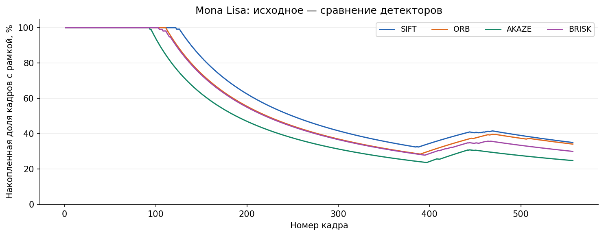

**Кадры характерных минимумов и максимумов.**

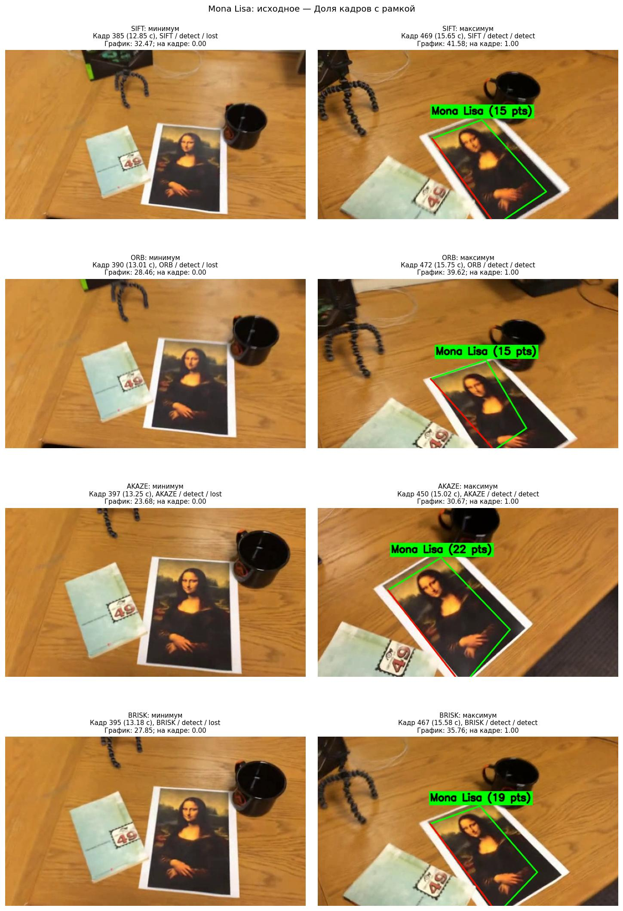

| Линия графика | Минимум: кадр / значение | Максимум: кадр / значение |
|---|---|---|
| SIFT | ≈385 / 32.47 | ≈469 / 41.58 |
| ORB | ≈390 / 28.46 | ≈472 / 39.62 |
| AKAZE | ≈397 / 23.68 | ≈450 / 30.67 |
| BRISK | ≈395 / 27.85 | ≈467 / 35.76 |

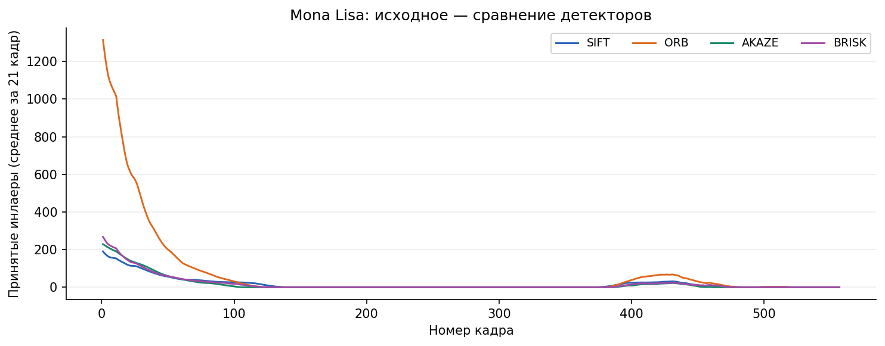


| Линия графика | Минимум: кадр / значение | Максимум: кадр / значение |
|---|---|---|
| SIFT | ≈137 / 0.00 | ≈431 / 31.29 |
| ORB | ≈122 / 0.00 | ≈431 / 67.86 |
| AKAZE | ≈106 / 0.00 | ≈431 / 22.43 |
| BRISK | ≈127 / 0.00 | ≈431 / 24.67 |

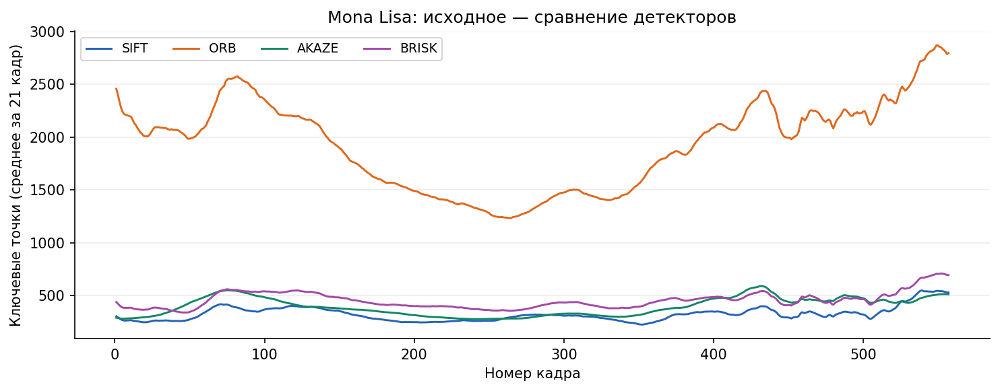


| Линия графика | Минимум: кадр / значение | Максимум: кадр / значение |
|---|---|---|
| SIFT | ≈475 / 298.05 | ≈108 / 381.71 |
| ORB | ≈49 / 1984.24 | ≈82 / 2575.33 |
| AKAZE | ≈521 / 431.57 | ≈75 / 551.24 |
| BRISK | ≈480 / 414.62 | ≈121 / 549.76 |

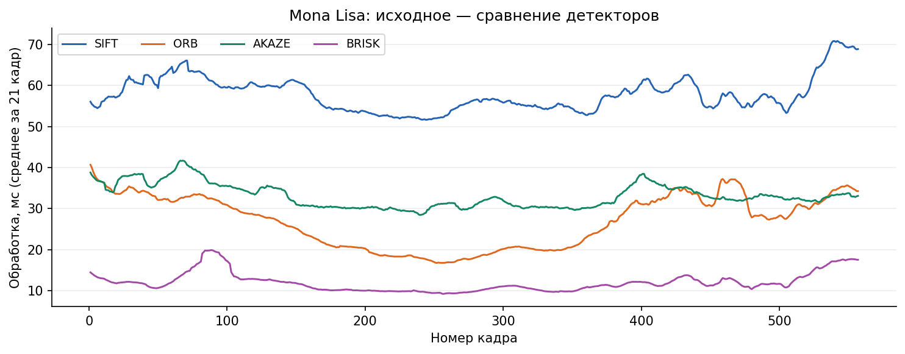


| Линия графика | Минимум: кадр / значение | Максимум: кадр / значение |
|---|---|---|
| SIFT | ≈475 / 54.62 | ≈404 / 61.66 |
| ORB | ≈493 / 27.31 | ≈431 / 35.00 |
| AKAZE | ≈17 / 33.94 | ≈68 / 41.66 |
| BRISK | ≈49 / 10.57 | ≈89 / 19.85 |

**Вывод.** В режиме `detect` наибольшую долю кадров с рамкой обеспечивает SIFT - 35.01%, за ним следует ORB - 34.11%. BRISK работает быстрее остальных (83.6 FPS), но выдаёт рамку на 29.98% кадров. AKAZE показывает наименьшее покрытие - 24.78%. Даже на исходном видео поиск по эталону не обеспечивает непрерывного сопровождения: каждый метод пропускает больше половины кадров.


### 3.3. Разные варианты размытия при фиксированном детекторе - 3 × 4 = 12 графиков

Для каждого детектора сравниваются три синхронных варианта Mona Lisa: исходное видео, `blur` и `extra credit`. На каждый метод приходятся три графика: накопленная доля кадров с рамкой, принятые инлаеры и ключевые точки. Таким образом, вторая группа содержит ещё 12 отдельных сравнительных графиков.

Для локальной проверки выделены кадры со средним абсолютным поканальным отличием от исходного видео больше 5 уровней (шкала 0–255). Это эвристика изменённых кадров, чувствительная также к перекодированию. Частота, длина и размеры сравниваемых версий проверяются. Метрика расхождения использует покадровое соответствие версий; истинные углы объекта вручную не размечены.


#### SIFT

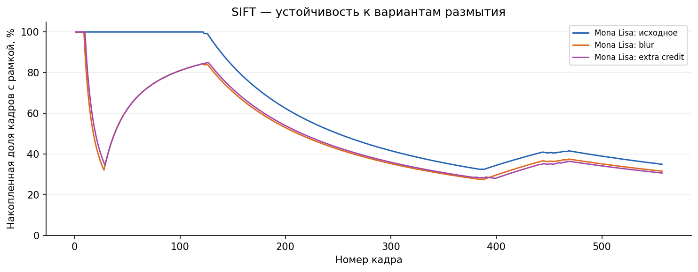

**Кадры характерных минимумов и максимумов.**

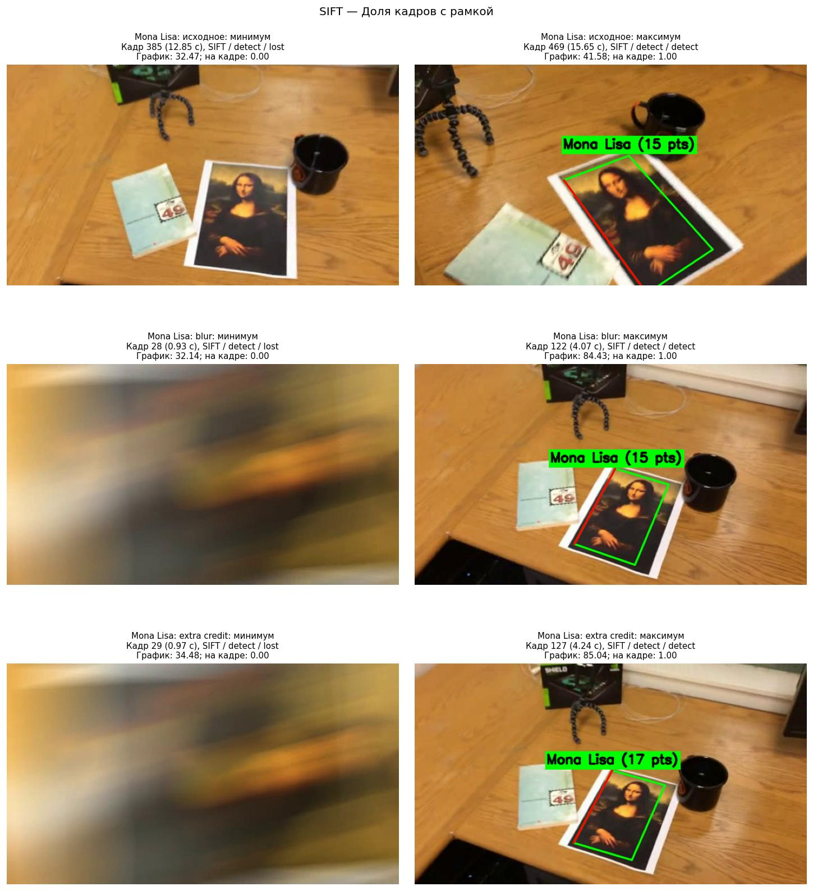

| Линия графика | Минимум: кадр / значение | Максимум: кадр / значение |
|---|---|---|
| Mona Lisa: исходное | ≈385 / 32.47 | ≈469 / 41.58 |
| Mona Lisa: blur | ≈28 / 32.14 | ≈122 / 84.43 |
| Mona Lisa: extra credit | ≈29 / 34.48 | ≈127 / 85.04 |

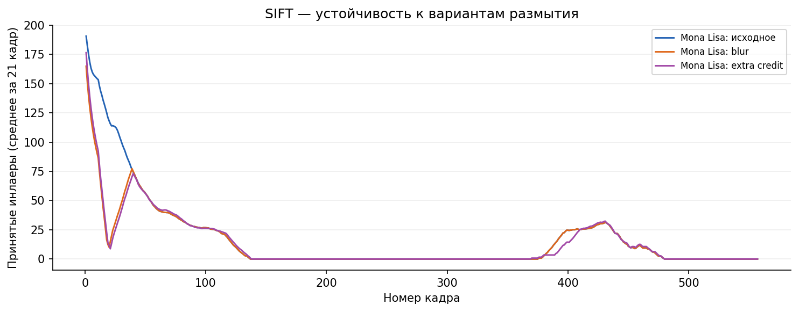


| Линия графика | Минимум: кадр / значение | Максимум: кадр / значение |
|---|---|---|
| Mona Lisa: исходное | ≈137 / 0.00 | ≈431 / 31.29 |
| Mona Lisa: blur | ≈20 / 10.14 | ≈39 / 77.24 |
| Mona Lisa: extra credit | ≈21 / 8.76 | ≈40 / 73.19 |

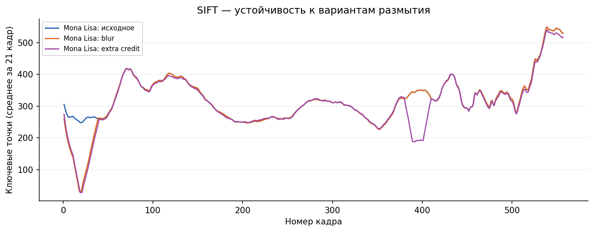


| Линия графика | Минимум: кадр / значение | Максимум: кадр / значение |
|---|---|---|
| Mona Lisa: исходное | ≈475 / 298.05 | ≈108 / 381.71 |
| Mona Lisa: blur | ≈19 / 29.52 | ≈108 / 381.71 |
| Mona Lisa: extra credit | ≈19 / 27.24 | ≈432 / 401.14 |

**Вывод.** В режиме `detect` доля кадров с рамкой у SIFT составляет 35.01% на исходном видео, 31.60% на `blur` и 30.70% на `extra credit`. Среднее число ключевых точек на кадре также уменьшается: 325 → 317 → 309 соответственно. На обоих вариантах размытия среднее число принятых инлаеров ниже, чем на исходном видео. Размытие ухудшает доступность обнаружения, хотя SIFT сохраняет наибольшее покрытие среди четырёх методов на каждом из трёх видео.


#### ORB

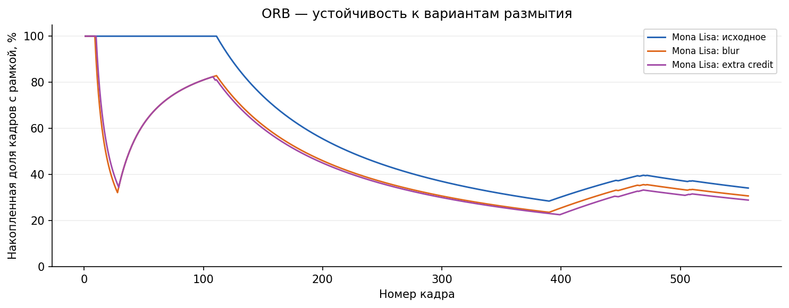

**Кадры характерных минимумов и максимумов.**

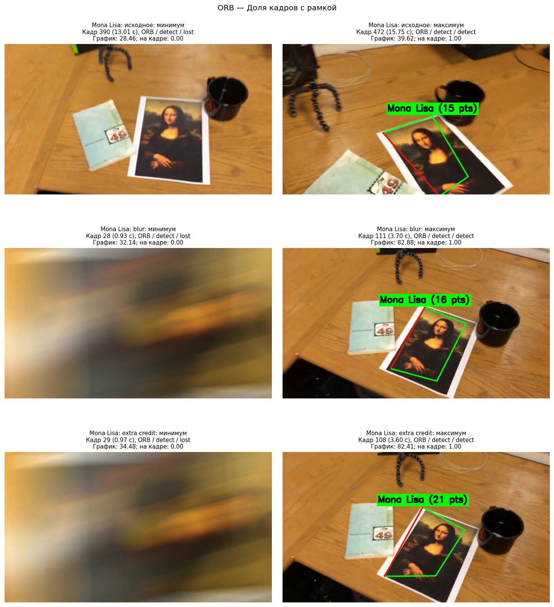

| Линия графика | Минимум: кадр / значение | Максимум: кадр / значение |
|---|---|---|
| Mona Lisa: исходное | ≈390 / 28.46 | ≈472 / 39.62 |
| Mona Lisa: blur | ≈28 / 32.14 | ≈111 / 82.88 |
| Mona Lisa: extra credit | ≈29 / 34.48 | ≈108 / 82.41 |

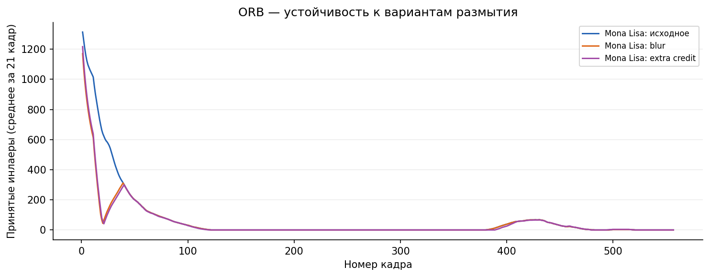


| Линия графика | Минимум: кадр / значение | Максимум: кадр / значение |
|---|---|---|
| Mona Lisa: исходное | ≈122 / 0.00 | ≈431 / 67.86 |
| Mona Lisa: blur | ≈20 / 43.95 | ≈39 / 311.90 |
| Mona Lisa: extra credit | ≈21 / 41.00 | ≈40 / 298.90 |

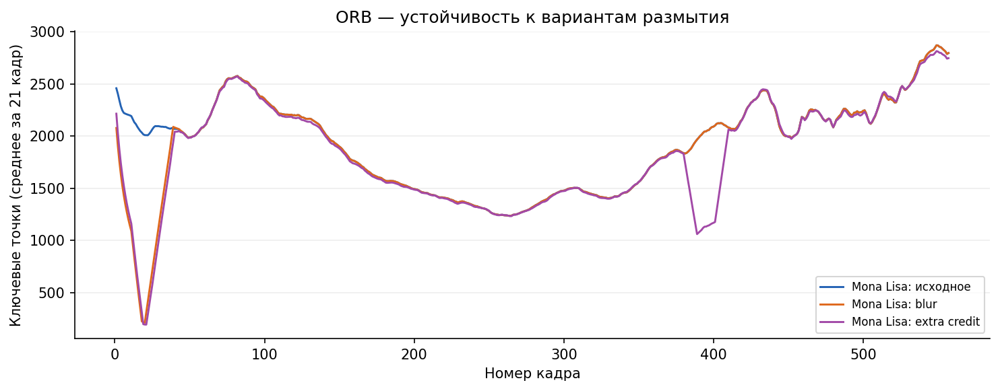


| Линия графика | Минимум: кадр / значение | Максимум: кадр / значение |
|---|---|---|
| Mona Lisa: исходное | ≈49 / 1984.24 | ≈82 / 2575.33 |
| Mona Lisa: blur | ≈20 / 211.00 | ≈82 / 2575.33 |
| Mona Lisa: extra credit | ≈21 / 192.33 | ≈82 / 2570.76 |

**Вывод.** В режиме `detect` доля кадров с рамкой у ORB составляет 34.11% на исходном видео, 30.70% на `blur` и 28.90% на `extra credit`. Среднее число ключевых точек на кадре также уменьшается: 1933 → 1865 → 1820 соответственно. На обоих вариантах размытия среднее число принятых инлаеров снижается относительно исходного видео. Несмотря на большое число ключевых точек, покрытие последовательно ухудшается: наличие точек не гарантирует достаточного числа подходящих соответствий с эталоном.


#### AKAZE

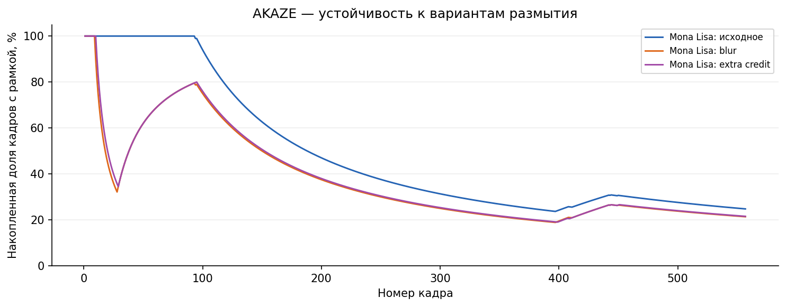

**Кадры характерных минимумов и максимумов.**

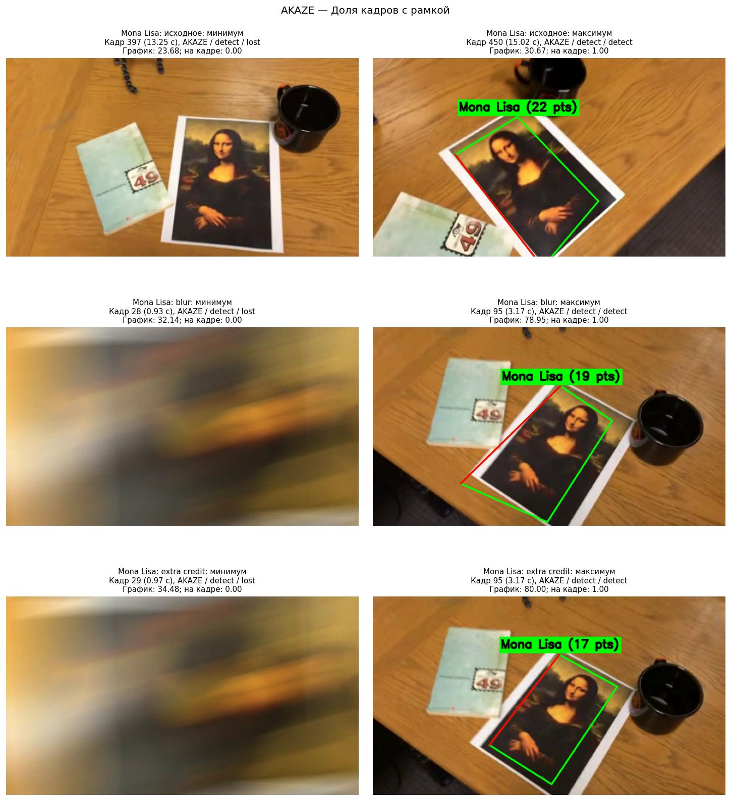

| Линия графика | Минимум: кадр / значение | Максимум: кадр / значение |
|---|---|---|
| Mona Lisa: исходное | ≈397 / 23.68 | ≈450 / 30.67 |
| Mona Lisa: blur | ≈28 / 32.14 | ≈95 / 78.95 |
| Mona Lisa: extra credit | ≈29 / 34.48 | ≈95 / 80.00 |

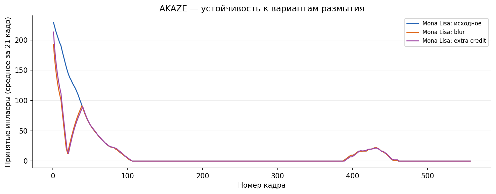


| Линия графика | Минимум: кадр / значение | Максимум: кадр / значение |
|---|---|---|
| Mona Lisa: исходное | ≈106 / 0.00 | ≈431 / 22.43 |
| Mona Lisa: blur | ≈20 / 12.48 | ≈39 / 91.43 |
| Mona Lisa: extra credit | ≈21 / 12.10 | ≈40 / 89.81 |

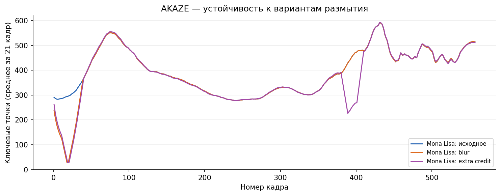


| Линия графика | Минимум: кадр / значение | Максимум: кадр / значение |
|---|---|---|
| Mona Lisa: исходное | ≈521 / 431.57 | ≈75 / 551.24 |
| Mona Lisa: blur | ≈18 / 28.86 | ≈75 / 551.24 |
| Mona Lisa: extra credit | ≈19 / 27.62 | ≈75 / 555.71 |

**Вывод.** В режиме `detect` доля кадров с рамкой у AKAZE составляет 24.78% на исходном видео, 21.36% на `blur` и 21.54% на `extra credit`. Среднее число ключевых точек на кадре также уменьшается: 396 → 386 → 379 соответственно. Среднее число принятых инлаеров на обоих вариантах размытия ниже, чем на исходном видео. Покрытие на `extra credit` немного выше, чем на `blur`, поэтому результаты не показывают последовательного ухудшения от одного варианта размытия к другому. Малое различие покрытия не позволяет утверждать, что AKAZE устойчив к размытию в целом.


#### BRISK

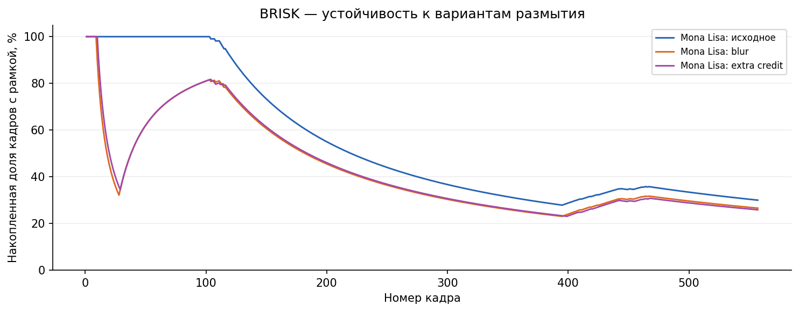

**Кадры характерных минимумов и максимумов.**

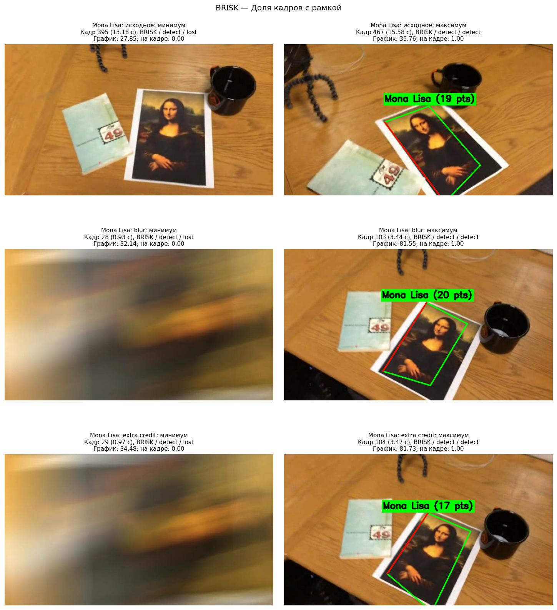

| Линия графика | Минимум: кадр / значение | Максимум: кадр / значение |
|---|---|---|
| Mona Lisa: исходное | ≈395 / 27.85 | ≈467 / 35.76 |
| Mona Lisa: blur | ≈28 / 32.14 | ≈103 / 81.55 |
| Mona Lisa: extra credit | ≈29 / 34.48 | ≈104 / 81.73 |

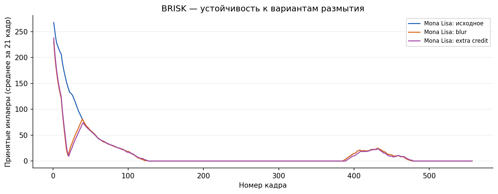


| Линия графика | Минимум: кадр / значение | Максимум: кадр / значение |
|---|---|---|
| Mona Lisa: исходное | ≈127 / 0.00 | ≈431 / 24.67 |
| Mona Lisa: blur | ≈20 / 10.57 | ≈39 / 81.05 |
| Mona Lisa: extra credit | ≈21 / 9.33 | ≈40 / 74.14 |

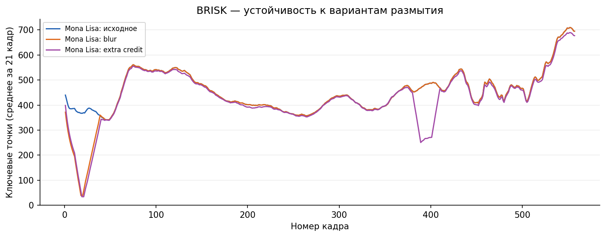


| Линия графика | Минимум: кадр / значение | Максимум: кадр / значение |
|---|---|---|
| Mona Lisa: исходное | ≈480 / 414.62 | ≈121 / 549.76 |
| Mona Lisa: blur | ≈19 / 38.14 | ≈121 / 549.76 |
| Mona Lisa: extra credit | ≈21 / 33.67 | ≈433 / 537.05 |

**Вывод.** В режиме `detect` доля кадров с рамкой у BRISK составляет 29.98% на исходном видео, 26.57% на `blur` и 25.85% на `extra credit`. Среднее число ключевых точек на кадре также уменьшается: 456 → 444 → 430 соответственно. Среднее число принятых инлаеров, как и покрытие, последовательно снижается от исходного видео к `blur` и `extra credit`. Метод сохраняет часть обнаружений, но на обоих изменённых видео чаще остаётся без принятой рамки, чем на исходном.

**Общий вывод по разделу 3.3.** На исходном видео каждый из четырёх методов обеспечивает большее покрытие, чем на обоих вариантах размытия. На `blur` и `extra credit` у всех методов в среднем меньше ключевых точек и принятых инлаеров: размытие затрудняет выделение деталей и получение геометрически согласованных соответствий с эталоном. Вариант `extra credit` даёт меньшее покрытие, чем `blur`, у SIFT, ORB и BRISK; у AKAZE наблюдается небольшое увеличение. Следовательно, влияние вариантов видео зависит от метода, и считать `extra credit` однозначно более сложным для всех детекторов нельзя. SIFT сохраняет наибольшую долю кадров с рамкой на всех трёх видео. Эти результаты описывают доступность обнаружения в режиме `detect`, без помощи потока и прогноза. Нули на графиках принятых инлаеров включают кадры без принятой рамки, поэтому их снижение отражает также учащение потерь. Без независимой разметки углов по этим графикам нельзя оценить истинную точность рамки или установить общее превосходство метода по устойчивости к любому размытию.

### 3.4. Дополнительно: вклад оптического потока и предсказания

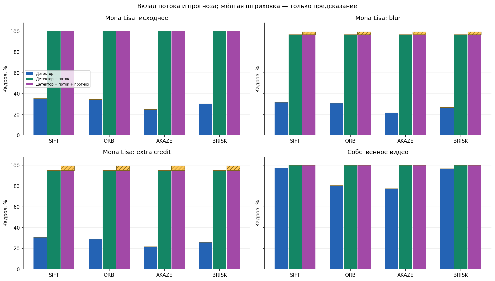

| Видео | SIFT detect | SIFT flow | SIFT hybrid | В hybrid только прогноз, кадров |
|---|---:|---:|---:|---:|
| Mona Lisa: исходное | 35.01% | 100.00% | 100.00% | 0 |
| Mona Lisa: blur | 31.60% | 96.59% | 99.28% | 15 |
| Mona Lisa: extra credit | 30.70% | 94.97% | 99.28% | 24 |
| Собственное видео | 97.20% | 100.00% | 100.00% | 0 |

Переход `detect → flow` изолирует вклад оптического потока; `flow → hybrid` добавляет только прогноз. Жёлтая штриховка показывает, какую долю покрытия обеспечивает прогноз. Она не трактуется как новое обнаружение.

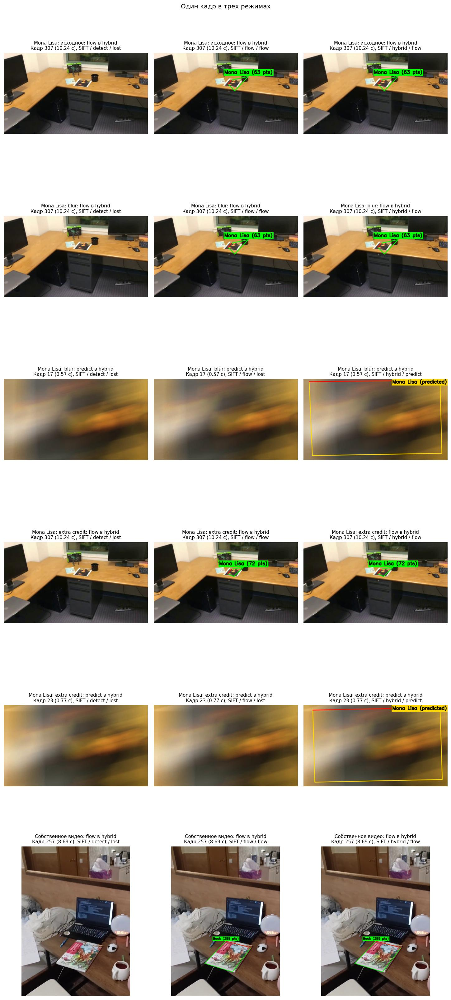

В каждой строке показан один и тот же кадр в режимах `detect`, `flow` и `hybrid` (слева направо). Источник положения подписан над кадром; `lost` означает отсутствие принятой рамки. Столбчатая диаграмма не имеет оси времени: эти примеры показывают события, формирующие итоговое покрытие.


### 3.5. Длительность потерь и вычислительные затраты

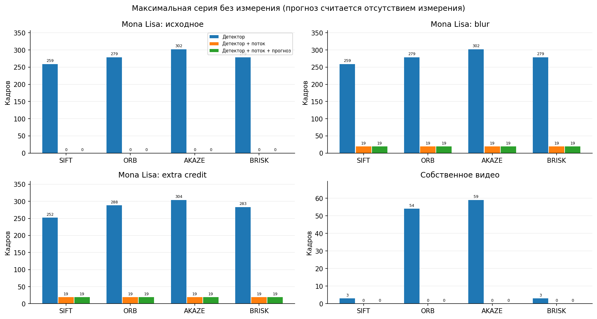

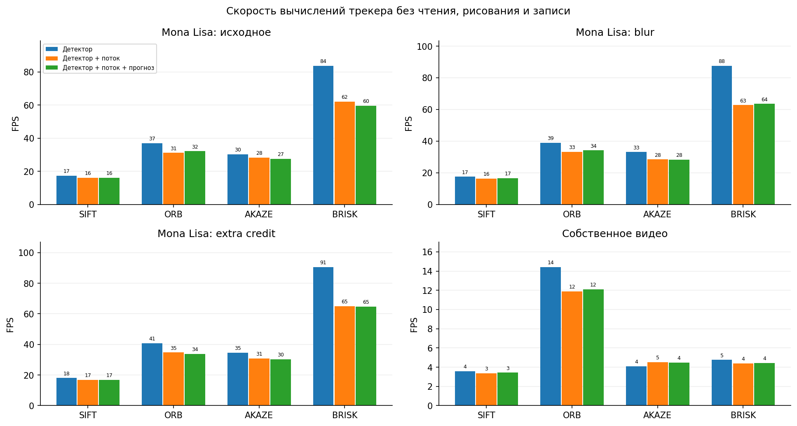


Доля кадров с рамкой не показывает длительность отдельного сбоя. График серий без измерения раскрывает непрерывные провалы и не скрывает их прогнозом.

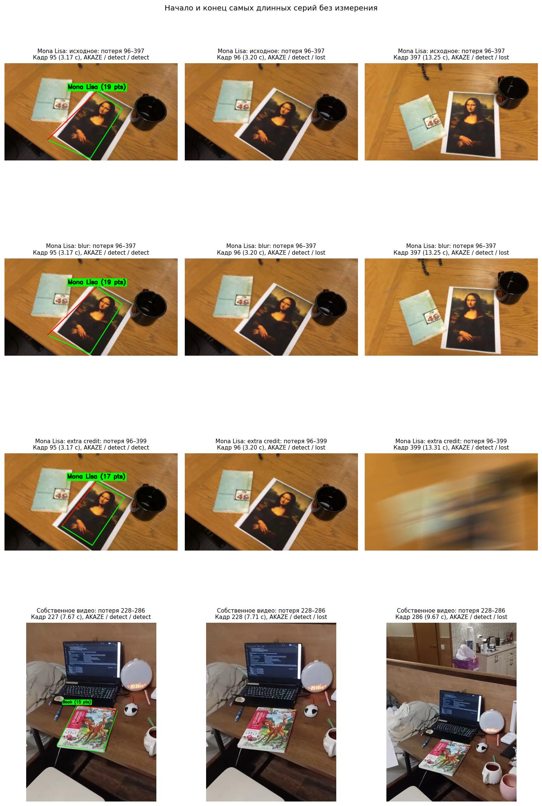

В каждой строке - кадр перед потерей, первый и последний кадры самой длинной серии без измерения для данного видео (выбор среди всех детекторов и режимов).

| Видео | Детектор / режим | Серия без измерения | Длина, кадров |
|---|---|---|---:|
| Mona Lisa: исходное | AKAZE / detect | 96–397 | 302 |
| Mona Lisa: blur | AKAZE / detect | 96–397 | 302 |
| Mona Lisa: extra credit | AKAZE / detect | 96–399 | 304 |
| Собственное видео | AKAZE / detect | 228–286 | 59 |


### 3.6. Дополнительно: собственное видео

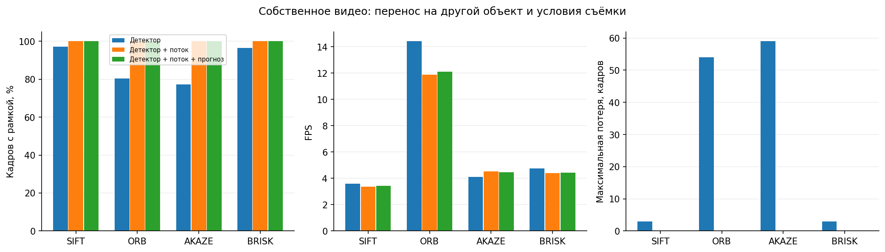

| Детектор | detect: рамка / FPS | flow: рамка / FPS | hybrid: рамка / FPS |
|---|---:|---:|---:|
| SIFT | 97.20% / 3.6 | 100.00% / 3.4 | 100.00% / 3.4 |
| ORB | 80.42% / 14.4 | 100.00% / 11.9 | 100.00% / 12.1 |
| AKAZE | 77.27% / 4.1 | 100.00% / 4.5 | 100.00% / 4.5 |
| BRISK | 96.50% / 4.8 | 100.00% / 4.4 | 100.00% / 4.4 |

Собственный ролик с обложкой книги обрабатывается всеми четырьмя детекторами с теми же параметрами. Он проверяет перенос алгоритма на другой объект и условия съёмки; ошибка относительно Mona Lisa для него не вычисляется.


### 3.7. RANSAC и MAGSAC++ для четырёх детекторов

Здесь SIFT, ORB, AKAZE и BRISK остаются детекторами и дескрипторами, а RANSAC и MAGSAC++ сравниваются как два способа оценки гомографии по уже найденным соответствиям. Цель - проверить, как смена оценщика влияет на доступность рамки и время вычисления H.


#### SIFT: RANSAC и MAGSAC++

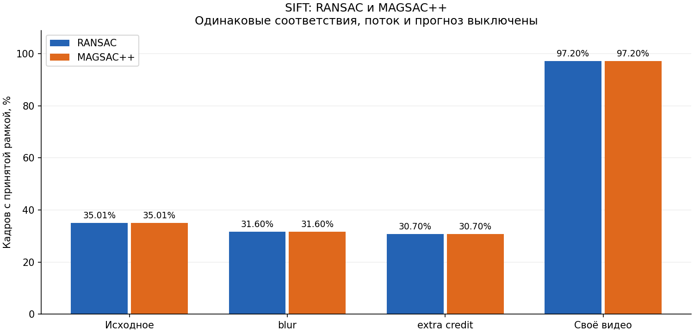

| Видео | Рамка RANSAC / MAGSAC++ | Инлаеры RANSAC / MAGSAC++ | Время H RANSAC / MAGSAC++, мс | Только RANSAC / только MAGSAC++, кадров |
|---|---:|---:|---:|---:|
| Mona Lisa: исходное | 35.01% / 35.01% | 17.65 / 17.66 | 2.682 / 0.237 | 0 / 0 |
| Mona Lisa: blur | 31.60% / 31.60% | 13.58 / 13.59 | 2.889 / 0.222 | 0 / 0 |
| Mona Lisa: extra credit | 30.70% / 30.70% | 13.41 / 13.43 | 2.163 / 0.218 | 0 / 0 |
| Собственное видео | 97.20% / 97.20% | 741.73 / 742.35 | 4.750 / 0.946 | 0 / 0 |

**Вывод для SIFT.** При переходе от RANSAC к MAGSAC++ сумма приростов числа кадров с рамкой по видео составляет 0, сумма снижений - 0; одинаковое итоговое покрытие получено на 4 из 4 видео. Среднее время оценки H с учётом числа вызовов - 3.153 мс у RANSAC и 0.415 мс у MAGSAC++; быстрее в этом замере MAGSAC++. Равное покрытие не означает совпадения рамок или наборов инлаеров.

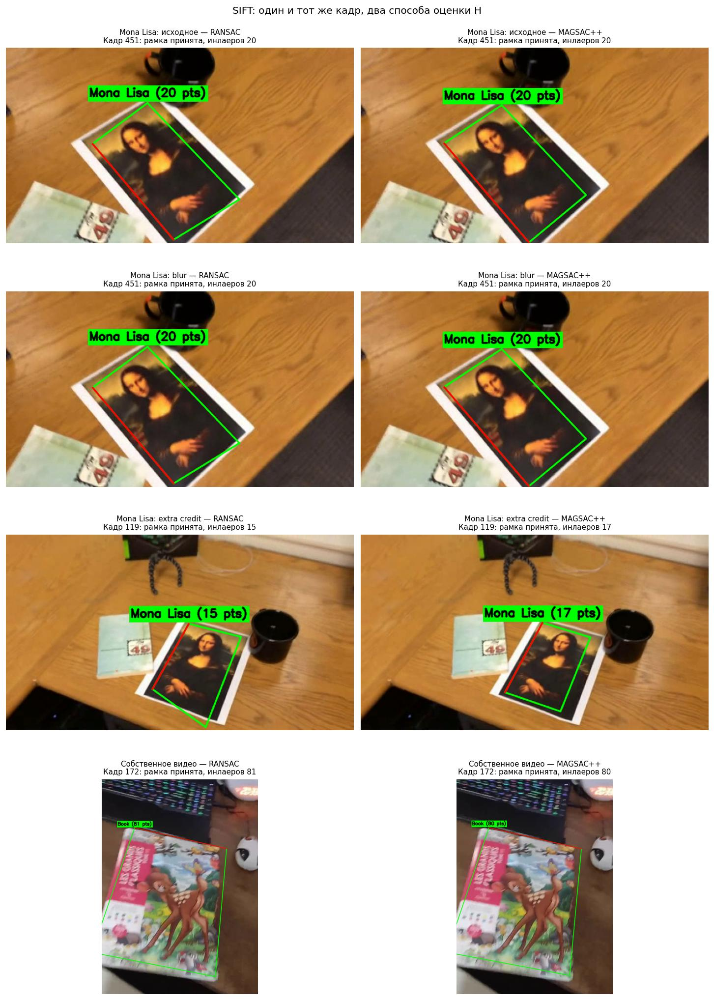

Слева RANSAC, справа MAGSAC++. Для каждого видео выбран один кадр с различием принятия рамки; если такого нет - с наибольшим расхождением углов среди общих рамок, затем по различию числа инлаеров. Это иллюстрации различий, а не независимая проверка правильности рамки.

#### ORB: RANSAC и MAGSAC++

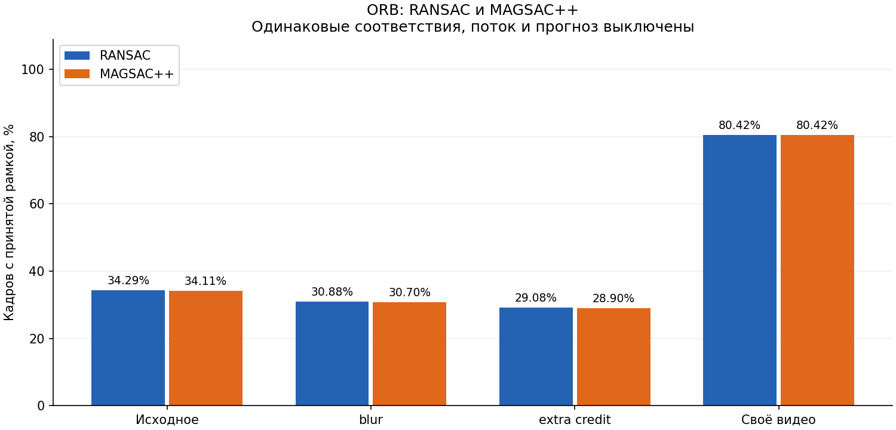

| Видео | Рамка RANSAC / MAGSAC++ | Инлаеры RANSAC / MAGSAC++ | Время H RANSAC / MAGSAC++, мс | Только RANSAC / только MAGSAC++, кадров |
|---|---:|---:|---:|---:|
| Mona Lisa: исходное | 34.29% / 34.11% | 72.53 / 72.69 | 20.095 / 0.419 | 1 / 0 |
| Mona Lisa: blur | 30.88% / 30.70% | 50.08 / 50.17 | 20.858 / 0.401 | 1 / 0 |
| Mona Lisa: extra credit | 29.08% / 28.90% | 49.43 / 49.61 | 19.788 / 0.392 | 1 / 0 |
| Собственное видео | 80.42% / 80.42% | 714.74 / 716.59 | 18.561 / 0.976 | 0 / 0 |

**Вывод для ORB.** При переходе от RANSAC к MAGSAC++ сумма приростов числа кадров с рамкой по видео составляет 0, сумма снижений - 3; одинаковое итоговое покрытие получено на 1 из 4 видео. Среднее время оценки H с учётом числа вызовов - 19.947 мс у RANSAC и 0.505 мс у MAGSAC++; быстрее в этом замере MAGSAC++. Равное покрытие не означает совпадения рамок или наборов инлаеров.

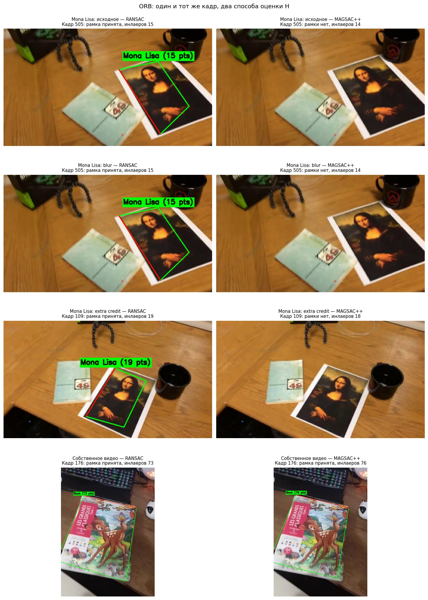

Слева RANSAC, справа MAGSAC++. Для каждого видео выбран один кадр с различием принятия рамки; если такого нет - с наибольшим расхождением углов среди общих рамок, затем по различию числа инлаеров. Это иллюстрации различий, а не независимая проверка правильности рамки.

#### AKAZE: RANSAC и MAGSAC++

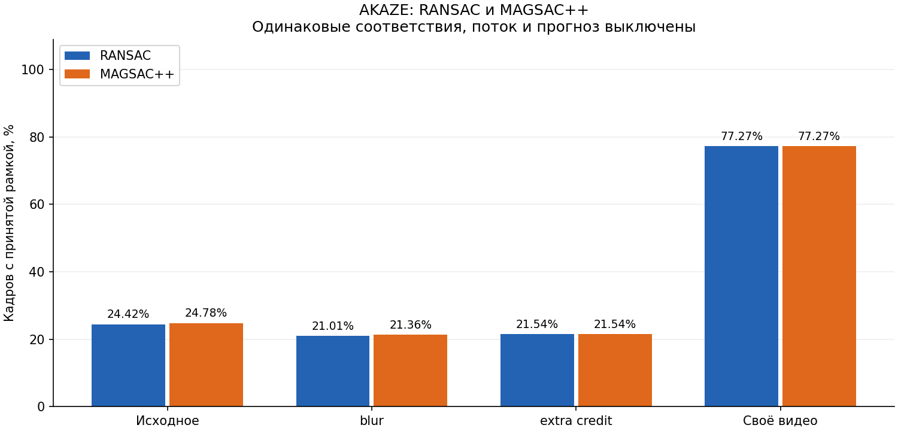

| Видео | Рамка RANSAC / MAGSAC++ | Инлаеры RANSAC / MAGSAC++ | Время H RANSAC / MAGSAC++, мс | Только RANSAC / только MAGSAC++, кадров |
|---|---:|---:|---:|---:|
| Mona Lisa: исходное | 24.42% / 24.78% | 16.40 / 16.49 | 7.091 / 0.306 | 0 / 2 |
| Mona Lisa: blur | 21.01% / 21.36% | 11.32 / 11.41 | 7.718 / 0.299 | 0 / 2 |
| Mona Lisa: extra credit | 21.54% / 21.54% | 11.59 / 11.69 | 8.851 / 0.305 | 0 / 0 |
| Собственное видео | 77.27% / 77.27% | 910.36 / 911.42 | 14.927 / 1.057 | 0 / 0 |

**Вывод для AKAZE.** При переходе от RANSAC к MAGSAC++ сумма приростов числа кадров с рамкой по видео составляет 4, сумма снижений - 0; одинаковое итоговое покрытие получено на 2 из 4 видео. Среднее время оценки H с учётом числа вызовов - 10.052 мс у RANSAC и 0.538 мс у MAGSAC++; быстрее в этом замере MAGSAC++. Равное покрытие не означает совпадения рамок или наборов инлаеров.

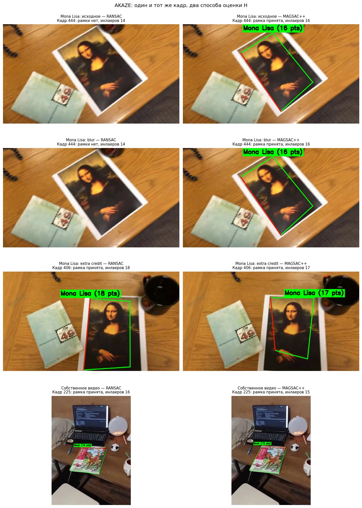

Слева RANSAC, справа MAGSAC++. Для каждого видео выбран один кадр с различием принятия рамки; если такого нет - с наибольшим расхождением углов среди общих рамок, затем по различию числа инлаеров. Это иллюстрации различий, а не независимая проверка правильности рамки.

#### BRISK: RANSAC и MAGSAC++

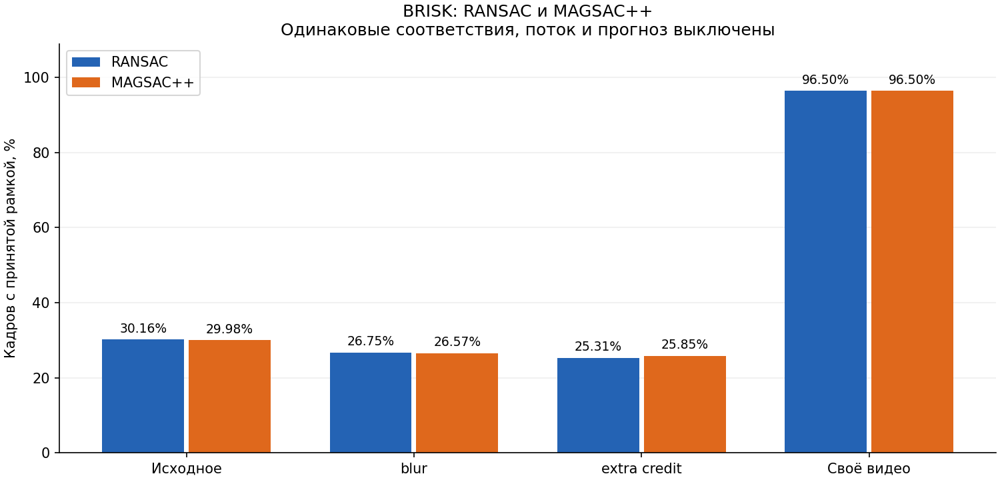

| Видео | Рамка RANSAC / MAGSAC++ | Инлаеры RANSAC / MAGSAC++ | Время H RANSAC / MAGSAC++, мс | Только RANSAC / только MAGSAC++, кадров |
|---|---:|---:|---:|---:|
| Mona Lisa: исходное | 30.16% / 29.98% | 18.13 / 18.27 | 4.123 / 0.260 | 1 / 0 |
| Mona Lisa: blur | 26.75% / 26.57% | 13.20 / 13.31 | 4.432 / 0.245 | 1 / 0 |
| Mona Lisa: extra credit | 25.31% / 25.85% | 12.60 / 12.85 | 2.308 / 0.236 | 0 / 3 |
| Собственное видео | 96.50% / 96.50% | 952.40 / 954.01 | 1.316 / 1.093 | 0 / 0 |

**Вывод для BRISK.** При переходе от RANSAC к MAGSAC++ сумма приростов числа кадров с рамкой по видео составляет 3, сумма снижений - 2; одинаковое итоговое покрытие получено на 1 из 4 видео. Среднее время оценки H с учётом числа вызовов - 2.965 мс у RANSAC и 0.504 мс у MAGSAC++; быстрее в этом замере MAGSAC++. Равное покрытие не означает совпадения рамок или наборов инлаеров.

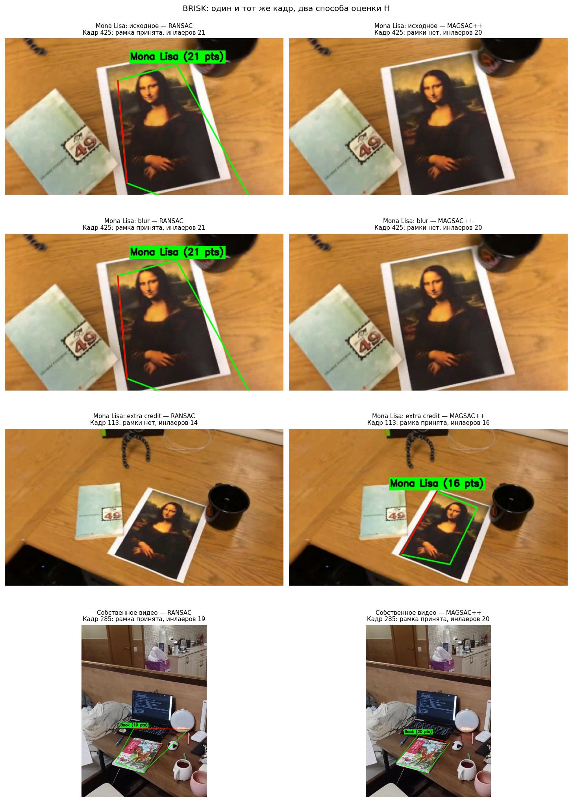

Слева RANSAC, справа MAGSAC++. Для каждого видео выбран один кадр с различием принятия рамки; если такого нет - с наибольшим расхождением углов среди общих рамок, затем по различию числа инлаеров. Это иллюстрации различий, а не независимая проверка правильности рамки.

**Общий вывод.** На 16 сочетаниях «детектор × видео» MAGSAC++ даёт больше кадров с принятой рамкой в 3 случаях, меньше - в 5, столько же - в 8. 

## 4. Выводы

**Основной вывод:** выбор детектора зависит от того, что важнее — чаще получать рамку или быстрее обрабатывать кадры. По результатам режима `detect`:

| Детектор | Когда стоит использовать | Когда подходит хуже |
|---|---|---|
| **SIFT** | Когда приоритет — обнаружение объекта: на всех четырёх видео он даёт наибольшую долю кадров с рамкой. | При строгих ограничениях по времени обработки: в этом исследовании он самый медленный. |
| **ORB** | Когда нужен баланс скорости и обнаружения: на Mona Lisa покрытие близко к SIFT, а обработка быстрее; на собственном видео он самый быстрый. | Когда важно реже терять объект: на собственном видео рамка появляется заметно реже, чем у SIFT и BRISK. |
| **BRISK** | Когда важна скорость на роликах Mona Lisa. На собственном видео он также даёт почти такое же покрытие, как SIFT. | На Mona Lisa уступает SIFT по покрытию, а на собственном видео уступает ORB по скорости. |
| **AKAZE** | Как дополнительный вариант для проверки на другой сцене; в этом эксперименте условий, где он был бы лучшим выбором, не выявлено. | Для исследованных видео: покрытие самое низкое, а скорость ниже ORB. |

Размытие снижает покрытие всех методов. Для непрерывного сопровождения на роликах Mona Lisa одного `detect` недостаточно: оптический поток существенно уменьшает пропуски, а прогноз лишь временно продолжает рамку без подтверждения по изображению. Выводы относятся к данным видео и настройкам; частота появления рамки не доказывает точность её границ.

## 5. Использованные источники

1. Lowe D. G. Distinctive Image Features from Scale-Invariant Keypoints // International Journal of Computer Vision. - 2004. - Vol. 60, № 2. - P. 91–110.
2. Rublee E., Rabaud V., Konolige K., Bradski G. ORB: An efficient alternative to SIFT or SURF // ICCV. - 2011. - P. 2564–2571.
3. Alcantarilla P. F., Nuevo J., Bartoli A. Fast Explicit Diffusion for Accelerated Features in Nonlinear Scale Spaces (AKAZE) // BMVC. - 2013.
4. Leutenegger S., Chli M., Siegwart R. BRISK: Binary Robust Invariant Scalable Keypoints // ICCV. - 2011. - P. 2548–2555.
5. Fischler M. A., Bolles R. C. Random Sample Consensus: A Paradigm for Model Fitting with Applications to Image Analysis and Automated Cartography // Communications of the ACM. - 1981. - Vol. 24, № 6. - P. 381–395.
6. Barath D., Noskova J., Ivashechkin M., Matas J. MAGSAC++, a fast, reliable and accurate robust estimator // CVPR. - 2020.
7. Muja M., Lowe D. G. Fast Approximate Nearest Neighbors with Automatic Algorithm Configuration (FLANN) // VISAPP. - 2009.
8. Hartley R., Zisserman A. Multiple View Geometry in Computer Vision. - 2nd ed. - Cambridge University Press, 2004.
9. Szeliski R. Computer Vision: Algorithms and Applications. - 2nd ed. - Springer, 2022.
10. OpenCV documentation: Feature Matching + Homography to find Objects. - URL: https://docs.opencv.org/4.x/d1/de0/tutorial_py_feature_homography.html

## Приложение. Видео с результатами трекинга

Полные выходные видео с рамкой объекта: три варианта Mona Lisa и собственное видео, каждый обработан методами SIFT, ORB, AKAZE и BRISK. Всего **4 видео × 4 детектора = 16 роликов**.

Все ролики получены в режиме `hybrid`: поиск по эталону, оптический поток и краткосрочный прогноз. Измеренная рамка зелёная, прогнозируемая — жёлтая с пометкой `predicted`.

**Нажмите на превью или ссылку «Открыть MP4», чтобы открыть видео.** Если просмотрщик не воспроизводит файл, его можно скачать и открыть в видеоплеере.

### П.1. Mona Lisa: исходное

Исходный файл: `mona-lisa.avi`. Превью соответствуют кадру с индексом 100.

| SIFT | ORB | AKAZE | BRISK |
|---|---|---|---|
| [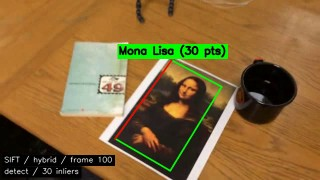](results/mona-lisa_sift.mp4) | [](results/mona-lisa_orb.mp4) | [](results/mona-lisa_akaze.mp4) | [](results/mona-lisa_brisk.mp4) |
| [Открыть MP4](results/mona-lisa_sift.mp4) | [Открыть MP4](results/mona-lisa_orb.mp4) | [Открыть MP4](results/mona-lisa_akaze.mp4) | [Открыть MP4](results/mona-lisa_brisk.mp4) |

### П.2. Mona Lisa: blur

Исходный файл: `mona-lisa-blur.avi`. Превью соответствуют кадру с индексом 100.

| SIFT | ORB | AKAZE | BRISK |
|---|---|---|---|
| [](results/mona-lisa-blur_sift.mp4) | [](results/mona-lisa-blur_orb.mp4) | [](results/mona-lisa-blur_akaze.mp4) | [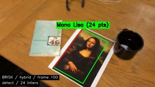](results/mona-lisa-blur_brisk.mp4) |
| [Открыть MP4](results/mona-lisa-blur_sift.mp4) | [Открыть MP4](results/mona-lisa-blur_orb.mp4) | [Открыть MP4](results/mona-lisa-blur_akaze.mp4) | [Открыть MP4](results/mona-lisa-blur_brisk.mp4) |

### П.3. Mona Lisa: extra credit

Исходный файл: `mona-lisa-blur-extra-credit.avi`. Превью соответствуют кадру с индексом 100.

| SIFT | ORB | AKAZE | BRISK |
|---|---|---|---|
| [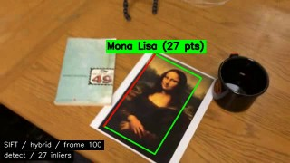](results/mona-lisa-blur-extra-credit_sift.mp4) | [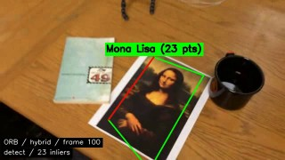](results/mona-lisa-blur-extra-credit_orb.mp4) | [](results/mona-lisa-blur-extra-credit_akaze.mp4) | [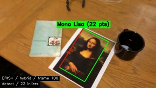](results/mona-lisa-blur-extra-credit_brisk.mp4) |
| [Открыть MP4](results/mona-lisa-blur-extra-credit_sift.mp4) | [Открыть MP4](results/mona-lisa-blur-extra-credit_orb.mp4) | [Открыть MP4](results/mona-lisa-blur-extra-credit_akaze.mp4) | [Открыть MP4](results/mona-lisa-blur-extra-credit_brisk.mp4) |

### П.4. Собственное видео

Исходный файл: `my_video.mp4`. Превью соответствуют кадру с индексом 100.

| SIFT | ORB | AKAZE | BRISK |
|---|---|---|---|
| [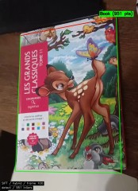](results/my_video_sift.mp4) | [](results/my_video_orb.mp4) | [](results/my_video_akaze.mp4) | [](results/my_video_brisk.mp4) |
| [Открыть MP4](results/my_video_sift.mp4) | [Открыть MP4](results/my_video_orb.mp4) | [Открыть MP4](results/my_video_akaze.mp4) | [Открыть MP4](results/my_video_brisk.mp4) |
