# Основные сравнения

Режим detect: поток и прогноз выключены. Первый кадр исключён.

Серые интервалы — кадры с отличием от исходного ролика > 5 уровней яркости.

## 1. Разные детекторы на одном видео: 4 метрики × 3 видео = 12 графиков

### Mona Lisa: исходное

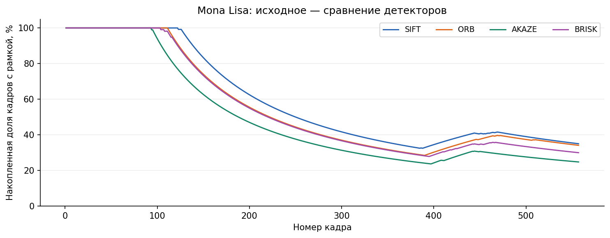

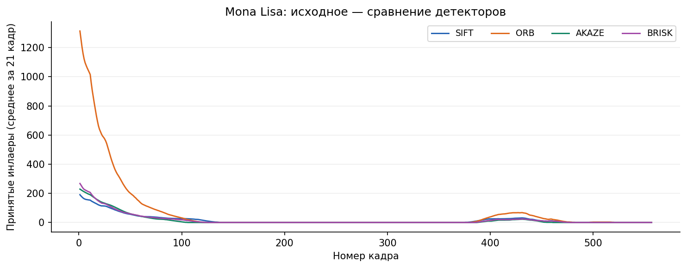

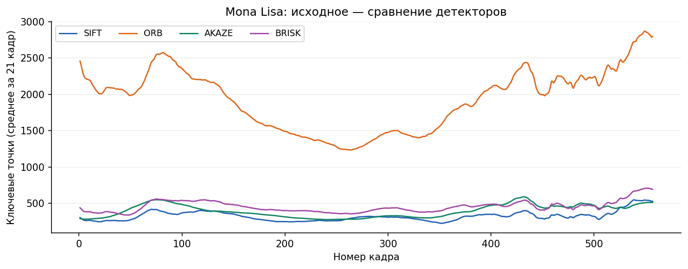

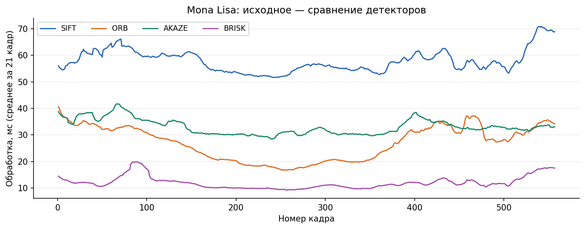

### Mona Lisa: blur

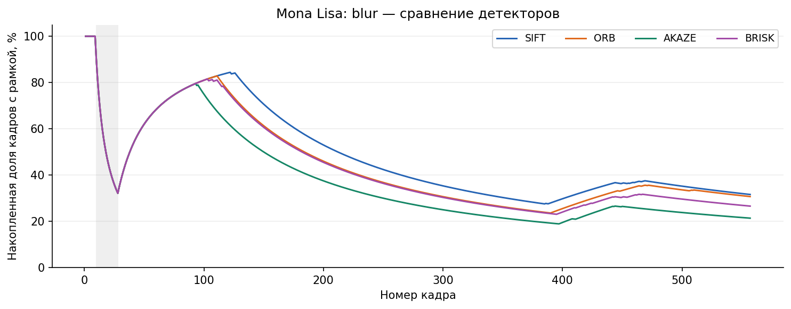

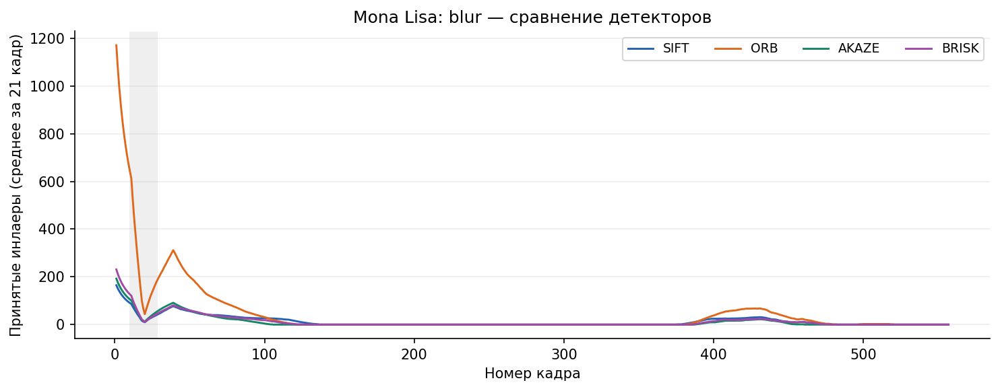

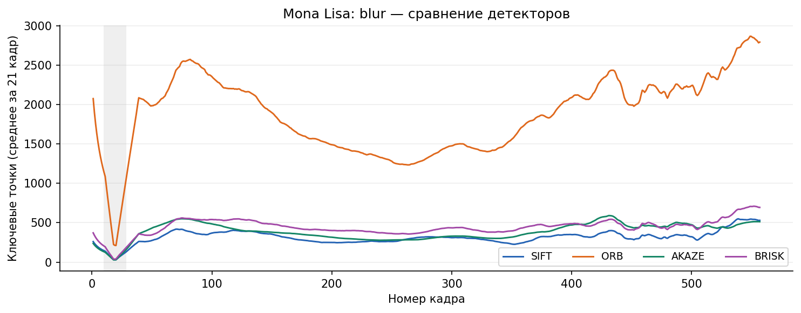

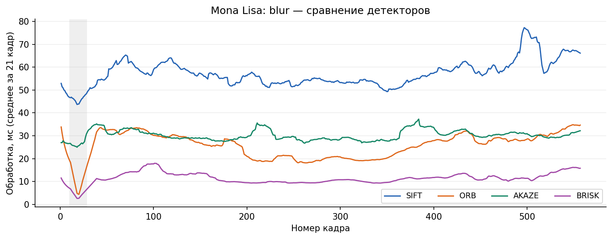

### Mona Lisa: extra credit

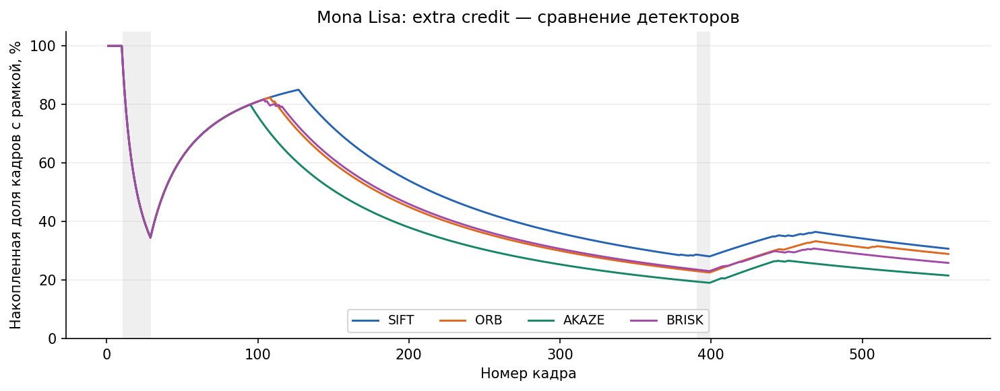

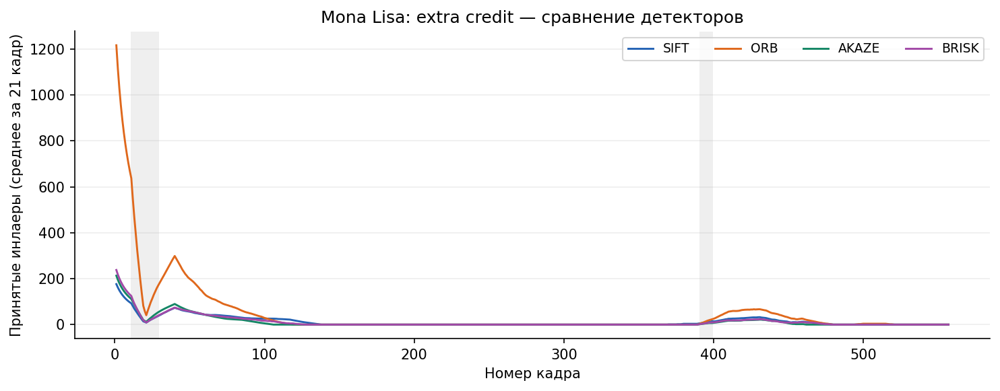

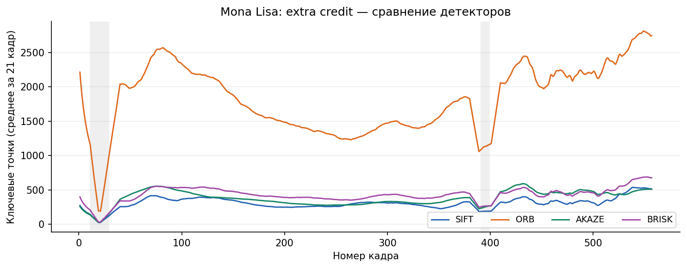

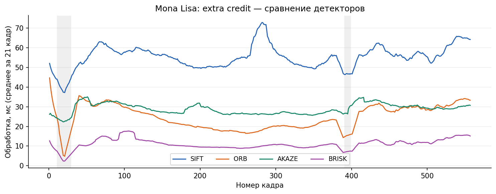

## 2. Варианты размытия для одного детектора: 3 метрики × 4 детектора = 12 графиков

Сравниваются исходный ролик, blur и extra credit; названия не задают конкретный тип ядра размытия.

### SIFT

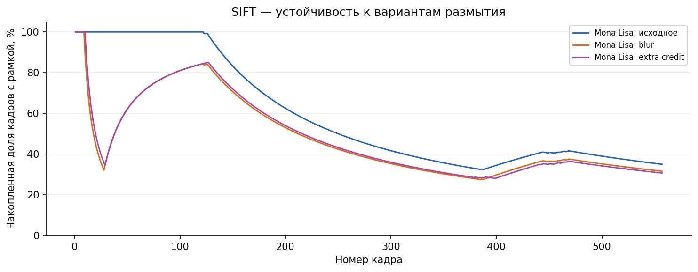

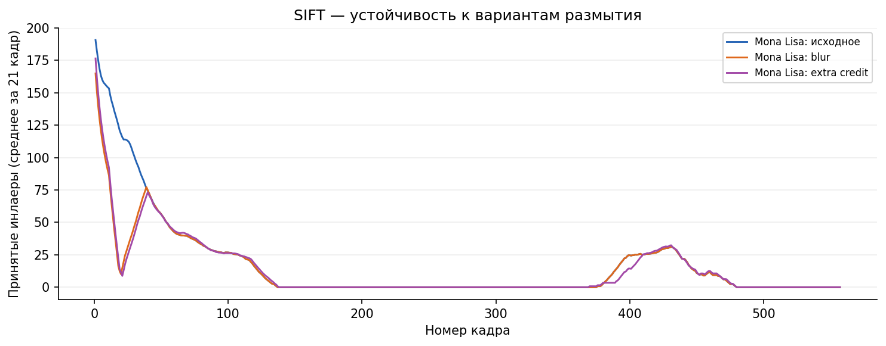

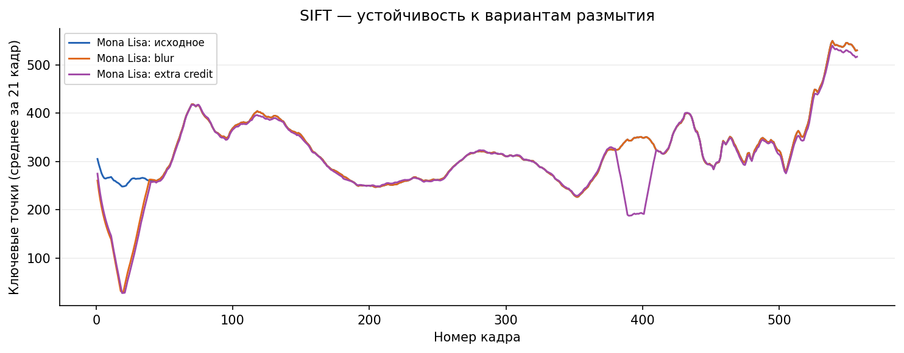

### ORB

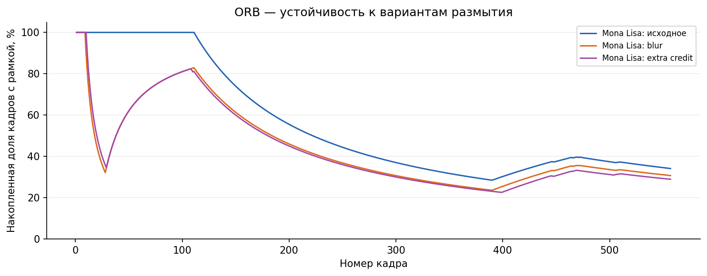

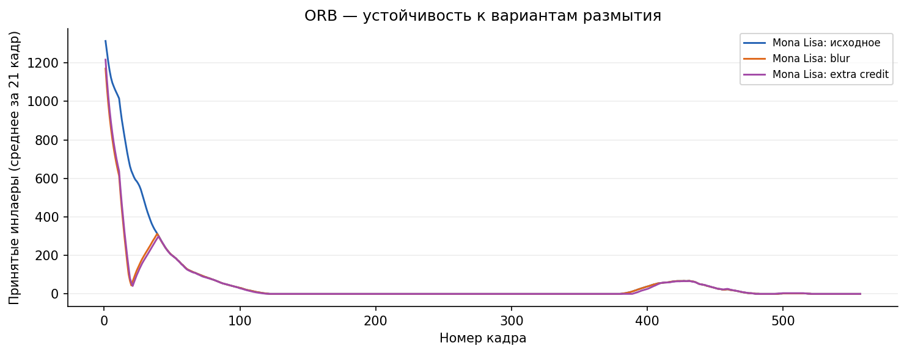

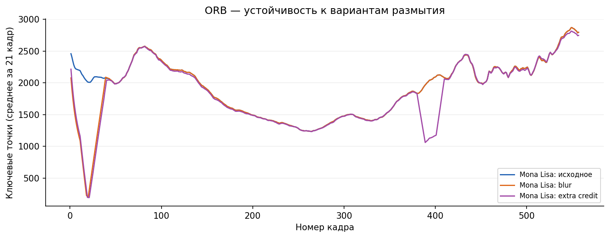

### AKAZE

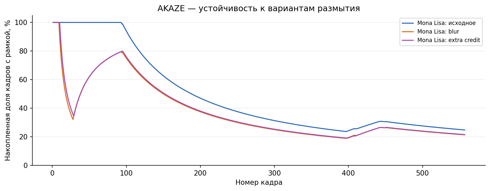

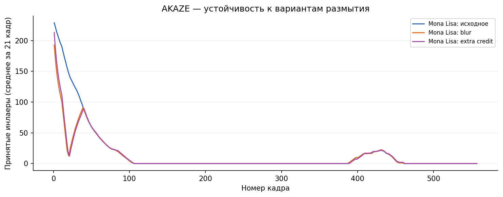

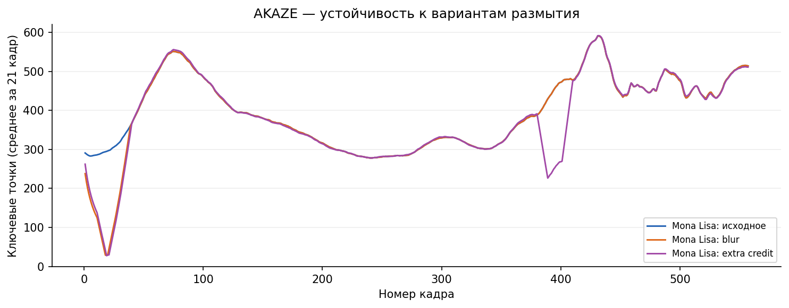

### BRISK

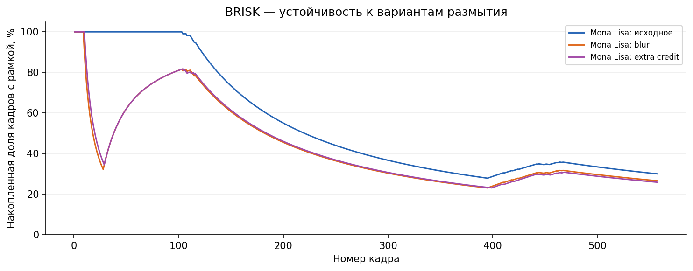

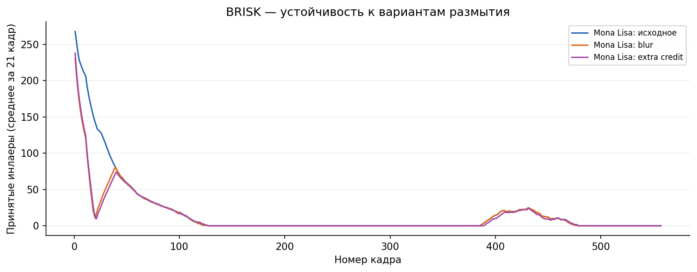

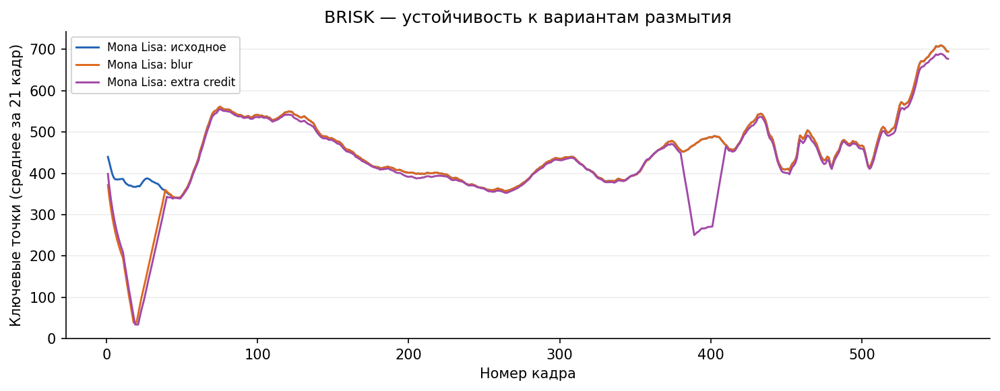
