# Лабораторная работа №3 — SR-inpainting

[Подробное дополнение: определения, вывод формул, алгоритмы, схемы и сравнительные таблицы](additions.md).

Локальное восстановление пользовательских фотографий предобученной Stable Diffusion 1.5. Область обработки задаётся бинарным массивом H×W. Демонстрационные исходники и их результаты удалены; используются только фотографии из [input](input).

## 1. Теоретическая база

Super-resolution восстанавливает изображение высокого разрешения из деградированного входа. Здесь изображение уменьшается ×4, искажается шумом и увеличивается bicubic до размера опорной фотографии. Диффузия уточняет разрешённые маской области. SD 1.5 не специализирована на SR: правдоподобные детали могут отличаться от реальных, поэтому рост воспринимаемого качества не гарантирует роста PSNR. SUPIR в задании рекомендуется, но не обязателен.

VAE кодирует вход в латент `z0`, U-Net оценивает шум с текстовым условием, DDIM выполняет обратную диффузию. После **каждого шага**:

`z(t_next) = M * z_proposal(t_next) + (1-M) * z_reference(t_next)`.

`z_reference(t) = sqrt(alpha_bar[t])*z0 + sqrt(1-alpha_bar[t])*epsilon` — исходный латент с фиксированным шумом на соответствующем уровне. На последнем шаге вне ROI используется чистый `z0`. После декодирования возвращаются исходные пиксели вне ROI: одного ограничения латентов недостаточно из-за потерь VAE.

Единицы маски разрешают восстановление, нули сохраняют вход. Маска уменьшается ближайшим соседом; маленькие области могут теряться. Нулевая маска возвращает вход без вызова нейросети.

## 2. Разработанная система

| Файл | Назначение |
|---|---|
| [sr_inpainting.py](sr_inpainting.py) | Изменённый DDIM, проверка маски, CLI одного входа |
| [experiment.py](experiment.py) | Маски, деградации, PSNR, LPIPS, CLIP-IQA и запуск исследований |
| [research.py](research.py) | Матрица опытов, возобновление, таблицы, графики и сравнения |
| [test_inpainting.py](test_inpainting.py) | Проверки алгоритма и протокола |

Используются `town.jpg` (800×1000) и новое `rubezh_vekov.jpg` (4000×5328). Длинная сторона уменьшается до 512 px с сохранением пропорций; точные размеры записываются в `runtime.json`. JPEG служат опорными фотографиями для контролируемых искажений, их исходная чистота неизвестна. Метрики относятся к уменьшенным опорным изображениям.

Python 3.10+, PyTorch, Diffusers, Transformers и PyIQA. Поддержаны CPU и CUDA. Изображение дополняется до кратности 8 и обрезается после восстановления. Сохраняется штатная проверка безопасности SD. Модель восстановления освобождается перед загрузкой метрик для экономии RAM. Итоги сохраняются в PNG без потерь.

На имеющейся GTX 1660 Ti вычисления FP16 дали нечисловые значения. Для GTX 16xx автоматически используется FP32 и перенос компонентов CPU↔GPU, включая проверку безопасности. Проверки `isfinite` не допускают сохранения некорректного результата. Отклонённые safety checker опыты отмечаются `safety_rejected`: для них нет изображения и метрик, остальные опыты продолжаются.

Из корня репозитория:

```powershell
python -m venv LW3/.venv
.\LW3\.venv\Scripts\python.exe -m pip install -r LW3/requirements.txt

# CUDA-сборка, использованная на GTX 1660 Ti:
.\LW3\.venv\Scripts\python.exe -m pip install torch==2.7.1 torchvision==0.22.1 --index-url https://download.pytorch.org/whl/cu118

# Только подготовка пользовательских входов и масок:
.\LW3\.venv\Scripts\python.exe LW3/experiment.py --prepare-only

# Полные исследования; повторный запуск продолжает проверенные опыты:
.\LW3\.venv\Scripts\python.exe LW3/experiment.py --device auto

# Повторный расчёт метрик для уже восстановленных изображений:
.\LW3\.venv\Scripts\python.exe LW3/experiment.py --metrics-only

.\LW3\.venv\Scripts\python.exe -m unittest discover -s LW3 -v
```

По умолчанию модель читается из `LW3/.cache/sd15`; `--model` принимает папку Diffusers или ID модели. `download_model.py` и `download_metrics.py` скачивают официальные веса с возобновлением и проверкой SHA-256. `download_gpu.py` получает официальные CUDA wheels PyTorch 2.7.1 / torchvision 0.22.1 для Windows Python 3.12. [Официальные команды установки PyTorch](https://docs.pytorch.org/get-started/previous-versions/). Кэш исключён из Git. Для OpenAI CLIP закреплён `setuptools<81`, поскольку пакет использует `pkg_resources`.

Аргументы `--max-side`, `--steps`, `--strength`, `--seed`, `--prompt` сохраняются в конфигурации. Изменённые параметры требуют нового `--output`. Возобновление проверяет конфигурацию, параметры опыта и SHA-256 PNG.

## 3. Исследования

При настройках по умолчанию — **104 уникальных измерения**: 64 вызова диффузии, 20 нулевых масок и 20 baseline. Одинаковые опыты переиспользуются между исследованиями.

1. **Форма и площадь маски.** Для bicubic и Gaussian σ=15 сравниваются zero, one, mixed (центральный прямоугольник около 25%), left_half, circle, stripes и blocks (фиксированные блоки 16×16). Доли ROI указаны в CSV. Формы отличаются также площадью; это не изолированное исследование формы.
2. **Тип и сила шума.** Для zero/one/mixed на обеих фотографиях — bicubic без дополнительного шума; Gaussian σ=5/15/30 в шкале 0–255; Poisson peak=30/10; salt-and-pepper 1%/5%; blur σ=1.2 + Gaussian σ=5 + JPEG quality=60. Шум добавляется в LR после уменьшения ×4, до увеличения; blur выполняется перед уменьшением. Меньший Poisson peak означает более сильный шум. Это собственные деградации, не DIV2K unknown или RealESRGAN.
3. **Повтор с другим seed.** Gaussian σ=15, zero/one/mixed, seed 42 и 123. Seed меняет входной и диффузионный шум; оценивается чувствительность всего процесса. Двух повторов недостаточно для статистически надёжных обобщений.
4. **Влияние strength.** Gaussian σ=15, one/mixed, strength 0.2/0.35/0.5. Расписание из 30 шагов фактически даёт 6/10/15 шагов уточнения. Guidance=5, eta=0; текстовые условия и seed фиксированы.

### Метрики

PSNR вычисляется по RGB полного кадра относительно опорной фотографии без обрезания границ; больше — лучше.

LPIPS и CLIP-IQA через PyIQA получают RGB [0,1] полного кадра: LPIPS меньше — лучше, CLIP-IQA больше — лучше. 

CLIP-IQA безэталонная и не измеряет достоверность деталей. Отдельно сохраняются PSNR ROI, доля ROI и максимальное изменение фона. Для пустой ROI PSNR отсутствует. Нулевая маска обязана совпадать с baseline. Неизменённый фон влияет на полные метрики частичных масок.

### Результаты и воспроизводимость

- `results/metrics.csv` — индивидуальные измерения всех опытов;
- `results/REPORT.md` — таблицы по четырём исследованиям;
- `results/masks.png`, `noise.png`, `strength.png` — графики;
- `results/comparison_*.png` — сравнения пользовательских фотографий;
- `results/images/` — опорные фотографии, деградации, маски и восстановленные PNG;
- `results/config.json`, `runtime.json`, `plan.json` — параметры, версии, размеры, источник весов и план.

**Запуск завершён:** 104 опыта, **99 успешных измерений и 5 отклонений** штатной проверкой SD. Для отклонений значения метрик отсутствуют. Все пять относятся к `rubezh_vekov.jpg`: полная маска при Gaussian σ=30, Poisson peak=30/10 и blur+noise+JPEG, а также mixed при Poisson peak=10. Чёрные заглушки не сохранялись и не оценивались.

Полные результаты: [таблицы четырёх исследований](results/REPORT.md), [104 записи CSV](results/metrics.csv), [конфигурация](results/config.json), [окружение и источник весов](results/runtime.json), [точные версии пакетов](results/environment.txt). Реальные размеры опорных фотографий — 384×512 и 410×512. Расчёт выполнен на GTX 1660 Ti 6 ГБ, PyTorch 2.7.1+cu118, FP32 с переносом компонентов между CPU и GPU.

### 3.1. Результаты сравнения масок

Ниже Gaussian σ=15, seed=42, strength=0.35. Baseline и zero совпали по всем трём метрикам во всех 20 условиях. Максимальное изменение пикселя вне маски для всех успешных опытов — **0**.

| Фото | Маска | PSNR ↑ | LPIPS ↓ | CLIP-IQA ↑ |
|---|---|---:|---:|---:|
| rubezh_vekov | baseline / zero | 25.232 | 0.5761 | 0.4438 |
| rubezh_vekov | one | 22.071 | 0.5434 | 0.2581 |
| rubezh_vekov | mixed | 24.369 | 0.5651 | 0.2381 |
| rubezh_vekov | left_half | 23.376 | 0.5556 | 0.2277 |
| rubezh_vekov | circle | 24.349 | 0.5652 | 0.2428 |
| rubezh_vekov | stripes | 23.703 | 0.5543 | 0.2391 |
| rubezh_vekov | blocks | 24.504 | 0.5556 | 0.2626 |
| town | baseline / zero | 24.071 | 0.8368 | 0.2111 |
| town | one | 22.816 | 0.7711 | 0.1404 |
| town | mixed | 23.721 | 0.8160 | 0.1683 |
| town | left_half | 23.109 | 0.7998 | 0.1702 |
| town | circle | 23.724 | 0.8140 | 0.1541 |
| town | stripes | 23.492 | 0.7803 | 0.1549 |
| town | blocks | 23.800 | 0.7986 | 0.1742 |

При этом шуме все ненулевые маски снизили LPIPS, но ухудшили PSNR и CLIP-IQA относительно baseline. Частичные маски сохраняют больше исходных пикселей и дают PSNR ближе к baseline. Их нельзя ранжировать только по форме: одновременно различаются площадь и содержание ROI.

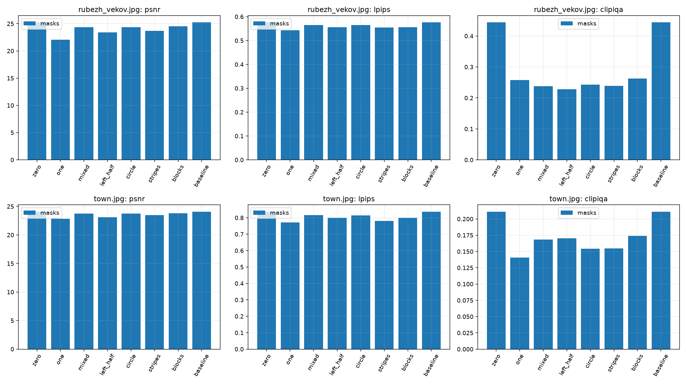

Ниже показаны все **8 вариантов × 3 фотографии × 2 деградации = 48 результатов**. В каждой панели восемь столбцов: **baseline, zero, one, mixed, left_half, circle, stripes, blocks**. Верхняя строка — bicubic без дополнительного шума, нижняя — Gaussian σ=15. Везде seed=42 и strength=0.35. Baseline — вход без восстановления; zero должен совпадать с ним.

**rubezh_vekov.jpg**

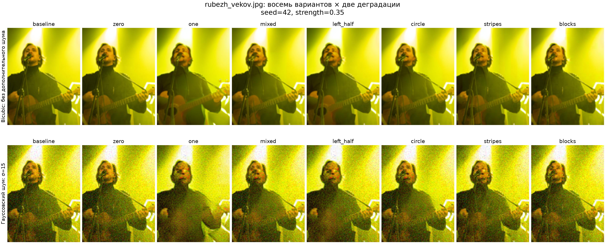

**town.jpg**

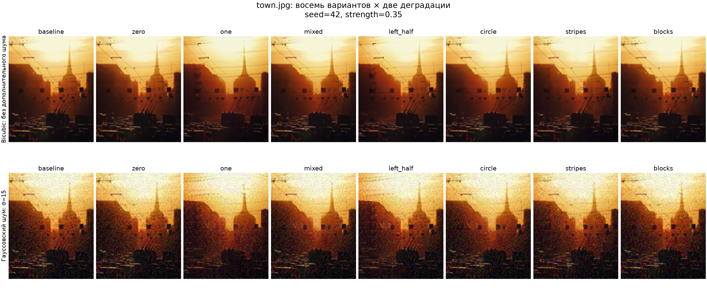

**background.jpg**

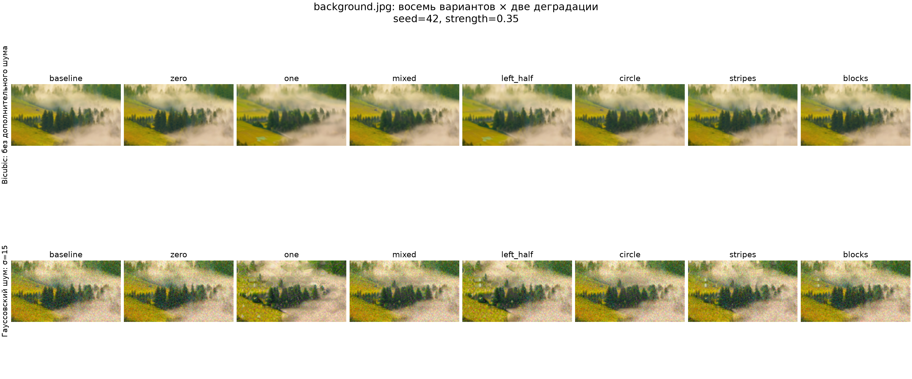

Панели можно открыть в полном размере для сравнения деталей. Они построены из сохранённых PNG; повторное построение без запуска модели: `.\LW3\.venv\Scripts\python.exe LW3/mask_comparisons.py`.


### 3.2. Результаты для разных шумов

У нового изображения baseline PSNR падает с 29.614 дБ для bicubic до 25.232 дБ при Gaussian σ=15 и 20.801 дБ при σ=30. На обеих фотографиях среди **31 успешного сравнения** one/mixed с baseline при strength=0.35 LPIPS улучшился в 20 случаях, PSNR — в 7, CLIP-IQA — только в 2. Ещё 5 из 36 попыток отклонены моделью и исключены из этих подсчётов. Это описательная статистика для двух фотографий, не оценка по большому датасету.

CLIP-IQA не всегда монотонна по силе шума: у town её baseline-значение равно 0.2111 при Gaussian σ=15 и 0.2478 при σ=30, хотя PSNR снижается. Одной безэталонной метрики недостаточно для вывода о восстановлении реальных деталей.

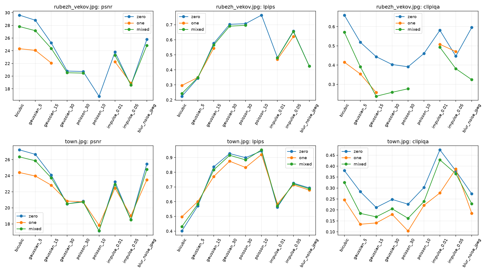

#### Подробное сравнение по каждому типу деградации

Это те же девять условий, которые показаны в [атласе шумов в additions](additions.md#2-деградации-и-шумы). Атлас показывает входные искажения; ниже приведено качество до и после восстановления. Bicubic — контроль без дополнительного шума, а blur + noise + JPEG — составная деградация.

Условия: уменьшение ×4, seed=42, strength=0.35, steps=30 (10 фактических шагов DDIM), guidance=5. Для каждой фотографии и деградации baseline, one и mixed используют один и тот же вход. Все метрики рассчитаны по полному кадру; zero совпадает с baseline и отдельно не повторяется. В каждой ячейке указаны **PSNR ↑ / LPIPS ↓ / CLIP-IQA ↑**. «Отклонено» означает `safety_rejected`, без изображения и метрик.

Как читать графики: слева показаны исходные значения PSNR, LPIPS и CLIP-IQA для baseline (серый), one (синий) и mixed (оранжевый). Справа — изменение относительно baseline: **столбец выше нуля всегда означает улучшение**, ниже нуля — ухудшение. Для PSNR и CLIP-IQA это «результат − baseline», для LPIPS — «baseline − результат». Крестики обозначают отклонённые опыты, а не нулевые значения. Gaussian подписан значением σ, Poisson — peak; категории по горизонтали не образуют единую числовую шкалу силы шума. Масштабы осей автоматически подобраны для каждой фотографии.

Графики строятся из сохранённых CSV без запуска модели: `.\LW3\.venv\Scripts\python.exe LW3/noise_figures.py`. Сохраняются PNG для отчёта и SVG для увеличения без потери качества.

**rubezh_vekov.jpg**

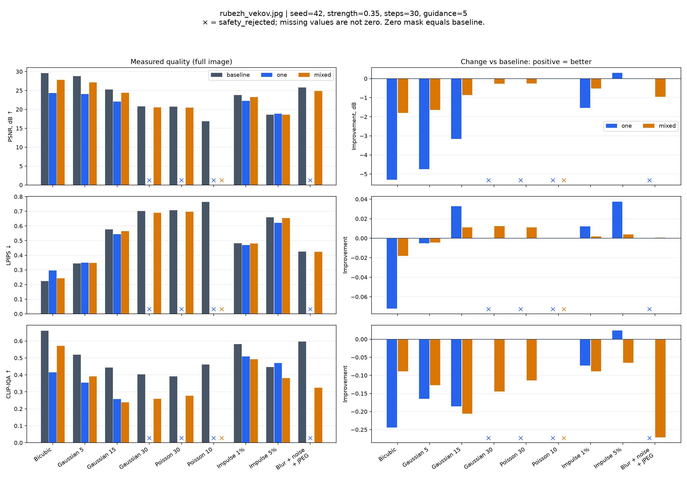

[Векторная версия графика (SVG)](results/noise_detail_rubezh_vekov.svg).

| Деградация | Baseline / zero | One: весь кадр | Mixed: центральная ROI ≈25% |
|---|---|---|---|
| Bicubic | 29.614 / 0.2244 / 0.6599 | 24.318 / 0.2964 / 0.4153 | 27.815 / 0.2424 / 0.5710 |
| Gaussian σ=5 | 28.809 / 0.3440 / 0.5191 | 24.065 / 0.3491 / 0.3542 | 27.163 / 0.3485 / 0.3917 |
| Gaussian σ=15 | 25.232 / 0.5761 / 0.4438 | 22.071 / 0.5434 / 0.2581 | 24.369 / 0.5651 / 0.2381 |
| Gaussian σ=30 | 20.801 / 0.7029 / 0.4031 | Отклонено | 20.537 / 0.6905 / 0.2586 |
| Poisson peak=30 | 20.727 / 0.7072 / 0.3912 | Отклонено | 20.476 / 0.6962 / 0.2770 |
| Poisson peak=10 | 16.830 / 0.7640 / 0.4605 | Отклонено | Отклонено |
| Salt-and-pepper 1% | 23.796 / 0.4819 / 0.5811 | 22.260 / 0.4699 / 0.5081 | 23.277 / 0.4802 / 0.4926 |
| Salt-and-pepper 5% | 18.586 / 0.6584 / 0.4466 | 18.890 / 0.6210 / 0.4705 | 18.603 / 0.6545 / 0.3814 |
| Blur + noise + JPEG | 25.788 / 0.4246 / 0.5958 | Отклонено | 24.837 / 0.4242 / 0.3243 |

**town.jpg**

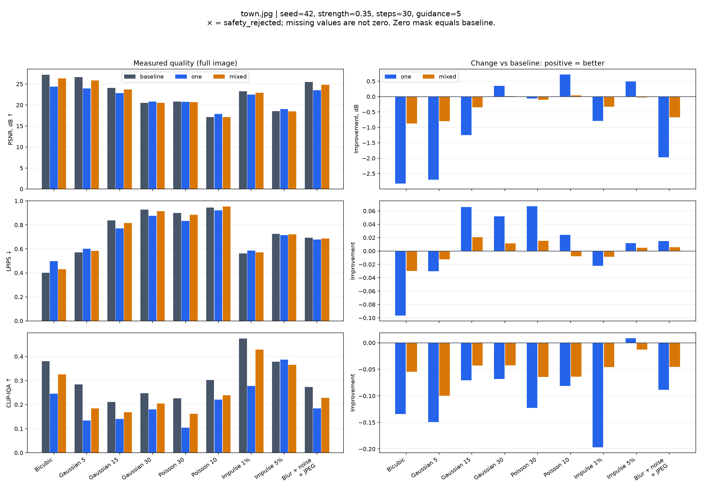

[Векторная версия графика (SVG)](results/noise_detail_town.svg).

| Деградация | Baseline / zero | One: весь кадр | Mixed: центральная ROI ≈25% |
|---|---|---|---|
| Bicubic | 27.213 / 0.4007 / 0.3800 | 24.390 / 0.4971 / 0.2455 | 26.336 / 0.4307 / 0.3254 |
| Gaussian σ=5 | 26.653 / 0.5708 / 0.2836 | 23.957 / 0.6011 / 0.1345 | 25.855 / 0.5834 / 0.1841 |
| Gaussian σ=15 | 24.071 / 0.8368 / 0.2111 | 22.816 / 0.7711 / 0.1404 | 23.721 / 0.8160 / 0.1683 |
| Gaussian σ=30 | 20.491 / 0.9270 / 0.2478 | 20.841 / 0.8752 / 0.1798 | 20.504 / 0.9154 / 0.2051 |
| Poisson peak=30 | 20.819 / 0.8992 / 0.2262 | 20.754 / 0.8324 / 0.1038 | 20.718 / 0.8841 / 0.1616 |
| Poisson peak=10 | 17.123 / 0.9446 / 0.3024 | 17.842 / 0.9206 / 0.2208 | 17.159 / 0.9524 / 0.2386 |
| Salt-and-pepper 1% | 23.245 / 0.5627 / 0.4744 | 22.458 / 0.5850 / 0.2774 | 22.917 / 0.5714 / 0.4286 |
| Salt-and-pepper 5% | 18.520 / 0.7262 / 0.3781 | 19.010 / 0.7143 / 0.3866 | 18.494 / 0.7214 / 0.3654 |
| Blur + noise + JPEG | 25.454 / 0.6933 / 0.2734 | 23.486 / 0.6785 / 0.1845 | 24.777 / 0.6876 / 0.2279 |

**background.jpg**

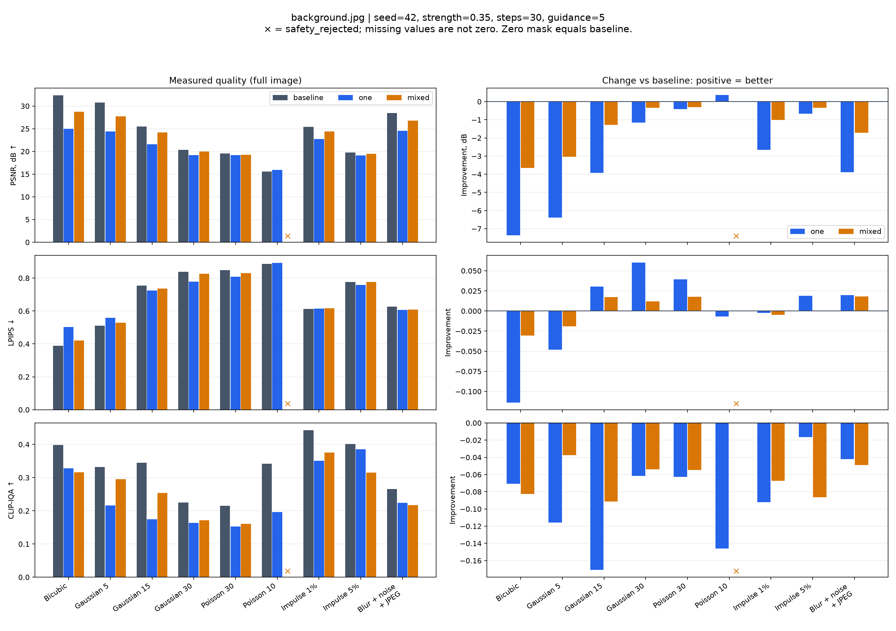

[Векторная версия графика (SVG)](results_background/noise_detail_background.svg).

| Деградация | Baseline / zero | One: весь кадр | Mixed: центральная ROI ≈25% |
|---|---|---|---|
| Bicubic | 32.369 / 0.3896 / 0.3988 | 25.012 / 0.5035 / 0.3281 | 28.723 / 0.4200 / 0.3162 |
| Gaussian σ=5 | 30.766 / 0.5102 / 0.3325 | 24.385 / 0.5584 / 0.2165 | 27.728 / 0.5292 / 0.2950 |
| Gaussian σ=15 | 25.472 / 0.7541 / 0.3450 | 21.556 / 0.7239 / 0.1742 | 24.186 / 0.7369 / 0.2539 |
| Gaussian σ=30 | 20.355 / 0.8381 / 0.2254 | 19.201 / 0.7778 / 0.1637 | 20.015 / 0.8261 / 0.1714 |
| Poisson peak=30 | 19.581 / 0.8485 / 0.2153 | 19.162 / 0.8091 / 0.1526 | 19.277 / 0.8309 / 0.1608 |
| Poisson peak=10 | 15.558 / 0.8862 / 0.3421 | 15.926 / 0.8930 / 0.1960 | Отклонено |
| Salt-and-pepper 1% | 25.422 / 0.6125 / 0.4427 | 22.762 / 0.6146 / 0.3506 | 24.409 / 0.6173 / 0.3756 |
| Salt-and-pepper 5% | 19.778 / 0.7768 / 0.4016 | 19.109 / 0.7581 / 0.3852 | 19.442 / 0.7770 / 0.3151 |
| Blur + noise + JPEG | 28.469 / 0.6257 / 0.2661 | 24.578 / 0.6062 / 0.2241 | 26.761 / 0.6076 / 0.2174 |

#### Каждый шум: метрики и вид искажения

Для каждой деградации сначала показаны PSNR, LPIPS и CLIP-IQA трёх фотографий, затем — **соответствующие зашумлённые входы** после увеличения bicubic. Это входы алгоритма, до восстановления. Серый — baseline, синий — one, оранжевый — mixed; крестик означает отклонённый опыт. Условия: seed=42, strength=0.35.

##### Bicubic — без дополнительного шума

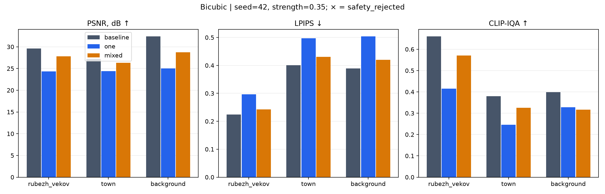

**Шум на входе: Bicubic — без дополнительного шума.**


##### Гауссовский шум, σ=5

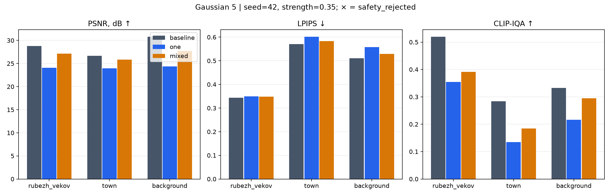

**Шум на входе: Гауссовский шум, σ=5.**


##### Гауссовский шум, σ=15

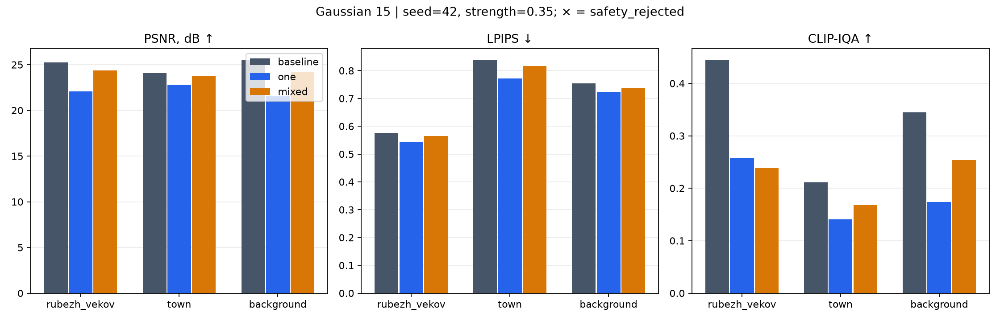

**Шум на входе: Гауссовский шум, σ=15.**


##### Гауссовский шум, σ=30

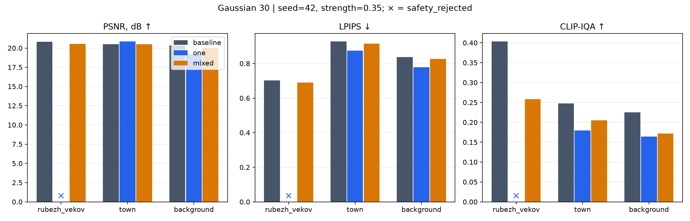

**Шум на входе: Гауссовский шум, σ=30.**

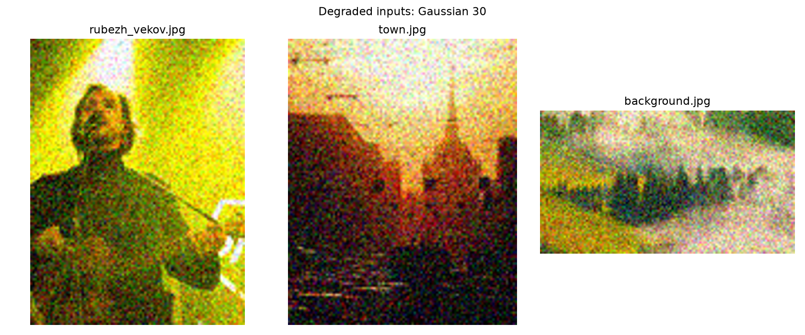

##### Пуассоновский шум, peak=30

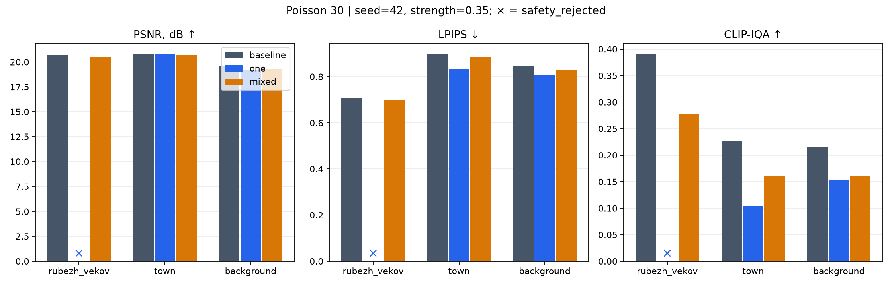

**Шум на входе: Пуассоновский шум, peak=30.**

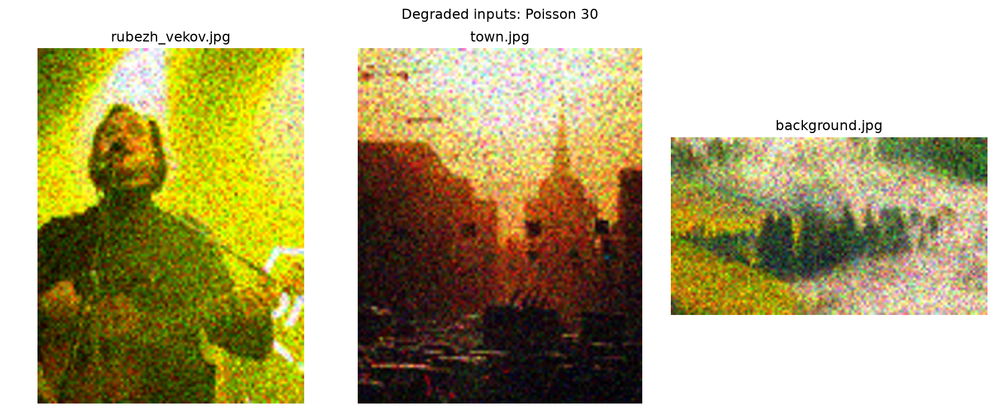

##### Пуассоновский шум, peak=10

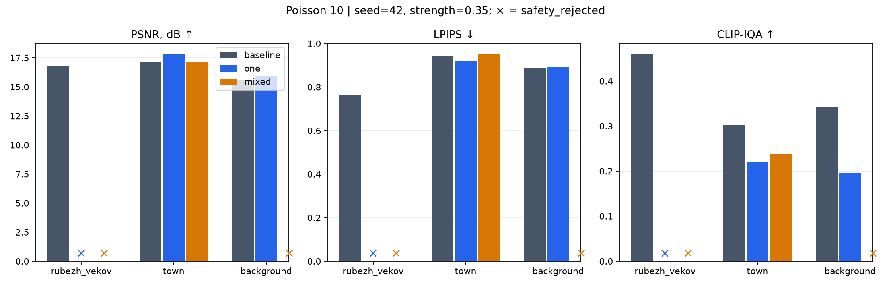

**Шум на входе: Пуассоновский шум, peak=10.**

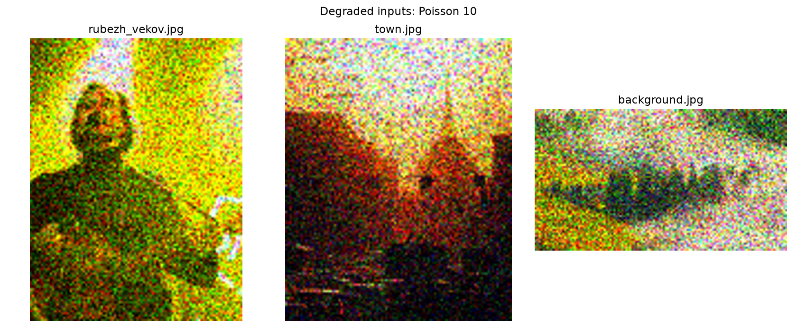

##### Импульсный шум salt-and-pepper, 1%

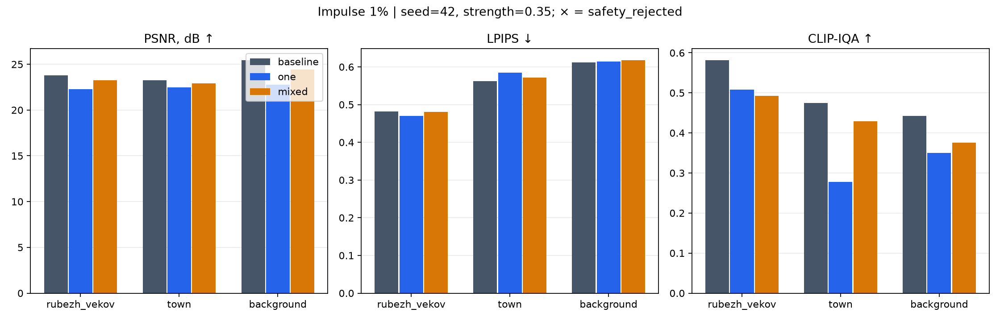

**Шум на входе: Импульсный шум salt-and-pepper, 1%.**

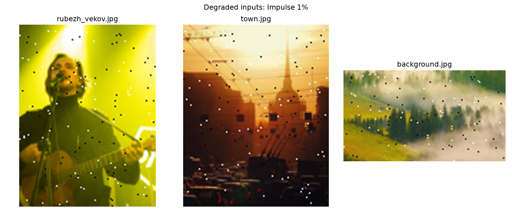

##### Импульсный шум salt-and-pepper, 5%

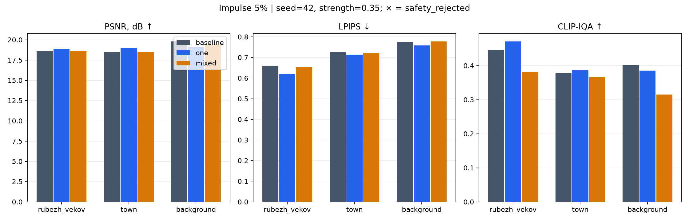

**Шум на входе: Импульсный шум salt-and-pepper, 5%.**

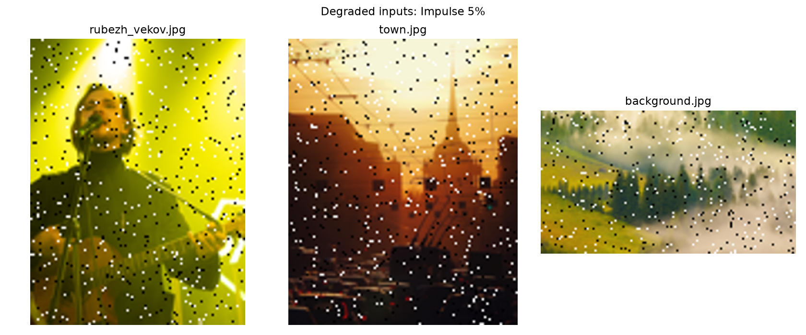

##### Размытие σ=1.2 + Gaussian σ=5 + JPEG quality=60

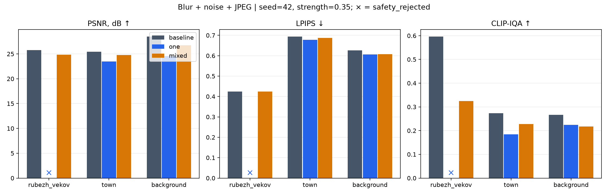

**Шум на входе: Размытие σ=1.2 + Gaussian σ=5 + JPEG quality=60.**

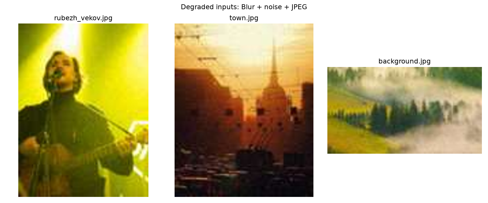

#### Что показывают отдельные шумы

- **Bicubic и слабый Gaussian σ=5.** На обеих основных фотографиях one и mixed ухудшают все три метрики относительно baseline. При небольших исходных искажениях выбранная диффузионная обработка вносит изменения, которые не оправдываются измеренным качеством.
- **Gaussian σ=15/30.** При σ=15 LPIPS улучшается на обеих основных фотографиях, но PSNR и CLIP-IQA снижаются. При σ=30 у town PSNR возрастает с 20.491 до 20.841 дБ для one, LPIPS снижается с 0.9270 до 0.8752, однако CLIP-IQA падает с 0.2478 до 0.1798. У rubezh_vekov полная маска отклонена; по ней вывода о качестве нет.
- **Poisson peak=30/10.** Снижение peak усиливает искажение: baseline PSNR у rubezh_vekov падает с 20.727 до 16.830 дБ, у town — с 20.819 до 17.123 дБ. Для town при peak=10 полная маска повышает PSNR до 17.842 дБ и снижает LPIPS до 0.9206, но ухудшает CLIP-IQA. При этом mixed повышает PSNR лишь до 17.159 дБ и ухудшает LPIPS до 0.9524. У rubezh_vekov при peak=10 обе обработки отклонены.
- **Salt-and-pepper 1%/5%.** При 1% на rubezh_vekov LPIPS улучшается, но PSNR и CLIP-IQA снижаются. При 5% полная маска на этой фотографии улучшает все три показателя: PSNR 18.586→18.890 дБ, LPIPS 0.6584→0.6210, CLIP-IQA 0.4466→0.4705. Это конкретный удачный случай, а не доказательство универсального преимущества метода.
- **Blur + noise + JPEG.** Это совместное воздействие размытия σ=1.2, Gaussian σ=5 и JPEG quality=60. По этому опыту нельзя отделить вклад каждого компонента. У rubezh_vekov mixed почти не меняет LPIPS (0.4246→0.4242), но снижает PSNR (25.788→24.837 дБ) и CLIP-IQA (0.5958→0.3243); one отклонена.

Таблица для background приведена отдельно, поскольку это дополнительная фотография с естественной дымкой; она не включена в статистику 31 успешного сравнения выше. Сравнивать численные параметры разных семейств напрямую нельзя: σ=15 и peak=15 не задают одинаковую силу искажения. Для частичной маски полный кадр включает неизменённый шумный фон, поэтому её метрики не характеризуют только обработанную ROI.

Числа взяты из [основного CSV](results/metrics.csv) и [CSV пейзажа](results_background/metrics.csv). В этих опытах изменяется деградация входа; распределение латентного шума SD остаётся гауссовским. Исследование охватывает выбранные фотографии и настройки, без статистического обобщения на другие изображения.

### 3.3. Результаты повторов

Для one при Gaussian σ=15 смена seed 42→123 изменила PSNR на 0.350 дБ у нового изображения и 0.081 дБ у town; абсолютные изменения LPIPS составили 0.0033 и 0.0166. Даже для zero CLIP-IQA нового изображения изменилась на 0.0899 при изменении PSNR всего на 0.006 дБ: здесь меняется только реализация входного шума. Эти два прогона показывают чувствительность измерений, но не дают доверительных интервалов.

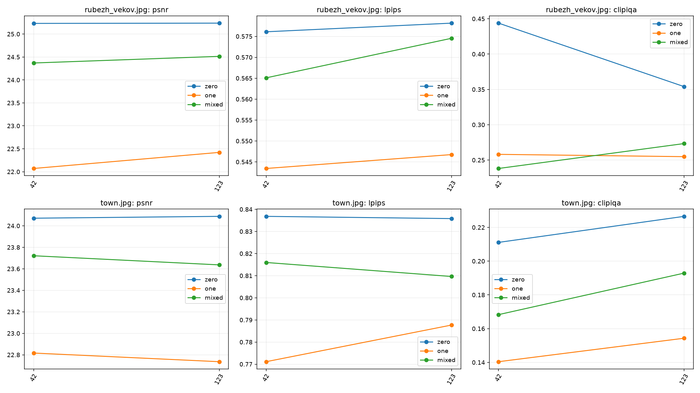

### 3.4. Результаты изменения strength

Для полной маски переход strength 0.2→0.5 дал следующие изменения:

| Фото | PSNR | LPIPS | CLIP-IQA |
|---|---:|---:|---:|
| rubezh_vekov | 23.793 → 19.869 | 0.5222 → 0.4965 | 0.2244 → 0.6344 |
| town | 23.641 → 20.977 | 0.7577 → 0.6480 | 0.1200 → 0.4436 |

Более интенсивное уточнение полной маски улучшает здесь обе перцептивные оценки ценой точности пикселей. Для mixed закономерность другая: LPIPS нового изображения почти не меняется (0.5630→0.5633), а у town ухудшается (0.8116→0.8322). Универсально лучшего strength для всех масок и метрик не обнаружено.

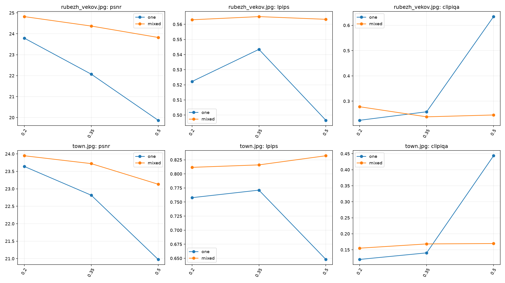

### Визуальные сравнения

Слева направо: опорное изображение, baseline, zero, one, mixed, circle, blocks. Условия: Gaussian σ=15, seed=42, strength=0.35.

Для карт ниже различаются **опорная фотография** (эталон после уменьшения до 512 px) и **вход алгоритма** (фотография после уменьшения ×4, шума и увеличения bicubic). Это позволяет увидеть и внесённые изменения, и их влияние на точность восстановления.

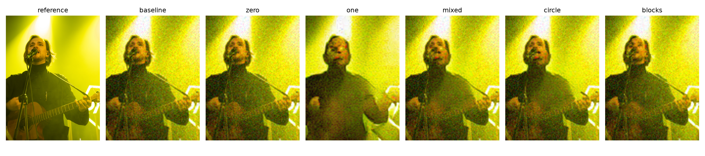

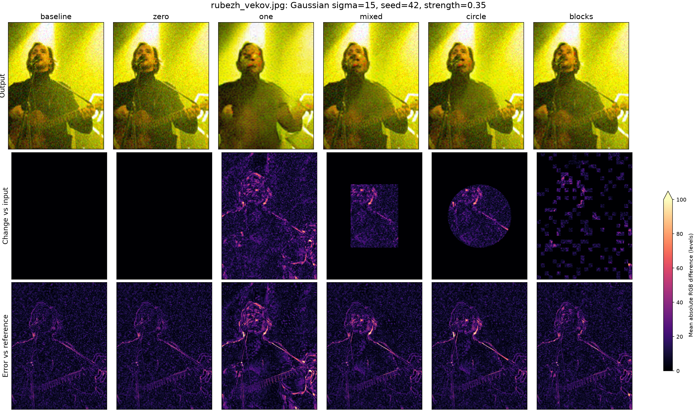

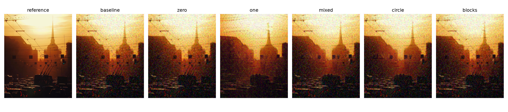

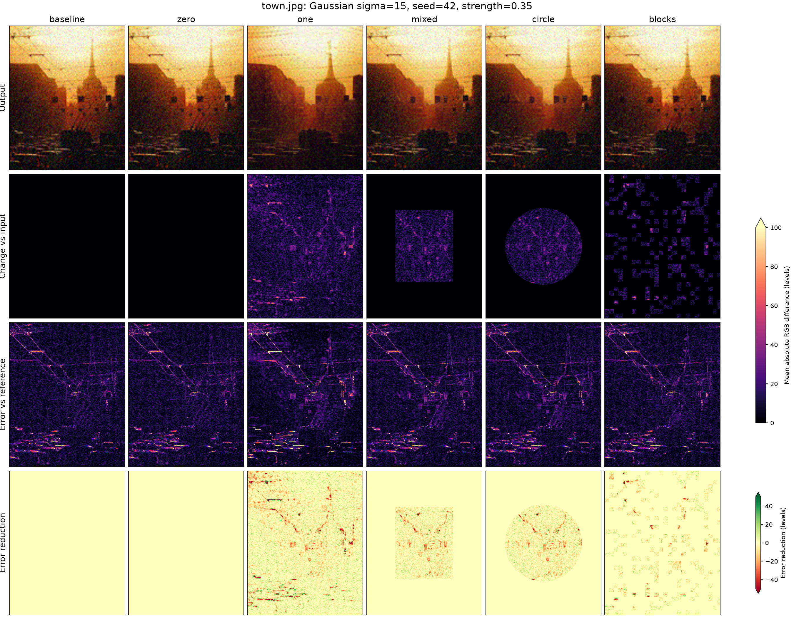

На каждой большой панели столбцы соответствуют **baseline, zero, one, mixed, circle, blocks**, а строки читаются так:

| Строка | Что показано | Как читать |
|---|---|---|
| Output | Результат обработки | Сравнивать детали и границы ROI |
| Change vs input | Среднее по RGB значение `abs(результат − вход)` | Чёрный — пиксели не изменились; светлый — сильное изменение |
| Error vs reference | Среднее по RGB значение `abs(результат − опорная фотография)` | Чем темнее, тем меньше ошибка относительно эталона |
| Error reduction | Ошибка входа минус ошибка результата относительно эталона | Зелёный — ошибка уменьшилась; красный — увеличилась; жёлтый — почти без изменений |

Шкалы **одинаковы для всех масок и обеих фотографий**: абсолютные различия показаны в диапазоне 0–100 уровней яркости, изменение ошибки — от −50 до +50. Значения за пределами шкалы отображаются крайним цветом и обозначены стрелками на цветовых легендах; сами изображения и метрики не изменяются. Усиленный диапазон делает небольшие различия заметнее.

У baseline и zero первая карта полностью чёрная, а карта изменения ошибки нейтральная. У частичных масок изменения относительно входа строго ограничены ROI. При этом светлая область на карте изменений не означает улучшения: направление изменения качества нужно смотреть по последней строке. Эти карты используют абсолютную ошибку пикселей, поэтому не заменяют LPIPS и CLIP-IQA.

Для повторного построения карт без запуска модели: `.\LW3\.venv\Scripts\python.exe LW3/comparison_maps.py`. Они также автоматически создаются при построении полного отчёта.

### 3.5. Дополнительный пейзаж с дымкой: background.jpg

На фотографии [background.jpg](input/background.jpg) показан лесной пейзаж с естественной дымкой. Исходный размер — **3840×2160**, опорный — **512×288**. Затем, как и в предыдущих опытах, выполняются уменьшение ×4, выбранная деградация и увеличение bicubic. Дымка уже присутствует в опорном изображении: это проверка SR на таком пейзаже, а не эксперимент с известным чистым эталоном без тумана.

Для фотографии выполнен тот же полный протокол: **52 опыта, 50 успешных измерений и 2 отклонения** штатной проверкой модели. Использованы SD 1.5, DDIM, seed=42 (дополнительно 123), steps=30, strength=0.35 (дополнительно 0.2/0.5), guidance=5 и прежние текстовые условия. Результаты предыдущих фотографий сохранены отдельно и не заменялись.

| Маска | Strength | PSNR ↑ | LPIPS ↓ | CLIP-IQA ↑ |
|---|---:|---:|---:|---:|
| baseline / zero | 0.35 | 25.472 | 0.7541 | 0.3450 |
| one | 0.35 | 21.556 | 0.7239 | 0.1742 |
| mixed | 0.35 | 24.186 | 0.7369 | 0.2539 |
| one | 0.2 | 23.942 | 0.6721 | 0.1769 |
| one | 0.5 | 20.581 | 0.6277 | 0.2110 |

Условия таблицы: Gaussian σ=15, seed=42; метрики по полному кадру. В этой серии LPIPS после обработки снижается, но PSNR и CLIP-IQA ухудшаются относительно baseline. Таким образом, даже для пейзажа с дымкой выбранная конфигурация не показала согласованного улучшения по всем трём показателям. Меньший LPIPS сам по себе не доказывает роста резкости или точности деталей.

Опорная фотография:

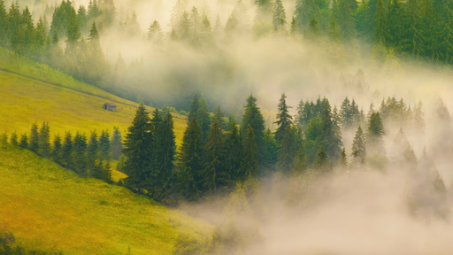

Сравнение: reference, baseline, zero, one, mixed, circle, blocks. Условия — Gaussian σ=15, strength=0.35, seed=42:

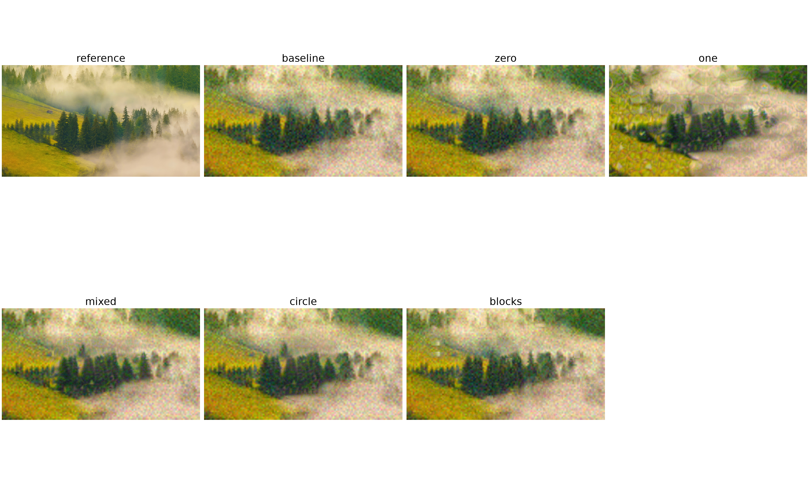

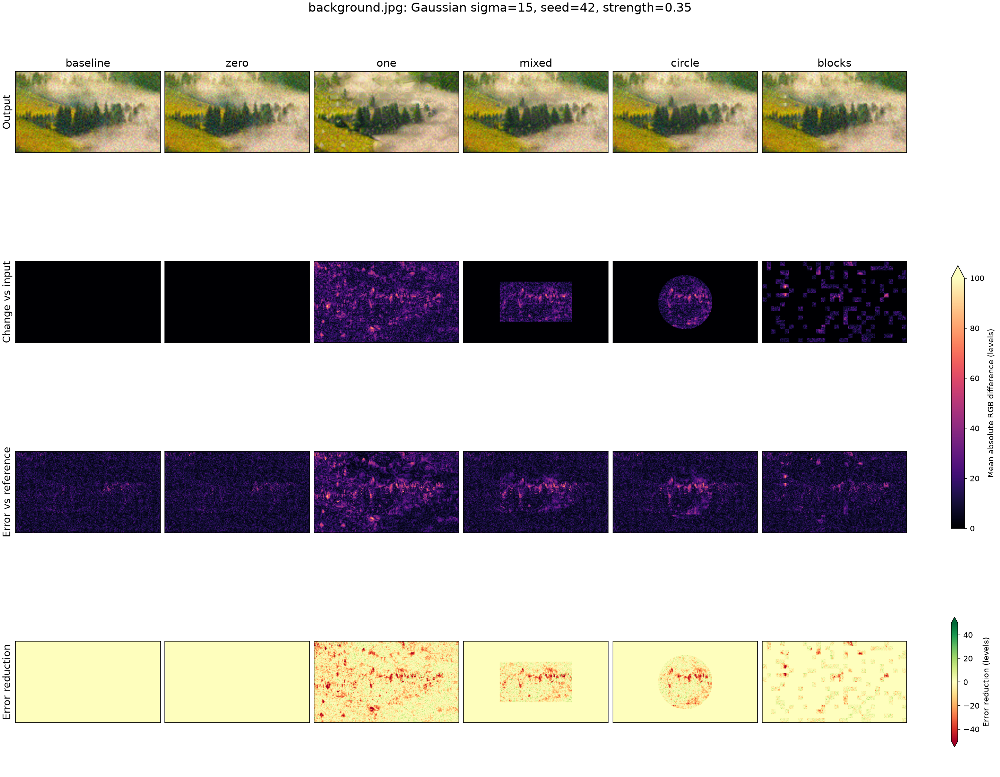

Карты читаются так же, как выше: результат, изменение относительно входа, ошибка относительно опорной фотографии и уменьшение ошибки. Естественная дымка не считается дефектом эталона, который алгоритм обязан удалить.

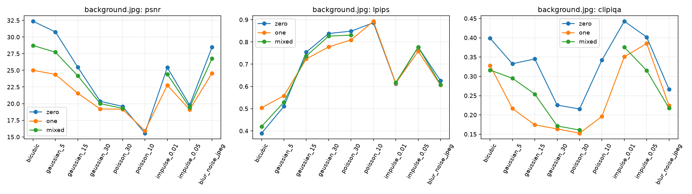

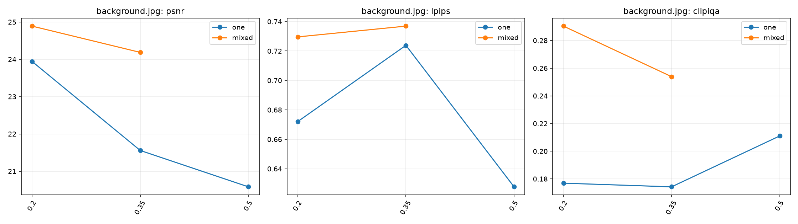

Все варианты масок, деградаций и seed приведены в [подробном отчёте](results_background/REPORT.md), [CSV с метриками](results_background/metrics.csv), [плане](results_background/plan.json) и [параметрах запуска](results_background/config.json). Отклонённые результаты отмечены в CSV как `safety_rejected` и не имеют метрик.

Повторный запуск с продолжением уже сохранённых опытов из корня репозитория:

```powershell
$env:TORCH_HOME = (Resolve-Path LW3/.cache/torch).Path
.\LW3\.venv\Scripts\python.exe LW3/experiment.py --hr LW3/background_input --output LW3/results_background --device auto
```

Папка `background_input` содержит копию только новой фотографии, чтобы не включать старые изображения в дополнительный запуск. Для пересчёта одних метрик к команде добавляется `--metrics-only`.

## 4. Выводы

Проверено ограничение восстановления на каждом шаге DDIM и точное сохранение пикселей вне маски. Выполнены четыре исследования на обеих пользовательских фотографиях, включая новое изображение и все выбранные шумы. Нулевая маска точно воспроизводит baseline; комбинированные маски локализуют изменения.

SD 1.5 в данной конфигурации не обеспечивает универсального улучшения SR: при strength=0.35 LPIPS часто снижается, а PSNR и CLIP-IQA преимущественно ухудшаются. Для полной маски strength=0.5 улучшает перцептивные оценки на обеих фотографиях, но дополнительно снижает точность относительно опорного изображения. Качество необходимо оценивать несколькими метриками и визуально, с учётом площади ROI, генеративных деталей и отклонённых случаев.

Демонстрационные исходники, их измерения и ссылки на них удалены. Все приведённые результаты относятся к `LW3/input`. Девять автоматических тестов проходят; дополнительно проверены 104 записи, конечность всех 99 троек метрик, SHA-256 PNG, 20 точных совпадений zero/baseline и неизменность фона.

## 5. Источники

1. [Задание](../LW3-2.pdf).
2. [Stable Diffusion 1.5: веса и лицензия](https://huggingface.co/stable-diffusion-v1-5/stable-diffusion-v1-5).
3. [DDIMScheduler](https://huggingface.co/docs/diffusers/api/schedulers/ddim).
4. [Diffusers: inpainting](https://huggingface.co/docs/diffusers/api/pipelines/stable_diffusion/inpaint).
5. [IQA-PyTorch](https://github.com/chaofengc/IQA-PyTorch).
