# Лабораторная работа №3 — SR-inpainting

[Подробное дополнение: определения, вывод формул, алгоритмы, схемы и сравнительные таблицы](additions.md).

Локальное восстановление пользовательских фотографий предобученной Stable Diffusion 1.5. Область обработки задаётся бинарным массивом H×W. Демонстрационные исходники и их результаты удалены; используются только фотографии из [input](input).

## 1. Теоретическая база

Super-resolution восстанавливает изображение высокого разрешения из деградированного входа. Здесь изображение уменьшается ×4, искажается шумом и увеличивается bicubic до размера опорной фотографии. Диффузия уточняет разрешённые маской области. SD 1.5 не специализирована на SR: правдоподобные детали могут отличаться от реальных, поэтому рост воспринимаемого качества не гарантирует роста PSNR. SUPIR в задании рекомендуется, но не обязателен.

VAE кодирует вход в латент `z0`, U-Net оценивает шум с текстовым условием, DDIM выполняет обратную диффузию. После **каждого шага**:

`z(t_next) = M * z_proposal(t_next) + (1-M) * z_reference(t_next)`.

`z_reference(t) = sqrt(alpha_bar[t])*z0 + sqrt(1-alpha_bar[t])*epsilon` — исходный латент с фиксированным шумом на соответствующем уровне. На последнем шаге вне ROI используется чистый `z0`. После декодирования возвращаются исходные пиксели вне ROI: одного ограничения латентов недостаточно из-за потерь VAE.

Единицы маски разрешают восстановление, нули сохраняют вход. Маска уменьшается ближайшим соседом; маленькие области могут теряться. Нулевая маска возвращает вход без вызова нейросети.

## 2. Разработанная система

| Файл | Назначение |
|---|---|
| [sr_inpainting.py](sr_inpainting.py) | Изменённый DDIM, проверка маски, CLI одного входа |
| [experiment.py](experiment.py) | Маски, деградации, PSNR, LPIPS, CLIP-IQA и запуск исследований |
| [research.py](research.py) | Матрица опытов, возобновление, таблицы, графики и сравнения |
| [test_inpainting.py](test_inpainting.py) | Проверки алгоритма и протокола |

Используются `town.jpg` (800×1000) и новое `rubezh_vekov.jpg` (4000×5328). Длинная сторона уменьшается до 512 px с сохранением пропорций; точные размеры записываются в `runtime.json`. JPEG служат опорными фотографиями для контролируемых искажений, их исходная чистота неизвестна. Метрики относятся к уменьшенным опорным изображениям.

Python 3.10+, PyTorch, Diffusers, Transformers и PyIQA. Поддержаны CPU и CUDA. Изображение дополняется до кратности 8 и обрезается после восстановления. Сохраняется штатная проверка безопасности SD. Модель восстановления освобождается перед загрузкой метрик для экономии RAM. Итоги сохраняются в PNG без потерь.

На имеющейся GTX 1660 Ti вычисления FP16 дали нечисловые значения. Для GTX 16xx автоматически используется FP32 и перенос компонентов CPU↔GPU, включая проверку безопасности. Проверки `isfinite` не допускают сохранения некорректного результата. Отклонённые safety checker опыты отмечаются `safety_rejected`: для них нет изображения и метрик, остальные опыты продолжаются.

Из корня репозитория:

```powershell
python -m venv LW3/.venv
.\LW3\.venv\Scripts\python.exe -m pip install -r LW3/requirements.txt

# CUDA-сборка, использованная на GTX 1660 Ti:
.\LW3\.venv\Scripts\python.exe -m pip install torch==2.7.1 torchvision==0.22.1 --index-url https://download.pytorch.org/whl/cu118

# Только подготовка пользовательских входов и масок:
.\LW3\.venv\Scripts\python.exe LW3/experiment.py --prepare-only

# Полные исследования; повторный запуск продолжает проверенные опыты:
.\LW3\.venv\Scripts\python.exe LW3/experiment.py --device auto

# Повторный расчёт метрик для уже восстановленных изображений:
.\LW3\.venv\Scripts\python.exe LW3/experiment.py --metrics-only

.\LW3\.venv\Scripts\python.exe -m unittest discover -s LW3 -v
```

По умолчанию модель читается из `LW3/.cache/sd15`; `--model` принимает папку Diffusers или ID модели. `download_model.py` и `download_metrics.py` скачивают официальные веса с возобновлением и проверкой SHA-256. `download_gpu.py` получает официальные CUDA wheels PyTorch 2.7.1 / torchvision 0.22.1 для Windows Python 3.12. [Официальные команды установки PyTorch](https://docs.pytorch.org/get-started/previous-versions/). Кэш исключён из Git. Для OpenAI CLIP закреплён `setuptools<81`, поскольку пакет использует `pkg_resources`.

Аргументы `--max-side`, `--steps`, `--strength`, `--seed`, `--prompt` сохраняются в конфигурации. Изменённые параметры требуют нового `--output`. Возобновление проверяет конфигурацию, параметры опыта и SHA-256 PNG.

## 3. Исследования

При настройках по умолчанию — **104 уникальных измерения**: 64 вызова диффузии, 20 нулевых масок и 20 baseline. Одинаковые опыты переиспользуются между исследованиями.

1. **Форма и площадь маски.** Для bicubic и Gaussian σ=15 сравниваются zero, one, mixed (центральный прямоугольник около 25%), left_half, circle, stripes и blocks (фиксированные блоки 16×16). Доли ROI указаны в CSV. Формы отличаются также площадью; это не изолированное исследование формы.
2. **Тип и сила шума.** Для zero/one/mixed на обеих фотографиях — bicubic без дополнительного шума; Gaussian σ=5/15/30 в шкале 0–255; Poisson peak=30/10; salt-and-pepper 1%/5%; blur σ=1.2 + Gaussian σ=5 + JPEG quality=60. Шум добавляется в LR после уменьшения ×4, до увеличения; blur выполняется перед уменьшением. Меньший Poisson peak означает более сильный шум. Это собственные деградации, не DIV2K unknown или RealESRGAN.
3. **Повтор с другим seed.** Gaussian σ=15, zero/one/mixed, seed 42 и 123. Seed меняет входной и диффузионный шум; оценивается чувствительность всего процесса. Двух повторов недостаточно для статистически надёжных обобщений.
4. **Влияние strength.** Gaussian σ=15, one/mixed, strength 0.2/0.35/0.5. Расписание из 30 шагов фактически даёт 6/10/15 шагов уточнения. Guidance=5, eta=0; текстовые условия и seed фиксированы.

### Метрики

PSNR вычисляется по RGB полного кадра относительно опорной фотографии без обрезания границ; больше — лучше.

LPIPS и CLIP-IQA через PyIQA получают RGB [0,1] полного кадра: LPIPS меньше — лучше, CLIP-IQA больше — лучше. 

CLIP-IQA безэталонная и не измеряет достоверность деталей. Отдельно сохраняются PSNR ROI, доля ROI и максимальное изменение фона. Для пустой ROI PSNR отсутствует. Нулевая маска обязана совпадать с baseline. Неизменённый фон влияет на полные метрики частичных масок.

### Результаты и воспроизводимость

- `results/metrics.csv` — индивидуальные измерения всех опытов;
- `results/REPORT.md` — таблицы по четырём исследованиям;
- `results/masks.png`, `noise.png`, `strength.png` — графики;
- `results/comparison_*.png` — сравнения пользовательских фотографий;
- `results/images/` — опорные фотографии, деградации, маски и восстановленные PNG;
- `results/config.json`, `runtime.json`, `plan.json` — параметры, версии, размеры, источник весов и план.

**Запуск завершён:** 104 опыта, **99 успешных измерений и 5 отклонений** штатной проверкой SD. Для отклонений значения метрик отсутствуют. Все пять относятся к `rubezh_vekov.jpg`: полная маска при Gaussian σ=30, Poisson peak=30/10 и blur+noise+JPEG, а также mixed при Poisson peak=10. Чёрные заглушки не сохранялись и не оценивались.

Полные результаты: [таблицы четырёх исследований](results/REPORT.md), [104 записи CSV](results/metrics.csv), [конфигурация](results/config.json), [окружение и источник весов](results/runtime.json), [точные версии пакетов](results/environment.txt). Реальные размеры опорных фотографий — 384×512 и 410×512. Расчёт выполнен на GTX 1660 Ti 6 ГБ, PyTorch 2.7.1+cu118, FP32 с переносом компонентов между CPU и GPU.

### 3.1. Результаты сравнения масок

Ниже Gaussian σ=15, seed=42, strength=0.35. Baseline и zero совпали по всем трём метрикам во всех 20 условиях. Максимальное изменение пикселя вне маски для всех успешных опытов — **0**.

| Фото | Маска | PSNR ↑ | LPIPS ↓ | CLIP-IQA ↑ |
|---|---|---:|---:|---:|
| rubezh_vekov | baseline / zero | 25.232 | 0.5761 | 0.4438 |
| rubezh_vekov | one | 22.071 | 0.5434 | 0.2581 |
| rubezh_vekov | mixed | 24.369 | 0.5651 | 0.2381 |
| rubezh_vekov | left_half | 23.376 | 0.5556 | 0.2277 |
| rubezh_vekov | circle | 24.349 | 0.5652 | 0.2428 |
| rubezh_vekov | stripes | 23.703 | 0.5543 | 0.2391 |
| rubezh_vekov | blocks | 24.504 | 0.5556 | 0.2626 |
| town | baseline / zero | 24.071 | 0.8368 | 0.2111 |
| town | one | 22.816 | 0.7711 | 0.1404 |
| town | mixed | 23.721 | 0.8160 | 0.1683 |
| town | left_half | 23.109 | 0.7998 | 0.1702 |
| town | circle | 23.724 | 0.8140 | 0.1541 |
| town | stripes | 23.492 | 0.7803 | 0.1549 |
| town | blocks | 23.800 | 0.7986 | 0.1742 |

При этом шуме все ненулевые маски снизили LPIPS, но ухудшили PSNR и CLIP-IQA относительно baseline. Частичные маски сохраняют больше исходных пикселей и дают PSNR ближе к baseline. Их нельзя ранжировать только по форме: одновременно различаются площадь и содержание ROI.


Ниже показаны все **8 вариантов × 3 фотографии × 2 деградации = 48 результатов**. В каждой панели восемь столбцов: **baseline, zero, one, mixed, left_half, circle, stripes, blocks**. Верхняя строка — bicubic без дополнительного шума, нижняя — Gaussian σ=15. Везде seed=42 и strength=0.35. Baseline — вход без восстановления; zero должен совпадать с ним.

**rubezh_vekov.jpg**


**town.jpg**


**background.jpg**


Для background панель разбита на **четыре ряда по четыре изображения**: первые два ряда — bicubic, следующие два — Gaussian σ=15. В каждой паре рядов сначала идут baseline, zero, one, mixed, затем left_half, circle, stripes, blocks.

#### Внешний вид масок на трёх фотографиях

Для каждой фотографии ниже показаны все **семь бинарных масок** и их наложение на опорное изображение. В каждой паре рядов сверху — сама маска, снизу — та же область на фото. **Белое на маске и красное наложение разрешают обработку; чёрное и отсутствие наложения означают сохранение входных пикселей.** В подписях указана доля обрабатываемой области ROI.

Baseline не имеет маски: это вход без восстановления. Zero — полностью чёрная маска, one — полностью белая. Для bicubic и Gaussian на одной фотографии геометрия масок одинакова, поэтому повторять её для каждого шума не требуется.

**rubezh_vekov.jpg — маски и области обработки**

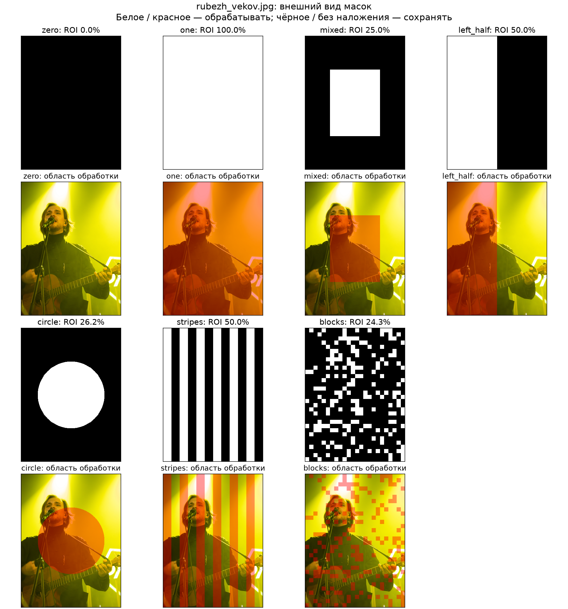

**town.jpg — маски и области обработки**

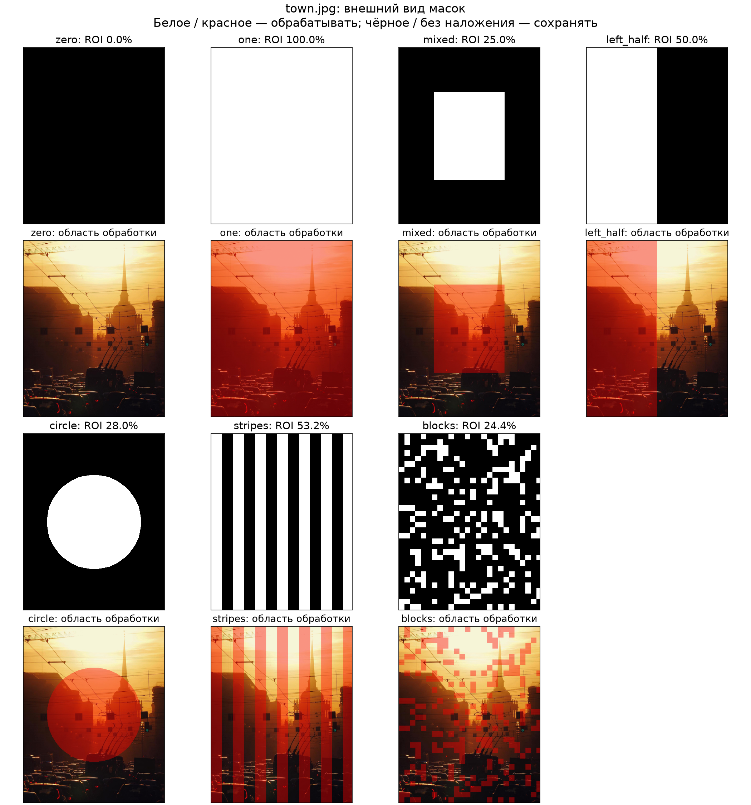

**background.jpg — маски и области обработки**

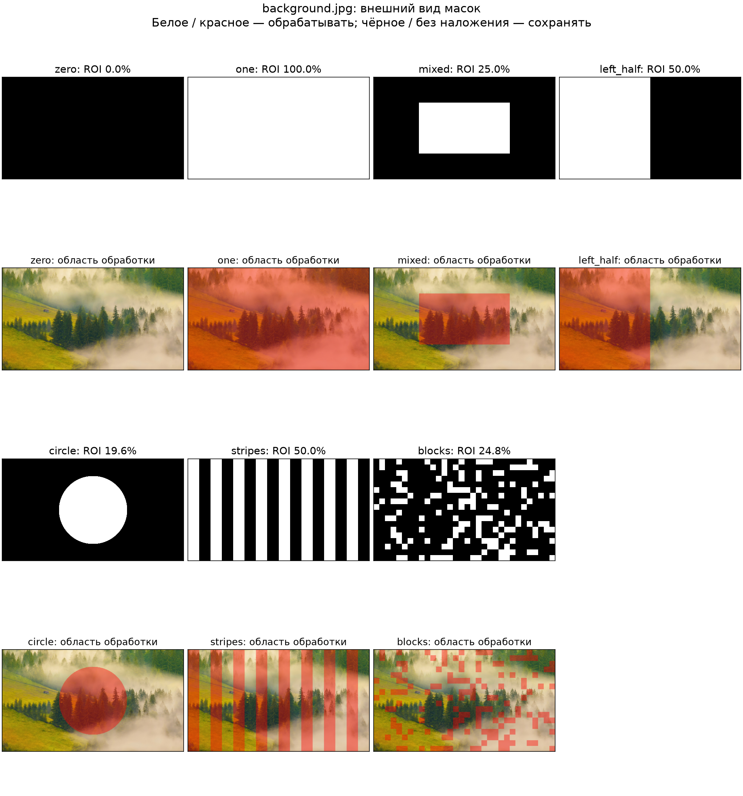

Панели можно открыть в полном размере для сравнения деталей. Они построены из сохранённых PNG; повторное построение без запуска модели: `.\LW3\.venv\Scripts\python.exe LW3/mask_comparisons.py`.


### 3.2. Результаты для разных шумов

**Итоговое исследование по пяти повторам каждого условия.**

Ранее графики этого раздела описывали один запуск с seed=42. Теперь для каждого из девяти условий на каждой из трёх фотографий выполнено **пять повторов** с seed **42, 123, 204, 285, 366**. В каждом повторе меняются и реализация входного шума, и начальный шум диффузии. Для baseline, one и mixed внутри одного повтора используется один и тот же вход. Проверенные результаты старых seed переиспользованы, остальные рассчитаны заново.

Параметры фиксированы: уменьшение ×4, опорная длинная сторона 512 px, SD 1.5, steps=30, strength=0.35 (10 шагов DDIM), guidance=5, eta=0. Для каждого результата один раз рассчитаны PSNR, LPIPS и CLIP-IQA, затем усреднены **метрики пяти повторов**, а не сами изображения. Пять одинаковых запусков с одним seed не давали бы оценки разброса.

**Все итоговые графики ниже показывают среднее ± выборочное стандартное отклонение (SD, ddof=1).** Это разброс повторов, не доверительный интервал. Статусы отклонения модели не заменяются нулями: при отклонениях среднее считается по доступным результатам, а число успешных повторов указано как n/5. При n=0 среднее отсутствует; при n=1 разброс оценить нельзя (нулевая длина полосы не означает отсутствие случайности).

Всего **405 условий**: 3 фотографии × 9 деградаций × 5 seed × 3 варианта (baseline/one/mixed). Успешных измерений: **390**, отклонений: **15**. Zero отдельно не запускается: нулевая маска возвращает baseline без вызова модели. В bicubic нет случайного входного шума: пять baseline одинаковы, и их SD=0; случайность сохраняется в восстановлении.

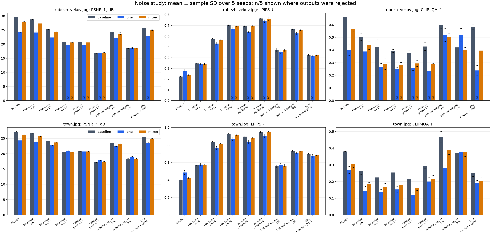
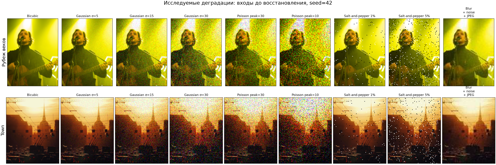
[Открыть панель в полном размере](results_noise_repeats/noise_inputs_two_rows.png).


**Проверка прежнего наблюдения для town.** При Gaussian σ=15 baseline CLIP-IQA равна 0.2245 ± 0.0089, при σ=30 — 0.2546 ± 0.0098. Средний PSNR меняется с 24.088 до 20.537 дБ. Рост среднего CLIP-IQA при усилении шума сохраняется и после усреднения. Это описательный результат пяти повторов; одного сравнения средних недостаточно для вывода о статистической значимости или точности реальных деталей.

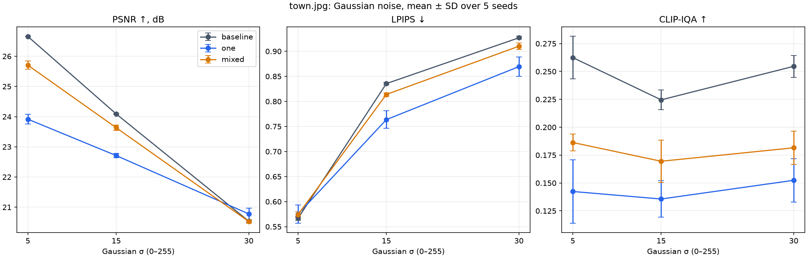

#### Средние значения по фотографиям

Слева на панелях — средние значения метрик, справа — **среднее парное изменение относительно baseline того же seed**. Выше нуля всегда лучше: результат − baseline для PSNR и CLIP-IQA, baseline − результат для LPIPS. При отклонениях для парного сравнения используются только успешные пары, а не разность средних по разным наборам seed.

В таблицах в каждой ячейке: **PSNR / LPIPS / CLIP-IQA**, каждое значение в формате **среднее ± SD**, затем число успешных повторов **n/5**.

**rubezh_vekov.jpg**


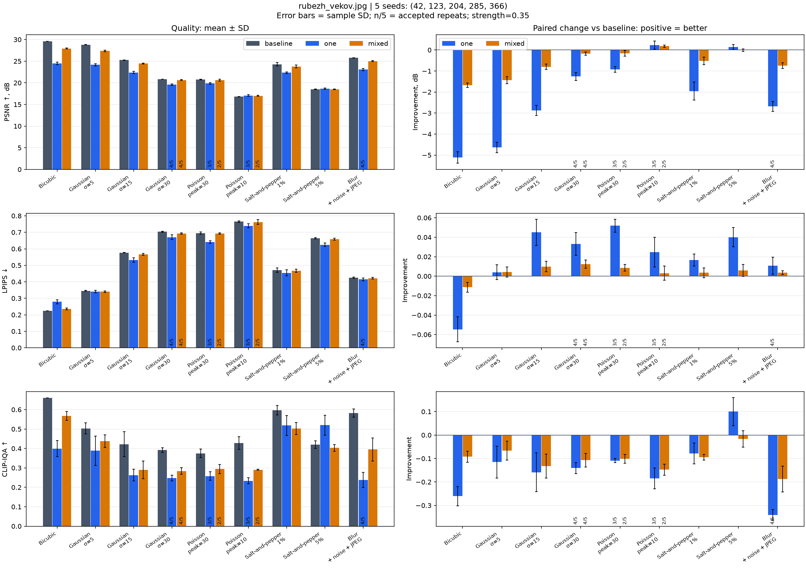

[Векторная версия SVG](results_noise_repeats/noise_detail_rubezh_vekov.svg).

| Деградация | Baseline / zero | One | Mixed |
|---|---|---|---|
| Bicubic | 29.6141 ± 0.0000 / 0.2244 ± 0.0000 / 0.6599 ± 0.0000 (n=5/5) | 24.4947 ± 0.2702 / 0.2790 ± 0.0127 / 0.3991 ± 0.0415 (n=5/5) | 27.9380 ± 0.1062 / 0.2358 ± 0.0050 / 0.5675 ± 0.0231 (n=5/5) |
| Gaussian σ=5 | 28.8130 ± 0.0087 / 0.3451 ± 0.0027 / 0.5035 ± 0.0287 (n=5/5) | 24.1762 ± 0.2518 / 0.3410 ± 0.0080 / 0.3883 ± 0.0751 (n=5/5) | 27.3758 ± 0.1641 / 0.3408 ± 0.0047 / 0.4374 ± 0.0326 (n=5/5) |
| Gaussian σ=15 | 25.2525 ± 0.0169 / 0.5768 ± 0.0015 / 0.4221 ± 0.0638 (n=5/5) | 22.3765 ± 0.2514 / 0.5317 ± 0.0133 / 0.2631 ± 0.0305 (n=5/5) | 24.4548 ± 0.1305 / 0.5668 ± 0.0052 / 0.2903 ± 0.0453 (n=5/5) |
| Gaussian σ=30 | 20.8342 ± 0.0190 / 0.7034 ± 0.0035 / 0.3917 ± 0.0125 (n=5/5) | 19.5821 ± 0.1960 / 0.6705 ± 0.0139 / 0.2481 ± 0.0148 (n=4/5) | 20.6547 ± 0.0894 / 0.6926 ± 0.0044 / 0.2841 ± 0.0174 (n=4/5) |
| Poisson peak=30 | 20.7748 ± 0.0549 / 0.6956 ± 0.0068 / 0.3752 ± 0.0227 (n=5/5) | 19.8540 ± 0.1925 / 0.6408 ± 0.0077 / 0.2582 ± 0.0214 (n=3/5) | 20.6182 ± 0.2005 / 0.6929 ± 0.0046 / 0.2941 ± 0.0241 (n=2/5) |
| Poisson peak=10 | 16.8129 ± 0.0421 / 0.7651 ± 0.0046 / 0.4278 ± 0.0327 (n=5/5) | 17.0521 ± 0.1794 / 0.7394 ± 0.0131 / 0.2335 ± 0.0154 (n=3/5) | 16.9856 ± 0.1188 / 0.7624 ± 0.0148 / 0.2905 ± 0.0021 (n=2/5) |
| Salt-and-pepper 1% | 24.2885 ± 0.3885 / 0.4712 ± 0.0127 / 0.5966 ± 0.0245 (n=5/5) | 22.3319 ± 0.1920 / 0.4545 ± 0.0176 / 0.5182 ± 0.0506 (n=5/5) | 23.7701 ± 0.3149 / 0.4677 ± 0.0097 / 0.5020 ± 0.0308 (n=5/5) |
| Salt-and-pepper 5% | 18.5111 ± 0.0531 / 0.6648 ± 0.0037 / 0.4199 ± 0.0201 (n=5/5) | 18.6457 ± 0.1551 / 0.6248 ± 0.0103 / 0.5199 ± 0.0509 (n=5/5) | 18.5075 ± 0.0723 / 0.6588 ± 0.0063 / 0.4031 ± 0.0176 (n=5/5) |
| Blur + noise + JPEG | 25.7759 ± 0.0217 / 0.4253 ± 0.0037 / 0.5826 ± 0.0214 (n=5/5) | 23.0873 ± 0.2515 / 0.4147 ± 0.0087 / 0.2387 ± 0.0390 (n=4/5) | 25.0286 ± 0.1364 / 0.4218 ± 0.0046 / 0.3951 ± 0.0592 (n=5/5) |

**town.jpg**


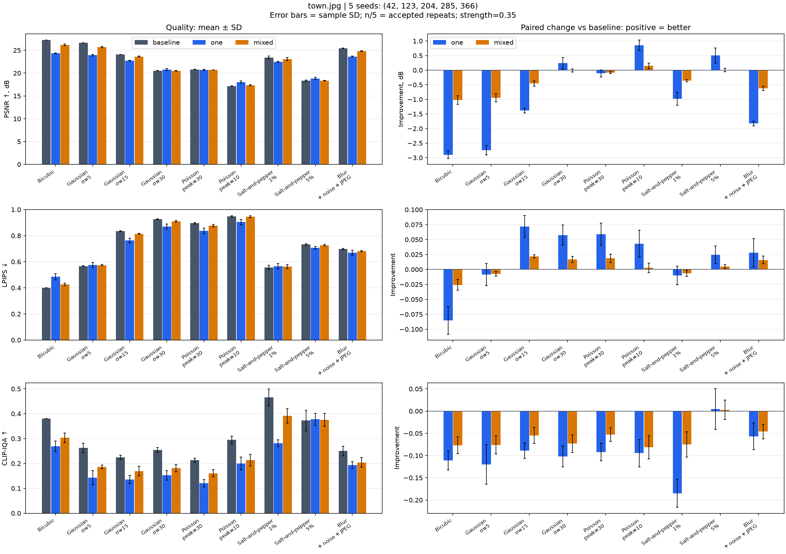

[Векторная версия SVG](results_noise_repeats/noise_detail_town.svg).

| Деградация | Baseline / zero | One | Mixed |
|---|---|---|---|
| Bicubic | 27.2129 ± 0.0000 / 0.4007 ± 0.0000 / 0.3800 ± 0.0000 (n=5/5) | 24.3165 ± 0.1308 / 0.4857 ± 0.0232 / 0.2690 ± 0.0213 (n=5/5) | 26.1902 ± 0.1446 / 0.4266 ± 0.0092 / 0.3033 ± 0.0191 (n=5/5) |
| Gaussian σ=5 | 26.6565 ± 0.0043 / 0.5666 ± 0.0040 / 0.2624 ± 0.0191 (n=5/5) | 23.9157 ± 0.1624 / 0.5751 ± 0.0182 / 0.1424 ± 0.0284 (n=5/5) | 25.7048 ± 0.1368 / 0.5740 ± 0.0058 / 0.1863 ± 0.0076 (n=5/5) |
| Gaussian σ=15 | 24.0882 ± 0.0142 / 0.8355 ± 0.0025 / 0.2245 ± 0.0089 (n=5/5) | 22.7100 ± 0.0743 / 0.7636 ± 0.0176 / 0.1356 ± 0.0164 (n=5/5) | 23.6327 ± 0.0852 / 0.8138 ± 0.0035 / 0.1695 ± 0.0190 (n=5/5) |
| Gaussian σ=30 | 20.5369 ± 0.0307 / 0.9270 ± 0.0029 / 0.2546 ± 0.0098 (n=5/5) | 20.7774 ± 0.1847 / 0.8694 ± 0.0194 / 0.1524 ± 0.0194 (n=5/5) | 20.5271 ± 0.0574 / 0.9101 ± 0.0066 / 0.1816 ± 0.0150 (n=5/5) |
| Poisson peak=30 | 20.8014 ± 0.0243 / 0.8956 ± 0.0059 / 0.2132 ± 0.0079 (n=5/5) | 20.6949 ± 0.1204 / 0.8366 ± 0.0220 / 0.1211 ± 0.0148 (n=5/5) | 20.7212 ± 0.0193 / 0.8769 ± 0.0100 / 0.1604 ± 0.0143 (n=5/5) |
| Poisson peak=10 | 17.1683 ± 0.0643 / 0.9475 ± 0.0051 / 0.2949 ± 0.0156 (n=5/5) | 18.0241 ± 0.2348 / 0.9044 ± 0.0208 / 0.2002 ± 0.0255 (n=5/5) | 17.3169 ± 0.1262 / 0.9449 ± 0.0071 / 0.2134 ± 0.0237 (n=5/5) |
| Salt-and-pepper 1% | 23.4341 ± 0.3244 / 0.5561 ± 0.0165 / 0.4661 ± 0.0335 (n=5/5) | 22.4519 ± 0.1365 / 0.5661 ± 0.0211 / 0.2813 ± 0.0133 (n=5/5) | 23.0705 ± 0.3227 / 0.5625 ± 0.0160 / 0.3911 ± 0.0286 (n=5/5) |
| Salt-and-pepper 5% | 18.3505 ± 0.1065 / 0.7320 ± 0.0055 / 0.3727 ± 0.0415 (n=5/5) | 18.8535 ± 0.2477 / 0.7074 ± 0.0092 / 0.3774 ± 0.0240 (n=5/5) | 18.3552 ± 0.0853 / 0.7272 ± 0.0055 / 0.3755 ± 0.0255 (n=5/5) |
| Blur + noise + JPEG | 25.4557 ± 0.0053 / 0.6977 ± 0.0045 / 0.2500 ± 0.0197 (n=5/5) | 23.6274 ± 0.0836 / 0.6695 ± 0.0196 / 0.1933 ± 0.0135 (n=5/5) | 24.8356 ± 0.0802 / 0.6818 ± 0.0052 / 0.2039 ± 0.0193 (n=5/5) |


#### Каждый шум: средние метрики и пример входа

Графики рассчитаны по пяти seed. Фотографии под каждым графиком — **пример входного шума для seed=42**, а не усреднённая картинка.

##### Bicubic

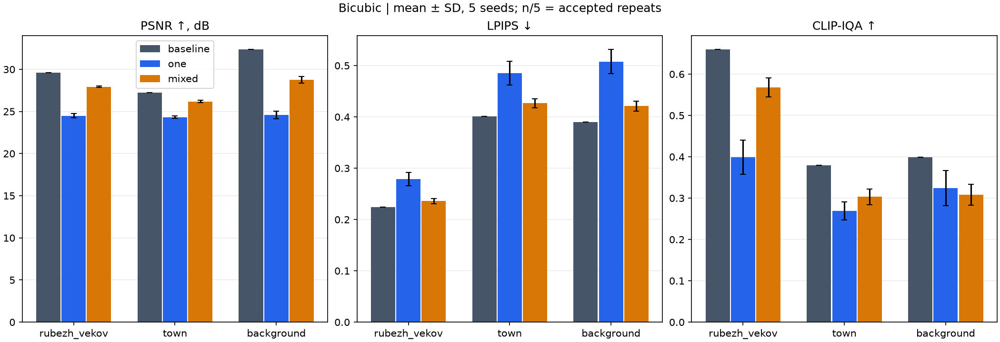

**Шум на входе: Bicubic, пример seed=42.**


##### Gaussian σ=5

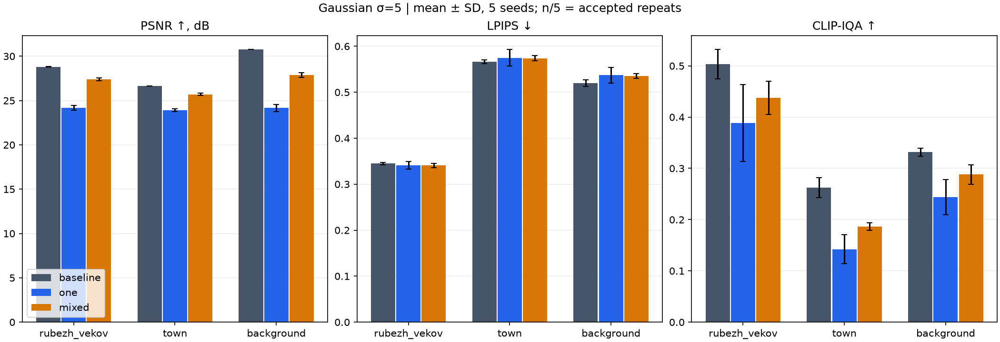

**Шум на входе: Gaussian σ=5, пример seed=42.**


##### Gaussian σ=15

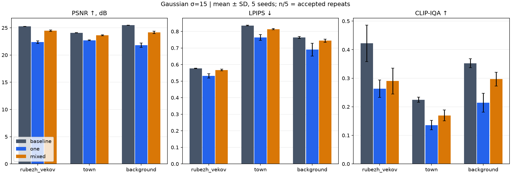

**Шум на входе: Gaussian σ=15, пример seed=42.**


##### Gaussian σ=30

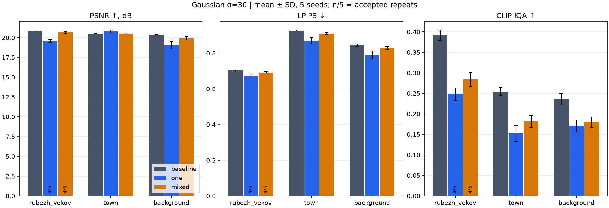

**Шум на входе: Gaussian σ=30, пример seed=42.**


##### Poisson peak=30

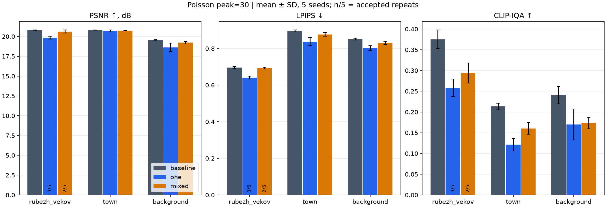

**Шум на входе: Poisson peak=30, пример seed=42.**


##### Poisson peak=10

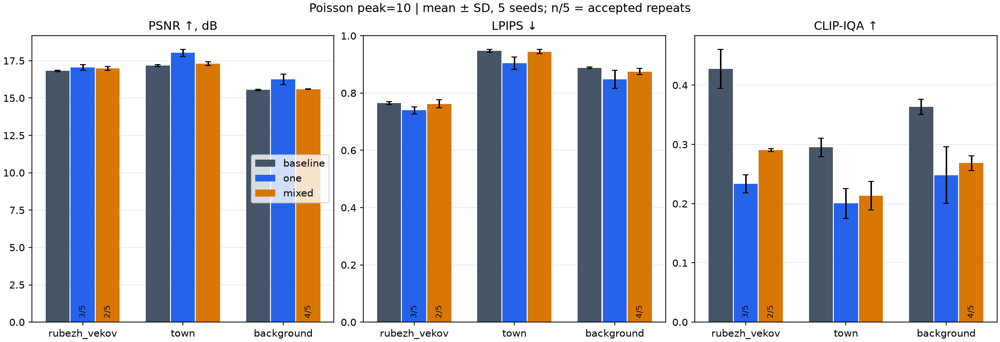

**Шум на входе: Poisson peak=10, пример seed=42.**


##### Salt-and-pepper 1%

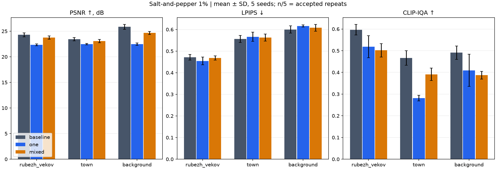

**Шум на входе: Salt-and-pepper 1%, пример seed=42.**


##### Salt-and-pepper 5%

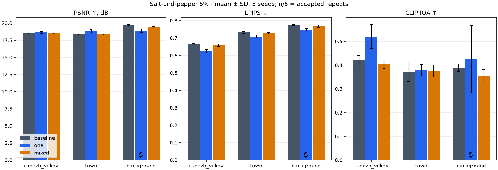

**Шум на входе: Salt-and-pepper 5%, пример seed=42.**


##### Blur + noise + JPEG

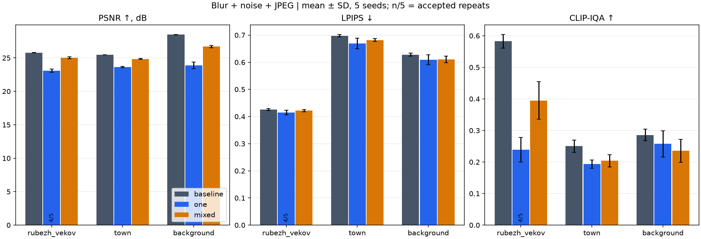

**Шум на входе: Blur + noise + JPEG, пример seed=42.**


#### Ограничения и воспроизводимость

Нужно учитывать отклонения штатной проверкой модели: при n<5 средние условны по успешным результатам и могут быть смещены. Повторы показывают чувствительность к случайности на этих трёх фотографиях, а не качество на большом датасете. Полные метрики частичной маски учитывают неизменённый шумный фон. Разные семейства шума не имеют общей числовой шкалы силы; составной blur+noise+JPEG не позволяет отделить вклад каждого компонента.

[Все 405 индивидуальных условий](results_noise_repeats/metrics.csv), [81 строка средних, SD и парных изменений](results_noise_repeats/summary.csv), [Конфигурация и источники весов](results_noise_repeats/config.json), [План](results_noise_repeats/plan.json). Исходные одиночные измерения сохранены в `results` и `results_background`; другие разделы отчёта по-прежнему описывают указанные в них seed.

Повторный запуск: `.\LW3\.venv\Scripts\python.exe LW3/noise_repeats.py`. Только пересборка средних и графиков: добавьте `--stage report`.

### 3.3. Результаты повторов

Для one при Gaussian σ=15 смена seed 42→123 изменила PSNR на 0.350 дБ у нового изображения и 0.081 дБ у town; абсолютные изменения LPIPS составили 0.0033 и 0.0166. Даже для zero CLIP-IQA нового изображения изменилась на 0.0899 при изменении PSNR всего на 0.006 дБ: здесь меняется только реализация входного шума. Эти два прогона показывают чувствительность измерений, но не дают доверительных интервалов.


### 3.4. Результаты изменения strength

Для полной маски переход strength 0.2→0.5 дал следующие изменения:

| Фото | PSNR | LPIPS | CLIP-IQA |
|---|---:|---:|---:|
| rubezh_vekov | 23.793 → 19.869 | 0.5222 → 0.4965 | 0.2244 → 0.6344 |
| town | 23.641 → 20.977 | 0.7577 → 0.6480 | 0.1200 → 0.4436 |

Более интенсивное уточнение полной маски улучшает здесь обе перцептивные оценки ценой точности пикселей. Для mixed закономерность другая: LPIPS нового изображения почти не меняется (0.5630→0.5633), а у town ухудшается (0.8116→0.8322). Универсально лучшего strength для всех масок и метрик не обнаружено.


### Визуальные сравнения

Слева направо: опорное изображение, baseline, zero, one, mixed, circle, blocks. Условия: Gaussian σ=15, seed=42, strength=0.35.

Для карт ниже различаются **опорная фотография** (эталон после уменьшения до 512 px) и **вход алгоритма** (фотография после уменьшения ×4, шума и увеличения bicubic). Это позволяет увидеть и внесённые изменения, и их влияние на точность восстановления.


На каждой большой панели столбцы соответствуют **baseline, zero, one, mixed, circle, blocks**, а строки читаются так:

| Строка | Что показано | Как читать |
|---|---|---|
| Output | Результат обработки | Сравнивать детали и границы ROI |
| Change vs input | Среднее по RGB значение `abs(результат − вход)` | Чёрный — пиксели не изменились; светлый — сильное изменение |
| Error vs reference | Среднее по RGB значение `abs(результат − опорная фотография)` | Чем темнее, тем меньше ошибка относительно эталона |
| Error reduction | Ошибка входа минус ошибка результата относительно эталона | Зелёный — ошибка уменьшилась; красный — увеличилась; жёлтый — почти без изменений |

Шкалы **одинаковы для всех масок и обеих фотографий**: абсолютные различия показаны в диапазоне 0–100 уровней яркости, изменение ошибки — от −50 до +50. Значения за пределами шкалы отображаются крайним цветом и обозначены стрелками на цветовых легендах; сами изображения и метрики не изменяются. Усиленный диапазон делает небольшие различия заметнее.

У baseline и zero первая карта полностью чёрная, а карта изменения ошибки нейтральная. У частичных масок изменения относительно входа строго ограничены ROI. При этом светлая область на карте изменений не означает улучшения: направление изменения качества нужно смотреть по последней строке. Эти карты используют абсолютную ошибку пикселей, поэтому не заменяют LPIPS и CLIP-IQA.

Для повторного построения карт без запуска модели: `.\LW3\.venv\Scripts\python.exe LW3/comparison_maps.py`. Они также автоматически создаются при построении полного отчёта.

### 3.5. Дополнительный пейзаж с дымкой: background.jpg

На фотографии [background.jpg](input/background.jpg) показан лесной пейзаж с естественной дымкой. Исходный размер — **3840×2160**, опорный — **512×288**. Затем, как и в предыдущих опытах, выполняются уменьшение ×4, выбранная деградация и увеличение bicubic. Дымка уже присутствует в опорном изображении: это проверка SR на таком пейзаже, а не эксперимент с известным чистым эталоном без тумана.

Для фотографии выполнен тот же полный протокол: **52 опыта, 50 успешных измерений и 2 отклонения** штатной проверкой модели. Использованы SD 1.5, DDIM, seed=42 (дополнительно 123), steps=30, strength=0.35 (дополнительно 0.2/0.5), guidance=5 и прежние текстовые условия. Результаты предыдущих фотографий сохранены отдельно и не заменялись.

| Маска | Strength | PSNR ↑ | LPIPS ↓ | CLIP-IQA ↑ |
|---|---:|---:|---:|---:|
| baseline / zero | 0.35 | 25.472 | 0.7541 | 0.3450 |
| one | 0.35 | 21.556 | 0.7239 | 0.1742 |
| mixed | 0.35 | 24.186 | 0.7369 | 0.2539 |
| one | 0.2 | 23.942 | 0.6721 | 0.1769 |
| one | 0.5 | 20.581 | 0.6277 | 0.2110 |

Условия таблицы: Gaussian σ=15, seed=42; метрики по полному кадру. В этой серии LPIPS после обработки снижается, но PSNR и CLIP-IQA ухудшаются относительно baseline. Таким образом, даже для пейзажа с дымкой выбранная конфигурация не показала согласованного улучшения по всем трём показателям. Меньший LPIPS сам по себе не доказывает роста резкости или точности деталей.

Опорная фотография:


Сравнение: reference, baseline, zero, one, mixed, circle, blocks. Условия — Gaussian σ=15, strength=0.35, seed=42:


Карты читаются так же, как выше: результат, изменение относительно входа, ошибка относительно опорной фотографии и уменьшение ошибки. Естественная дымка не считается дефектом эталона, который алгоритм обязан удалить.


Все варианты масок, деградаций и seed приведены в [подробном отчёте](results_background/REPORT.md), [CSV с метриками](results_background/metrics.csv), [плане](results_background/plan.json) и [параметрах запуска](results_background/config.json). Отклонённые результаты отмечены в CSV как `safety_rejected` и не имеют метрик.

Повторный запуск с продолжением уже сохранённых опытов из корня репозитория:

```powershell
$env:TORCH_HOME = (Resolve-Path LW3/.cache/torch).Path
.\LW3\.venv\Scripts\python.exe LW3/experiment.py --hr LW3/background_input --output LW3/results_background --device auto
```

Папка `background_input` содержит копию только новой фотографии, чтобы не включать старые изображения в дополнительный запуск. Для пересчёта одних метрик к команде добавляется `--metrics-only`.

<!-- mask-size-study:start -->
### 3.6. Влияние размера маски на background.jpg

Выполнены два отдельных исследования с пятью размерами центральной маски: горизонтальный прямоугольник и круг. Во всех десяти опытах использован **один и тот же** вход: опорная фотография 512×288 → уменьшение ×4 → Gaussian σ=15 → bicubic. Параметры SD 1.5 фиксированы: seed=42, steps=30, strength=0.35 (10 шагов DDIM), guidance=5, eta=0.

Размеры уменьшаются по линейному коэффициенту **100%, 80%, 60%, 40%, 20%**. У прямоугольника обе стороны уменьшаются пропорционально, сохраняя горизонтальные пропорции 16:9; максимальный прямоугольник занимает весь кадр. У круга максимальный диаметр равен высоте кадра (288 px); круг целиком вписан в изображение. Коэффициент размера не равен площади ROI: площадь убывает примерно как квадрат коэффициента.

**Как читать панели:** верхний ряд — бинарные маски (белое разрешает обработку), средний — красное наложение ROI на опорную фотографию, нижний — восстановленные изображения. Столбцы идут от самой большой маски к маленькой.

| Контроль | PSNR ↑ | LPIPS ↓ | CLIP-IQA ↑ |
|---|---:|---:|---:|
| Вход без восстановления | 25.472 | 0.7541 | 0.3450 |

#### Горизонтальная прямоугольная маска

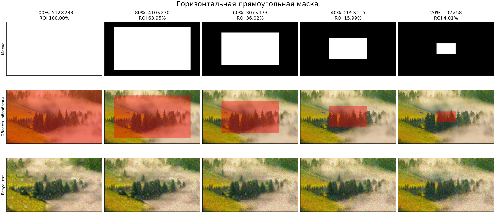

| Линейный размер | Размер, px | ROI | PSNR ↑ | LPIPS ↓ | CLIP-IQA ↑ |
|---|---|---:|---:|---:|---:|
| 100% | 512×288 | 100.00% | 21.5563 | 0.7239 | 0.1742 |
| 80% | 410×230 | 63.95% | 22.7434 | 0.7277 | 0.1457 |
| 60% | 307×173 | 36.02% | 23.8044 | 0.7344 | 0.2041 |
| 40% | 205×115 | 15.99% | 24.5454 | 0.7432 | 0.3028 |
| 20% | 102×58 | 4.01% | 25.2380 | 0.7479 | 0.3254 |

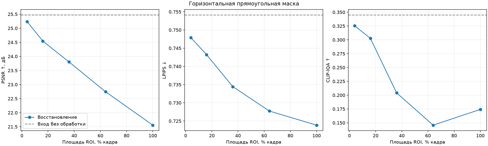

Лучшие значения среди пяти размеров этой формы: PSNR — размер 20% (ROI 4.01%); LPIPS — размер 100% (ROI 100.00%); CLIP-IQA — размер 20% (ROI 4.01%).

При уменьшении от максимальной маски до 20% PSNR меняется 21.556→25.238 дБ, LPIPS — 0.7239→0.7479, CLIP-IQA — 0.1742→0.3254. Все пять размеров дают PSNR ниже baseline и LPIPS ниже baseline.

PSNR растёт последовательно при уменьшении прямоугольника, LPIPS последовательно ухудшается. CLIP-IQA сначала падает при переходе 100%→80%, затем растёт, но остаётся ниже baseline.

#### Круглая маска

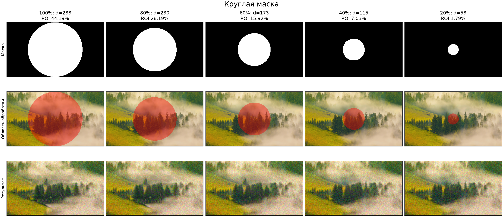

| Линейный размер | Размер, px | ROI | PSNR ↑ | LPIPS ↓ | CLIP-IQA ↑ |
|---|---|---:|---:|---:|---:|
| 100% | d=288 | 44.19% | 23.4546 | 0.7398 | 0.2050 |
| 80% | d=230 | 28.19% | 24.0168 | 0.7383 | 0.2437 |
| 60% | d=173 | 15.92% | 24.5795 | 0.7427 | 0.3108 |
| 40% | d=115 | 7.03% | 25.0862 | 0.7438 | 0.3228 |
| 20% | d=58 | 1.79% | 25.3397 | 0.7506 | 0.3453 |

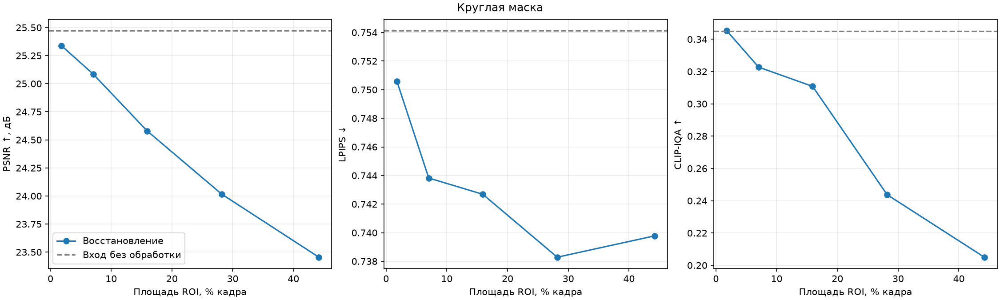

Лучшие значения среди пяти размеров этой формы: PSNR — размер 20% (ROI 1.79%); LPIPS — размер 80% (ROI 28.19%); CLIP-IQA — размер 20% (ROI 1.79%).

При уменьшении от максимальной маски до 20% PSNR меняется 23.455→25.340 дБ, LPIPS — 0.7398→0.7506, CLIP-IQA — 0.2050→0.3453. Все пять размеров дают PSNR ниже baseline и LPIPS ниже baseline.

PSNR последовательно растёт при уменьшении круга. LPIPS сначала снижается при переходе 100%→80%, затем растёт. Для самого маленького круга CLIP-IQA выше baseline лишь на 0.000240; при одном seed это не доказывает устойчивого улучшения качества.

При уменьшении маски всё больше шумных пикселей сохраняется без обработки, поэтому полные метрики могут приближаться к baseline. Это не означает, что маленькая ROI восстанавливается лучше. Разные размеры охватывают разное содержание кадра; это исследование площади и охвата области, а не изолированное сравнение качества на одних пикселях. Прямоугольник и круг при одинаковом линейном коэффициенте имеют разную площадь.

Все опыты используют одну фотографию и один seed; выводы описывают эту серию. Пиксели вне маски проверяются на точное совпадение с входом. Дополнительный PSNR ROI, статусы и хеши сохранены в [CSV](results_mask_sizes/metrics.csv).

Повторный запуск из корня проекта: `.\LW3\.venv\Scripts\python.exe LW3/mask_size_study.py`. Повторное построение таблиц и графиков: добавьте `--stage report`.

<!-- mask-size-study:end -->

## 4. Выводы

В разделе 3.2 исследование шумов дополнительно повторено по пяти seed для каждой из трёх фотографий. Итоговые графики этого раздела показывают средние и выборочные SD; средние при отклонениях рассчитаны только по успешным результатам с указанием n/5.

Проверено ограничение восстановления на каждом шаге DDIM и точное сохранение пикселей вне маски. Выполнены четыре исследования на обеих пользовательских фотографиях, включая новое изображение и все выбранные шумы. Нулевая маска точно воспроизводит baseline; комбинированные маски локализуют изменения.

SD 1.5 в данной конфигурации не обеспечивает универсального улучшения SR: при strength=0.35 LPIPS часто снижается, а PSNR и CLIP-IQA преимущественно ухудшаются. Для полной маски strength=0.5 улучшает перцептивные оценки на обеих фотографиях, но дополнительно снижает точность относительно опорного изображения. Качество необходимо оценивать несколькими метриками и визуально, с учётом площади ROI, генеративных деталей и отклонённых случаев.

Демонстрационные исходники, их измерения и ссылки на них удалены. Все приведённые результаты относятся к `LW3/input`. Девять автоматических тестов проходят; дополнительно проверены 104 записи, конечность всех 99 троек метрик, SHA-256 PNG, 20 точных совпадений zero/baseline и неизменность фона.

## 5. Источники

1. [Задание](../LW3-2.pdf).
2. [Stable Diffusion 1.5: веса и лицензия](https://huggingface.co/stable-diffusion-v1-5/stable-diffusion-v1-5).
3. [DDIMScheduler](https://huggingface.co/docs/diffusers/api/schedulers/ddim).
4. [Diffusers: inpainting](https://huggingface.co/docs/diffusers/api/pipelines/stable_diffusion/inpaint).
5. [IQA-PyTorch](https://github.com/chaofengc/IQA-PyTorch).
