# Дополнение к ЛР3: определения, вывод формул и устройство программы

Этот документ объясняет математическую модель и конкретную реализацию из [sr_inpainting.py](sr_inpainting.py), [experiment.py](experiment.py) и [research.py](research.py). Результаты взяты из [metrics.csv](results/metrics.csv); описание опытов — из [основного отчёта](README.md).

Все фотографии ниже происходят из `input/`. Новые иллюстрации — схемы, графики и визуализации уже измеренных данных. Генератора демонстрационных исходников нет. Иллюстрации воспроизводятся командой:

```powershell
.\LW3\.venv\Scripts\python.exe LW3/additions_figures.py
```

## Содержание

1. [Обозначения и постановка задачи](#1-обозначения-и-постановка-задачи)
2. [Деградации и шумы](#2-деградации-и-шумы)
3. [Латентное пространство и архитектура](#3-латентное-пространство-и-архитектура)
4. [Прямой диффузионный процесс](#4-прямой-диффузионный-процесс)
5. [Обратный процесс, CFG и DDIM](#5-обратный-процесс-cfg-и-ddim)
6. [Сэмплинг с маской](#6-сэмплинг-с-маской)
7. [Метрики и вывод их формул](#7-метрики-и-вывод-их-формул)
8. [Работа программы по шагам](#8-работа-программы-по-шагам)
9. [Сравнения и интерпретация результатов](#9-сравнения-и-интерпретация-результатов)
10. [Ограничения, проверки и источники](#10-ограничения-проверки-и-источники)

## 1. Обозначения и постановка задачи

| Обозначение | Определение | Размерность / диапазон |
|---|---|---|
| $x$ | Опорное изображение после уменьшения длинной стороны до 512 px | $H\times W\times3$, RGB, 0…255 |
| $y$ | Деградированное и увеличенное bicubic изображение | Как у $x$ |
| $\hat x$ | Итоговое восстановление | Как у $x$ |
| $M$ | Бинарная пиксельная маска: 1 — обрабатывать, 0 — сохранять | $H\times W$ |
| $\Omega$ | Область интереса, ROI: множество пикселей с $M=1$ | Подмножество кадра |
| $\rho$ | Доля обрабатываемых пикселей | $\rho=\frac1{HW}\sum M$ |
| $E,D$ | Энкодер и декодер VAE | Предобученные нейросети |
| $s$ | Коэффициент масштабирования латентов из конфигурации VAE | Скаляр |
| $z_0$ | Латент исходного **входа $y$**, а не эталона $x$ | $1\times4\times H'/8\times W'/8$ |
| $z_t$ | Латент с уровнем шума $t$ | Как у $z_0$ |
| $\epsilon$ | Стандартный гауссовский шум | $\mathcal N(0,I)$ |
| $\epsilon_\theta$ | Оценка шума U-Net с параметрами $\theta$ | Как у латента |
| $c_+,c_-$ | Эмбеддинги положительного и отрицательного текста | Текстовые условия |
| $t,t'$ | Текущий и следующий, меньший, обучающие индексы шума | $t'<t$ |

**Super-resolution (SR, повышение разрешения)** — попытка восстановить мелкие детали на изображении, которое сначала уменьшили, а затем увеличили обратно. Простое увеличение делает картинку больше, но само по себе не возвращает потерянные детали.

**Inpainting** обычно означает заполнение отсутствующего или заменяемого участка изображения. В этой работе выбранный участок уже содержит изображение: программа пытается улучшить его детализацию. Это сочетание и называется здесь **SR-inpainting**.

**ROI (Region of Interest, область интереса)** — участок, который разрешено менять. **Маска** — отдельная чёрно-белая картинка того же размера: белым отмечены места для обработки, чёрным — места, которые нужно сохранить. Например, можно выделить фасад здания и оставить небо вокруг без изменений. Выделенный фасад не стирается перед обработкой: модель получает изображение целиком, включая детали внутри маски.

Чтобы понять дальнейшие разделы, полезно представить работу модели как цепочку:

**Изображение → энкодер → компактное представление → пошаговая обработка → декодер → изображение.**

- **Энкодер (encoder, кодировщик)** — часть нейросети, которая переводит картинку в более компактный набор чисел. Эти числа описывают её содержимое и расположение деталей; это уже не обычные RGB-пиксели.
- **Латент**, или **скрытое представление**, — получившийся набор чисел. **Латентное пространство** — пространство таких представлений. Модель выполняет основную обработку в нём, чтобы уменьшить объём вычислений.
- **Декодер (decoder)** — часть нейросети, которая превращает обработанный набор чисел обратно в видимую картинку. Такое преобразование приблизительное: даже без обработки результат может немного отличаться от входа.
- **VAE (Variational Autoencoder, вариационный автоэнкодер)** — используемая здесь модель, в которую входят энкодер и декодер. Подробности её обучения для понимания этой цепочки не нужны.
- **Диффузионная обработка** — процесс, при котором к скрытому представлению добавляют случайный шум, а затем за несколько шагов убирают его с помощью нейросети. При этом модель может создавать правдоподобные детали. Совпадение с настоящими потерянными деталями не гарантируется.

Энкодер и декодер сами по себе не обеспечивают точное сохранение фона. Поэтому в конце программа берёт обработанный участок из результата модели, а всё вокруг копирует из входной картинки.

Правило сохранения: **каждый пиксель вне выбранной области должен остаться точно таким же, каким был на входе**. Математически:

$$
\forall (i,j)\notin\Omega:\quad \hat x_{ij}=y_{ij}.
$$

Здесь $(i,j)$ — положение пикселя, $\Omega$ — выбранная область, $\hat x$ — результат, а $y$ — входная картинка. Знак $\notin$ означает «не принадлежит». То есть формула говорит: «вне выбранной области результат равен входу».

**Деградированный вход** — картинка, качество которой ухудшили: уменьшили, добавили шум или другие искажения, а затем увеличили до рабочего размера. Именно её пиксели сохраняются вне маски, **включая шум и размытие**.

**Эталон** — изображение до этих искусственных ухудшений. В эксперименте оно известно программе оценки, но модель восстановления его не получает. После обработки результат сравнивают с эталоном и рассчитывают **метрики** — числовые показатели качества.

Задача SR неоднозначна: разные исходники после уменьшения могут давать один LR-вход. Поэтому правдоподобное восстановление не обязательно совпадает с настоящими деталями. Это объясняет расхождение пиксельных и перцептивных метрик.

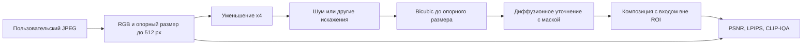

## 2. Деградации и шумы

### 2.1. Общая модель

Обычная модель деградации:

$$
y_{LR}=\mathcal Q\!\left(\mathcal N\!\left(\downarrow_4(k*x)\right)\right),
\qquad y=\uparrow_4^{bicubic}(y_{LR}).
$$

Здесь $k*x$ — размытие свёрткой, $\mathcal N$ — шум, $\mathcal Q$ — квантование или JPEG. Операции включаются в зависимости от опыта. **Порядок важен:** в программе шум добавляется в LR, а не после увеличения. Поэтому после bicubic соседние шумовые значения становятся коррелированными.

Разрешение LR равно $(\lfloor W/4\rfloor,\lfloor H/4\rfloor)$; затем изображение возвращается точно к $(W,H)$. Для ширины 410 это 102, а не дробное 102.5: «×4» здесь содержит округление размеров.

Bicubic вычисляет значение по соседним отсчётам с кубическими весами. В одном измерении:

$$
\tilde x(u)=\sum_n x[n]\,h(u-n),
$$

где $h$ — кубическое интерполяционное ядро. В 2D используются произведения весов по двум координатам. Это восстанавливает сетку пикселей, но не утраченную информацию. При уменьшении библиотека также учитывает масштаб фильтра; формула иллюстрирует принцип, а не полностью воспроизводит реализацию Pillow.

### 2.2. Гауссовский шум

Для каждого LR-пикселя и канала:

$$
n\sim\mathcal N(0,\sigma^2),\qquad
v'=\operatorname{clip}(v+n,0,255).
$$

До clipping $\mathbb E[n]=0$, $\operatorname{Var}(n)=\sigma^2$. Поэтому увеличение $\sigma$ вдвое увеличивает ожидаемую энергию шума вчетверо. В опытах $\sigma=5,15,30$ в шкале 0…255.

После clipping и преобразования в `uint8` точные нулевое среднее и дисперсия $\sigma^2$ уже не гарантируются. У насыщенных пикселей распределение становится асимметричным.

### 2.3. Пуассоновский шум

Нормируем яркость: $u=v/255$. Для параметра peak $P$:

$$
K\sim\operatorname{Poisson}(Pu),\qquad u'=K/P.
$$

Из свойств распределения Пуассона $\mathbb E[K]=\operatorname{Var}(K)=Pu$ получаем:

$$
\mathbb E[u']=u,\qquad
\operatorname{Var}(u')=\frac{Pu}{P^2}=\frac{u}{P}.
$$

Следовательно, шум зависит от яркости: при большем $u$ его абсолютная дисперсия выше. Меньший peak означает более сильный шум. Программа использует $P=30$ и $10$, затем clipping к 0…255. Это упрощённая модель фотонного шума, не полная модель камеры.

### 2.4. Импульсный шум

Для каждого LR-пикселя генерируется $U\sim\mathcal U[0,1)$:

$$
v'=\begin{cases}
0,&U<p/2,\\
255,&U>1-p/2,\\
v,&\text{иначе}.
\end{cases}
$$

Все три канала выбранного пикселя заменяются одновременно. Вероятность замены — примерно $p$; конечная выборка не обязана содержать ровно $pHW$ замен. Используются $p=0.01$ и $0.05$.

### 2.5. Размытие и JPEG

Гауссовское ядро имеет вид:

$$
G_\sigma(a,b)=\frac{1}{2\pi\sigma^2}
\exp\!\left(-\frac{a^2+b^2}{2\sigma^2}\right).
$$

Соседние значения усредняются с весами $G_\sigma$; высокие пространственные частоты подавляются. В дискретной реализации ядро ограничивается и нормируется. `GaussianBlur(1.2)` реализуется средствами Pillow.

JPEG преобразует блоки изображения в частотные коэффициенты и квантует их:

$$
\hat C_{uv}=Q_{uv}\,\operatorname{round}(C_{uv}/Q_{uv}).
$$

Квантование необратимо. Оно может давать блочные границы и ringing. Значение `quality=60` — настройка библиотеки, а не «60% сохранённой информации».

| Искажение | Что изменяет | От чего зависит сила | Параметры опыта |
|---|---|---|---|
| Bicubic ×4 | Мелкие детали, границы | Масштаб, фильтр | Уменьшение ×4 |
| Gaussian | Значения всех каналов | $\sigma$ | 5, 15, 30 |
| Poisson | Яркость со случайной дисперсией | Яркость и peak | 30, 10 |
| Salt-and-pepper | Отдельные целые RGB-пиксели | Вероятность $p$ | 1%, 5% |
| Blur + noise + JPEG | Частоты, шум, блоковые артефакты | Все этапы и их порядок | 1.2; 5; quality 60 |

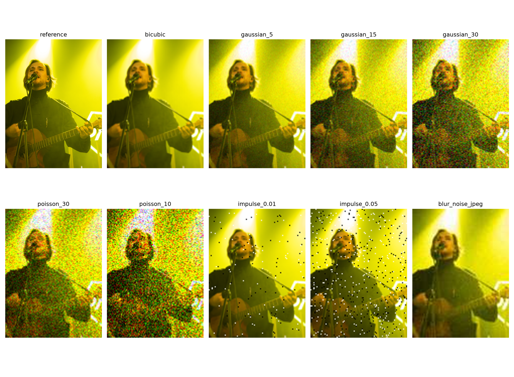

Численное исследование восстановления для всех показанных деградаций — таблицы baseline/one/mixed и выводы по каждому типу шума — приведено в [разделе 3.2 основного отчёта](README.md#32-результаты-для-разных-шумов).

## 3. Латентное пространство и архитектура

### 3.1. VAE

**VAE**, вариационный автоэнкодер, представляет изображение компактным распределением латентов. Энкодер выдаёт параметры:

$$
q_\phi(z\mid y)=\mathcal N(\mu_\phi(y),\operatorname{diag}(\sigma_\phi^2(y))).
$$

При обучении типичная выборка записывается как $z=\mu+\sigma\odot\xi$, где $\xi\sim\mathcal N(0,I)$ — репараметризация, позволяющая передавать градиент через параметры распределения.

В программе используется **мода** распределения: `latent_dist.mode()`. Для диагональной нормали это $\mu$. Поэтому случайная выборка VAE не добавляет ещё один источник случайности:

$$
z_0=s\,\mu_\phi(y),\qquad
\tilde x=D_\phi(z/s).
$$

Коэффициент $s$ берётся из `vae.config.scaling_factor`; он согласует масштаб латентов с обучением U-Net. Убирать его при кодировании или забывать обратное деление при декодировании нельзя.

Типичная обучающая цель VAE объединяет реконструкцию и регуляризацию:

$$
\mathcal L_{VAE}=\mathbb E[-\log p_\phi(y\mid z)]
+\lambda D_{KL}(q_\phi(z\mid y)\Vert\mathcal N(0,I)).
$$

Для диагональной нормали KL-слагаемое выводится подстановкой плотностей в $\mathbb E_q[\log q-\log p]$:

$$
D_{KL}=\frac12\sum_j\left(\mu_j^2+\sigma_j^2-1-\log\sigma_j^2\right).
$$

Это объяснение принципа VAE, а не полный состав обучающей функции потерь конкретного SD-автоэнкодера. Лабораторная использует готовые веса и ничего не обучает.

### 3.2. Размеры тензоров

В коде $H'=8\lceil H/8\rceil$, $W'=8\lceil W/8\rceil$. Справа и снизу добавляются копии крайних пикселей; после декодирования дополнение удаляется.

| Объект | rubezh_vekov | town |
|---|---|---|
| Оригинал, $W\times H$ | 4000×5328 | 800×1000 |
| Опорный RGB | 384×512 | 410×512 |
| LR для деградации | 96×128 | 102×128 |
| Дополненный вход | 384×512 | 416×512 |
| Тензор VAE, NCHW | 1×3×512×384 | 1×3×512×416 |
| Латент | 1×4×64×48 | 1×4×64×52 |
| Маска латента | 1×1×64×48 | 1×1×64×52 |
| CFG-вход U-Net | 2×4×64×48 | 2×4×64×52 |

Число латентных элементов относительно RGB примерно равно $4/(3\cdot8^2)=1/48$. Это **не** означает ускорение всей сети ровно в 48 раз: вычислительная стоимость зависит от внутренних каналов, attention, весов и перемещений памяти.

### 3.3. U-Net и текстовое условие

**U-Net** — нейросеть, которая на каждом шаге оценивает шум в текущем скрытом представлении картинки. По этой оценке алгоритм рассчитывает следующее, менее зашумлённое представление. Это отдельная часть системы: декодер VAE превращает её итог в обычную картинку уже после завершения шагов.

U-Net сначала уменьшает размер внутренних карт данных, чтобы учитывать крупные объекты и их окружение, а затем увеличивает его обратно. **Skip connections (прямые связи между уровнями)** передают информацию из уменьшающей ветви в увеличивающую и помогают учитывать мелкие детали. **Эмбеддинг времени** — набор чисел, сообщающий сети текущий уровень шума.

Текстовый энкодер тоже переводит вход в числа, но его вход — текстовое описание, а не картинка. Полученные **текстовые признаки**, или **эмбеддинги**, позволяют направлять обработку словами. **Cross-attention (перекрёстное внимание)** — механизм, с помощью которого сеть сопоставляет участки изображения с текстовым описанием. Его формула:

$$
\operatorname{Attention}(Q,K,V)
=\operatorname{softmax}\!\left(\frac{QK^T}{\sqrt d}\right)V.
$$

В cross-attention запросы $Q$ формируются из признаков изображения, а ключи $K$ и значения $V$ — из текстового условия. Деление на $\sqrt d$ сдерживает рост масштаба скалярных произведений при увеличении размерности.

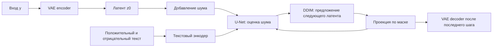

## 4. Прямой диффузионный процесс

### 4.1. Один шаг

Пусть $\beta_t\in(0,1)$ — добавляемая дисперсия, $\alpha_t=1-\beta_t$. В прямом процессе:

$$
z_t=\sqrt{\alpha_t}\,z_{t-1}+\sqrt{1-\alpha_t}\,\epsilon_t,
\qquad \epsilon_t\sim\mathcal N(0,I).
$$

Первый коэффициент ослабляет сигнал; второй добавляет шум. При стандартной нормальной исходной величине такая комбинация сохраняет единичную дисперсию.

### 4.2. Вывод формулы сразу для произвольного уровня

Раскроем два шага:

$$
z_2=\sqrt{\alpha_2\alpha_1}z_0
+\sqrt{\alpha_2(1-\alpha_1)}\epsilon_1
+\sqrt{1-\alpha_2}\epsilon_2.
$$

Независимые нормальные слагаемые дают нормальную сумму. Её дисперсия:

$$
\alpha_2(1-\alpha_1)+(1-\alpha_2)=1-\alpha_1\alpha_2.
$$

Обозначив $\bar\alpha_t=\prod_{k=1}^{t}\alpha_k$, по индукции получаем:

$$
\boxed{z_t=\sqrt{\bar\alpha_t}z_0+\sqrt{1-\bar\alpha_t}\epsilon},
\qquad
q(z_t\mid z_0)=\mathcal N(\sqrt{\bar\alpha_t}z_0,(1-\bar\alpha_t)I).
$$

В `scheduler.add_noise` используется именно эта формула: для получения нужного уровня не требуется вычислять все предшествующие шаги. Математическая нумерация здесь начинается с чистого $z_0$; индексы массивов Diffusers начинаются с нуля, поэтому обозначение «t=0» в конфигурации не следует автоматически считать полностью чистым состоянием.

### 4.3. Расписание шума

Используемая конфигурация задаёт 1000 обучающих уровней и `scaled_linear`:

$$
\beta_k=\left[(1-u_k)\sqrt{\beta_{start}}+u_k\sqrt{\beta_{end}}\right]^2,
\quad u_k=k/(T-1),
$$

где $\beta_{start}=0.00085$, $\beta_{end}=0.012$, $T=1000$. Линейно меняется квадратный корень из $\beta$, а не сама $\beta$. Отношение энергий сигнала и шума:

$$
\operatorname{SNR}(t)=\frac{\bar\alpha_t}{1-\bar\alpha_t}.
$$

При росте $t$ накопленное произведение уменьшается и SNR падает. График ниже вычислен по реальной конфигурации модели.

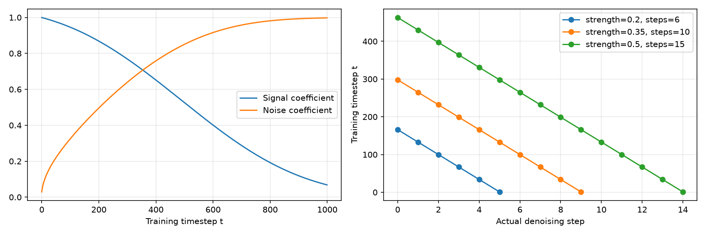

## 5. Обратный процесс, CFG и DDIM

### 5.1. Что предсказывает сеть

Для используемой параметризации U-Net оценивает шум $\epsilon_\theta(z_t,t,c)$. Базовая обучающая цель имеет вид:

$$
\mathcal L_{noise}=\mathbb E_{z_0,t,\epsilon,c}
\left[\|\epsilon-\epsilon_\theta(z_t,t,c)\|_2^2\right].
$$

Она объясняет смысл выхода сети: это не готовое RGB-изображение. В этой лабораторной данная функция потерь не оптимизируется, используются предобученные параметры.

### 5.2. Classifier-free guidance

В одном батче вычисляются два предсказания:

$$
\epsilon_- =\epsilon_\theta(z_t,t,c_-),\qquad
\epsilon_+ =\epsilon_\theta(z_t,t,c_+),
$$

$$
\boxed{\hat\epsilon=\epsilon_-+w(\epsilon_+-\epsilon_-)}.
$$

При $w=0$ остаётся отрицательное условие, при $w=1$ — положительное, при $w>1$ выполняется экстраполяция от отрицательного к положительному. В коде $w=5$. Переменная `unconditional` фактически содержит **negative prompt**, поэтому здесь условие не строго «безусловное».

Связь со score-функцией: для гауссовского зашумления оценка градиента логарифма плотности связана с оценкой шума как $s_\theta\approx-\epsilon_\theta/\sqrt{1-\bar\alpha_t}$. Линейное комбинирование score-оценок даёт такую же линейную комбинацию шумов. CFG усиливает влияние текста, но не гарантирует правильные детали или улучшение метрик.

### 5.3. Вывод DDIM при eta=0

Из формулы прямого процесса выразим чистый латент, заменяя неизвестный шум оценкой сети:

$$
\hat z_0=\frac{z_t-\sqrt{1-\bar\alpha_t}\hat\epsilon}
{\sqrt{\bar\alpha_t}}.
$$

Далее поместим оценённый сигнал на меньший уровень шума $t'$ с тем же предсказанным направлением шума:

$$
\boxed{\tilde z_{t'}=\sqrt{\bar\alpha_{t'}}\hat z_0
+\sqrt{1-\bar\alpha_{t'}}\hat\epsilon}.
$$

Это детерминированный шаг DDIM. Он детерминирован **при фиксированных входном латенте, условиях и вычислениях**, а не независимо от seed.

В более общей форме:

$$
\tilde z_{t'}=\sqrt{\bar\alpha_{t'}}\hat z_0+
\sqrt{1-\bar\alpha_{t'}-\sigma_{t,t'}^2}\hat\epsilon+
\sigma_{t,t'}\xi,
$$

$$
\sigma_{t,t'}=\eta\sqrt{\frac{1-\bar\alpha_{t'}}{1-\bar\alpha_t}
\left(1-\frac{\bar\alpha_t}{\bar\alpha_{t'}}\right)}.
$$

В программе `eta=0`, поэтому дополнительный шум $\xi$ на шагах не генерируется. Общая формула приведена для объяснения параметра, не как описание выполненного стохастического режима. [Источник: DDIM](https://arxiv.org/abs/2010.02502).

### 5.4. Steps, strength и seed — разные параметры

При `steps=N` и `strength=a` код берёт последние $K=\lfloor Na\rfloor$ элементов убывающего расписания. Поэтому strength задаёт и стартовый шум, и фактическое число вызовов сэмплера.

| Параметр | Значение | Следствие |
|---|---:|---|
| Обучающие уровни | 1000 | Сетка, на которой обучалась модель |
| steps | 30 | Сетка инференса, а не обучение |
| strength | 0.2 | 6 шагов, стартовый индекс 166 |
| strength | 0.35 | 10 шагов, стартовый индекс 298 |
| strength | 0.5 | 15 шагов, стартовый индекс 463 |
| guidance | 5 | Вес текстового условия |
| eta | 0 | Без дополнительного случайного шума DDIM |
| seed | 42 / 123 | Начальные состояния генераторов шума |

Числа индексов относятся к конкретному `leading`-расписанию с `steps_offset=1`. Обучающий индекс — не процент шума: зависимость определяется $\bar\alpha_t$.

Конфигурация содержит `set_alpha_to_one=false`: для шага, уходящего за нижнюю границу индексов, DDIM использует начальное значение накопленной alpha, а не принудительную единицу. Поэтому предел «идеально чистого состояния» в теоретической формуле и конечный библиотечный шаг немного различаются. Область вне маски код на последнем шаге всё равно явно заменяет чистым исходным латентом.

## 6. Сэмплинг с маской

### 6.1. Зачем менять каждый шаг

Если сначала обработать весь кадр, а затем вырезать ROI, модель во время генерации будет опираться на изменявшийся фон. В данном алгоритме фон ограничивается уже во время итераций; финальная композиция решает отдельную задачу точности пикселей.

Для исходного латента входа задаётся опорное зашумлённое состояние:

$$
z^{ref}_t=\sqrt{\bar\alpha_t}z_0+\sqrt{1-\bar\alpha_t}\epsilon_{fixed}.
$$

Один $\epsilon_{fixed}$ используется на всех уровнях. Это согласованный выбор связи между уровнями с правильными одномоментными распределениями; он **не** равен буквальному проигрыванию прямой марковской цепи с независимыми шумами на каждом шаге.

Сначала DDIM вычисляет предложение $\tilde z_{t'}$, затем код выполняет:

$$
\boxed{z_{t'}=M_z\odot\tilde z_{t'}+(1-M_z)\odot z^{ref}_{t'}}.
$$

$M_z$ — маска в латентном разрешении, транслируемая на четыре канала. Опорный шум должен соответствовать **следующему** уровню $t'$, а не текущему $t$: предложение уже сделало шаг к меньшему шуму. Иначе возникнет скачок уровня шума на границе ROI.

### 6.2. Вывод как проекции на ограничение

Рассмотрим допустимое множество:

$$
\mathcal C_{t'}=\{z:(1-M_z)\odot z=(1-M_z)\odot z^{ref}_{t'}\}.
$$

Ищем ближайшее к предложению состояние:

$$
\arg\min_{z\in\mathcal C_{t'}}\|z-\tilde z_{t'}\|_2^2.
$$

Сумма квадратов разделяется по координатам. При $M_z=1$ ограничений нет, минимум достигается в $\tilde z_{t'}$. При $M_z=0$ допустима только координата $z^{ref}_{t'}$. Объединение этих двух решений и даёт формулу смешивания. Это вывод для **бинарной** маски; мягкое смешивание уже не является такой жёсткой проекцией.

### 6.3. Почему нужна пиксельная композиция

Декодер нелокален: соседние латенты влияют на общие пиксели. Кроме того, $D(E(y))$ обычно не равно $y$. Поэтому сохранение латента не доказывает сохранение RGB-фона.

Финальный результат:

$$
\boxed{\hat x=M\odot\tilde x+(1-M)\odot y}.
$$

Для $M=0$ получаем $\hat x=y$ точно. Для $M=1$ получаем $\hat x=\tilde x$. Следовательно,

$$
\max_{M_{ij}=0,c}|\hat x_{ijc}-y_{ijc}|=0.
$$

Именно это проверяется через `outside_max_error`. Для полной маски сохраняемой области нет, поэтому значение 0 является соглашением, а не проверкой непустого фона.

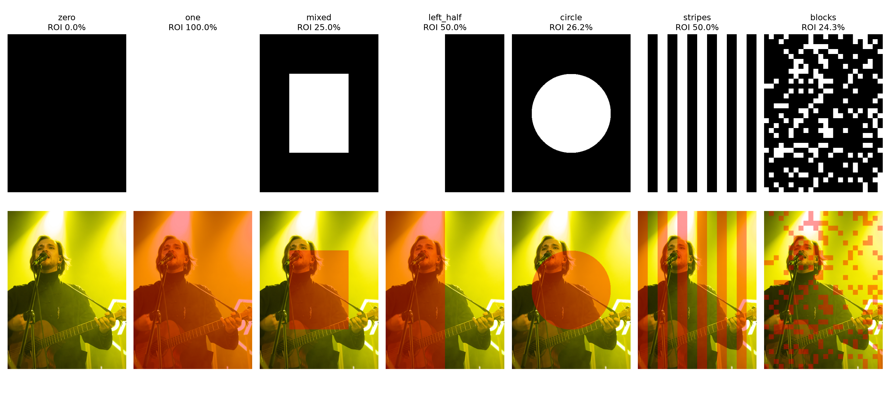

В первой строке белое означает $M=1$, чёрное — $M=0$. Во второй красным выделена ROI. Нулевая маска возвращает вход до VAE; полная разрешает уточнение всего кадра.

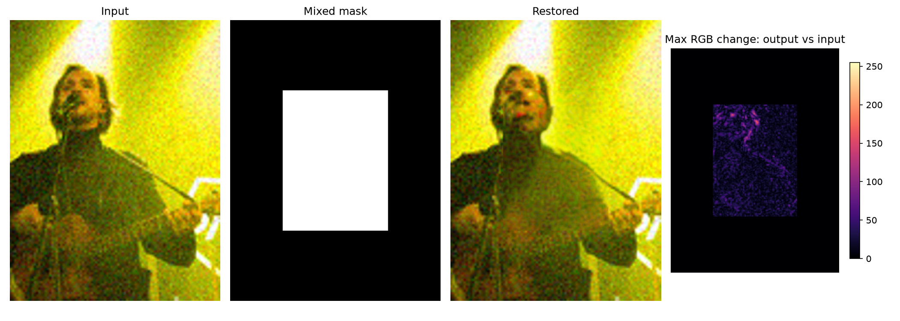

На карте справа показано $\max_c|\hat x-y|$, а не ошибка относительно эталона. Чёрный фон карты означает отсутствие изменений. Такая карта доказывает локальность обработки, но сама по себе не доказывает повышение качества внутри ROI.

### 6.4. Цена жёсткой границы

Nearest-neighbor сохраняет бинарность латентной маски, но не субпиксельную геометрию. Узкие области могут исчезнуть, а границы сдвигаются относительно пиксельной сетки. Финальная композиция возвращает точную пиксельную границу, но может создавать шов между восстановленной ROI и шумным фоном. Размытие маски могло бы сгладить шов, однако изменило бы требование о строго бинарной области; в опытах его нет.

## 7. Метрики и вывод их формул

### 7.1. MSE и PSNR

Среднеквадратичная ошибка RGB:

$$
\operatorname{MSE}=\frac{1}{3HW}\sum_{i,j,c}(x_{ijc}-\hat x_{ijc})^2.
$$

Отношение пиковой мощности $L^2$ к мощности ошибки MSE переводится в децибелы:

$$
\boxed{\operatorname{PSNR}=10\log_{10}\frac{L^2}{\operatorname{MSE}}
=20\log_{10}\frac{L}{\operatorname{RMSE}}},\quad L=255.
$$

Вторая форма следует из $\operatorname{RMSE}=\sqrt{\operatorname{MSE}}$. Уменьшение MSE вдвое увеличивает PSNR на $10\log_{10}2\approx3.01$ дБ. Для двух результатов:

$$
\Delta PSNR=10\log_{10}(\operatorname{MSE}_{old}/\operatorname{MSE}_{new}).
$$

| MSE при $L=255$ | PSNR, дБ | Интерпретация |
|---:|---:|---|
| 0 | $+\infty$ | Полное совпадение |
| 1 | 48.13 | RMSE=1 уровень |
| 100 | 28.13 | RMSE=10 уровней |
| 65025 | 0 | Максимальная ошибка на каждом канале |

Программа переводит массивы в `float` **до вычитания**, иначе `uint8` дал бы переполнение. PSNR считается по RGB полного кадра без обрезания границ. Результаты не следует прямо сравнивать с чужими SR-таблицами, где используется Y-канал и border shaving.

Для ROI:

$$
\operatorname{MSE}_{ROI}=\frac{\sum_{i,j,c}M_{ij}(x_{ijc}-\hat x_{ijc})^2}
{3\sum_{i,j}M_{ij}}.
$$

Далее применяется та же формула PSNR. Для пустой ROI знаменатель равен нулю: код возвращает `None`, а не бесконечное «идеальное качество».

### 7.2. Почему площадь маски влияет на полную метрику

Разделим сумму ошибок на ROI и фон:

$$
\boxed{\operatorname{MSE}_{full}=\rho\operatorname{MSE}_{ROI}
+(1-\rho)\operatorname{MSE}_{background}}.
$$

Это следует непосредственно из количества элементов в двух суммах. Фон сохраняется из $y$, поэтому его ошибка относительно $x$ фиксирована. При маленькой $\rho$ даже сильное изменение ROI может слабо влиять на полную MSE. **PSNR не усредняется такой же линейной формулой**, поскольку содержит логарифм. Для LPIPS и CLIP-IQA подобное разложение по пикселям также не действует: их признаки имеют широкие рецептивные поля.

### 7.3. LPIPS

LPIPS сравнивает глубокие признаки двух изображений. Пусть $f_l(x)$ — признаки слоя $l$, нормированные по каналам в каждой позиции:

$$
\hat f_{l,h,w}(x)=\frac{f_{l,h,w}(x)}{\|f_{l,h,w}(x)\|_2+\delta}.
$$

Типичная запись обученно взвешенного расстояния:

$$
\operatorname{LPIPS}(x,\hat x)=\sum_l\frac1{H_lW_l}
\sum_{h,w}\left\|w_l\odot
(\hat f_l(x)_{h,w}-\hat f_l(\hat x)_{h,w})\right\|_2^2.
$$

Это схема калиброванного признакового расстояния: конкретные реализации задают веса обучаемыми линейными слоями. Здесь используется PyIQA `lpips`, backbone AlexNet, версия калибровки v0.1. Внешний интерфейс получает RGB [0,1], дальнейшее приведение диапазона и нормирование выполняет сама метрика.

LPIPS не выводится из физической модели шума: признаки и калибровка обучены по данным. Меньше — лучше, но значения не имеют единиц яркости и не обязаны лежать в [0,1]. Это перцептивная оценка сходства, а не гарантия истинности мелких деталей. [Работа о LPIPS](https://arxiv.org/abs/1801.03924).

### 7.4. CLIP-IQA и отличие конкретной реализации

CLIP кодирует изображение и тексты в общее пространство. Для нормированных эмбеддингов $v$ и $t$ cosine similarity равна $v^Tt$. Для положительной и отрицательной фраз:

$$
s_k^+=v^Tt_k^+,\quad s_k^-=v^Tt_k^-,\qquad
p_k=\frac{\exp(\gamma s_k^+)}{\exp(\gamma s_k^+)+\exp(\gamma s_k^-)}.
$$

Разделив числитель и знаменатель на $\exp(\gamma s_k^+)$, получаем:

$$
p_k=\frac1{1+\exp[-\gamma(s_k^+-s_k^-)]}.
$$

Таким образом, значение определяется разностью сходств и логит-масштабом $\gamma$ CLIP. Оно не является откалиброванной вероятностью того, что человек назовёт фотографию качественной.

В установленной **PyIQA 0.1.15.post2** `clipiqa` использует RN50 и усредняет **пять**, а не одну пару:

| Положительная фраза | Отрицательная фраза |
|---|---|
| Good image | bad image |
| Sharp image | blurry image |
| sharp edges | blurry edges |
| High resolution image | low resolution image |
| Noise-free image | noisy image |

$$
\boxed{Q_{CLIP}=\frac15\sum_{k=1}^5p_k}.
$$

Изображение нормируется средним и стандартным отклонением CLIP; вызов использует `pos_embedding=False`. Это особенности установленной реализации, проверенные по `pyiqa/archs/clipiqa_arch.py`, а не утверждение о любой реализации CLIP-IQA. Эталон $x$ метрике не нужен. [Исходная работа](https://arxiv.org/abs/2207.12396), [код PyIQA](https://github.com/chaofengc/IQA-PyTorch).

### 7.5. Сравнение метрик

| Свойство | PSNR | LPIPS | CLIP-IQA |
|---|---|---|---|
| Нужен эталон | Да | Да | Нет |
| Сравнивается | Значения пикселей | Глубокие признаки | Сходство с оценочными текстами |
| Лучше | Больше | Меньше | Больше |
| Единицы | Децибелы | Условное расстояние | Безразмерный score |
| Типичная чувствительность | Сдвиг, цвет, точность | Структура и признаки | Семантика, стиль, текстовые признаки качества |
| Главное ограничение | Правдоподобная новая деталь может ухудшить оценку | Не доказывает реальность деталей | Не проверяет соответствие оригиналу |

## 8. Работа программы по шагам

### 8.1. Один вызов restore

```text
1. Привести вход к RGB, проверить форму и бинарность маски.
2. Проверить steps и strength; если маска пустая — вернуть копию входа.
3. Дополнить вход и маску справа/снизу до кратности 8.
4. Нормировать вход, кодировать VAE, взять mode(), умножить на s.
5. Уменьшить маску до латентного размера ближайшим соседом.
6. По seed создать epsilon; выбрать хвост расписания DDIM.
7. Добавить начальный шум к исходному латенту.
8. Получить положительные и отрицательные текстовые эмбеддинги.
9. Для каждого выбранного t:
       два прогноза U-Net -> CFG -> шаг DDIM;
       построить опорный латент на следующем уровне;
       объединить предложение и опорный латент по маске.
10. Декодировать z/s через VAE, проверить конечность значений.
11. Применить штатную проверку безопасности и убрать padding.
12. Освободить offload hooks; при отклонении выдать исключение.
13. Вернуть исходные RGB-пиксели вне ROI.
```

Проверки конечности есть также после VAE-кодирования и прогнозов U-Net. Они предотвращают превращение NaN в чёрные или некорректные PNG.

| Формула / этап | Место реализации |
|---|---|
| Контракт бинарной маски | `validate_mask` |
| Перевод VAE↔латент | `MaskedDiffusion.restore`, `vae.encode/decode` |
| Прямой процесс | `scheduler.add_noise` |
| CFG | `unconditional + guidance * (conditional - unconditional)` |
| DDIM | `scheduler.step(..., eta=0)` |
| Проекция латента | `blend_latents` |
| Точность RGB-фона | `composite`, `np.where` |
| Деградации | `degrade` |
| Метрики | `psnr`, `Metrics` |
| План, возобновление, CSV, графики | `research.plan`, `main`, `report` |

### 8.2. Организация четырёх исследований

| Исследование | Изменяется | Фиксируется |
|---|---|---|
| Маски | Семь масок | Bicubic / Gaussian 15, seed 42, strength 0.35 |
| Шумы | Девять деградаций | Zero / one / mixed, seed 42, strength 0.35 |
| Повторяемость | Seed 42 / 123 | Gaussian 15, zero / one / mixed, strength 0.35 |
| Strength | 0.2 / 0.35 / 0.5 | Gaussian 15, one / mixed, seed 42 |

Число **104** — количество уникальных случаев после удаления пересечений исследований и добавления baseline, а не произведение всех значений параметров. На одну фотографию:

- маски: $2\cdot7=14$;
- шумы добавляют $9\cdot3-2\cdot3=21$ новых случаев;
- второй seed добавляет 3;
- два дополнительных strength добавляют $2\cdot2=4$;
- baseline для девяти деградаций и ещё одного seed добавляет 10.

Итого $14+21+3+4+10=52$, для двух фотографий — 104. Из них 20 baseline, 20 zero и 64 попытки диффузионного восстановления. Отдельные случаи входят сразу в несколько таблиц, но в CSV не дублируются.

### 8.3. Сохранение, возобновление и ошибки

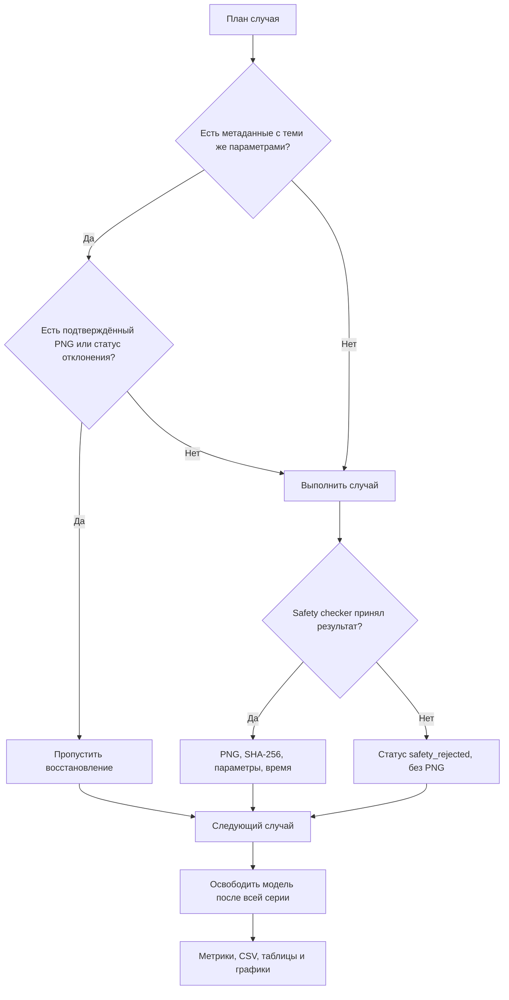

`config.json` защищает от смешивания разных входов и параметров в одной папке. SHA-256 подтверждает неизменность файлов, но сам по себе не подтверждает качество или корректность алгоритма. Для корректности нужны математические инварианты, тесты и интеграционные измерения.

`write_csv` сначала записывает временный файл, затем заменяет основной. Сохранение происходит после каждого измерения. Отклонения содержат пустые числовые поля, а не нули и не метрики чёрного изображения. Результаты baseline/zero с одинаковыми пикселями переиспользуют вычисленные метрики через кэш хэшей.

### 8.4. Память и численная точность

На GTX 1660 Ti FP16 дал нечисловые значения. Поэтому для GTX 16xx код выбирает FP32 и `enable_model_cpu_offload`: компоненты перемещаются между CPU и GPU по мере необходимости, включая safety checker. Это снижает одновременную занятость VRAM ценой обменов через PCIe. Attention slicing вычисляет внимание частями и уменьшает пиковую память.

Для обычной матрицы **self-attention** память растёт примерно как $O(n^2)$ по числу пространственных токенов; при увеличении обеих сторон кадра вдвое $n$ растёт примерно вчетверо, а полный self-attention — до 16 раз. Для cross-attention с фиксированным числом текстовых токенов $m$ матрица имеет размер $n\times m$, и такое квадратичное масштабирование не действует. Это оценки отдельных операций, не точная модель памяти всей программы.

| Приём | Что даёт | Цена / ограничение |
|---|---|---|
| Латентное пространство | Меньшая пространственная сетка | Потери VAE |
| FP32 на GTX 16xx | Стабильные числа в этом запуске | Больше памяти, чем FP16 |
| CPU offload | Компоненты не обязаны одновременно помещаться в VRAM | Переносы и зависимость от RAM |
| Attention slicing | Меньшая пиковая память | Дополнительные последовательные операции |
| Метрики после освобождения SD | Нет одновременного хранения всех сетей | Два этапа выполнения |
| Кэш результатов | Возобновление без повторной генерации | Требуются метаданные и место на диске |

## 9. Сравнения и интерпретация результатов

### 9.1. Маска меняет не только результат, но и условия оценки

Gaussian σ=15, seed=42, strength=0.35:

| Фото | Маска | PSNR ↑ | LPIPS ↓ | CLIP-IQA ↑ |
|---|---|---:|---:|---:|
| rubezh_vekov | baseline / zero | 25.232 | 0.5761 | 0.4438 |
| rubezh_vekov | one | 22.071 | 0.5434 | 0.2581 |
| rubezh_vekov | mixed | 24.369 | 0.5651 | 0.2381 |
| town | baseline / zero | 24.071 | 0.8368 | 0.2111 |
| town | one | 22.816 | 0.7711 | 0.1404 |
| town | mixed | 23.721 | 0.8160 | 0.1683 |

LPIPS улучшается, но PSNR и CLIP-IQA ухудшаются. Поэтому утверждение «картинка стала лучше» по одной метрике недостаточно. Маленькая ROI сохраняет больше baseline-пикселей; её высокий полный PSNR ещё не доказывает лучшую реконструкцию обработанной области.

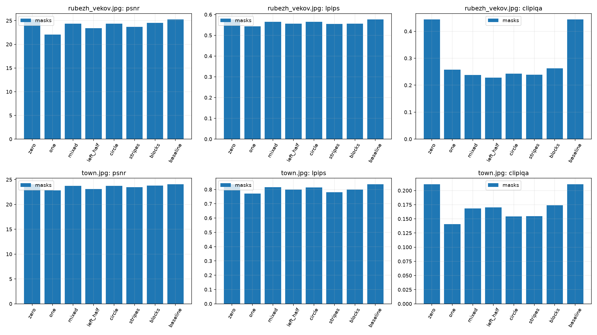

### 9.2. Визуальные сравнения

Порядок: reference, baseline, zero, one, mixed, circle, blocks. Условия соответствуют таблице выше. Сравнивать следует одновременно детали внутри ROI и возможные швы на её границе.

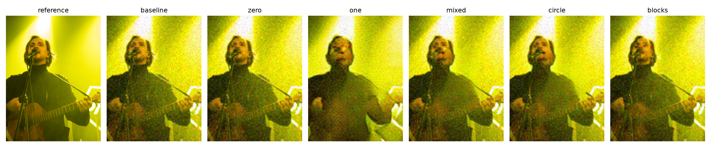

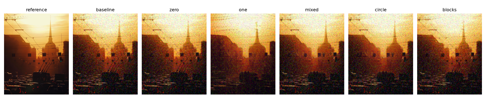

### 9.3. Разный шум

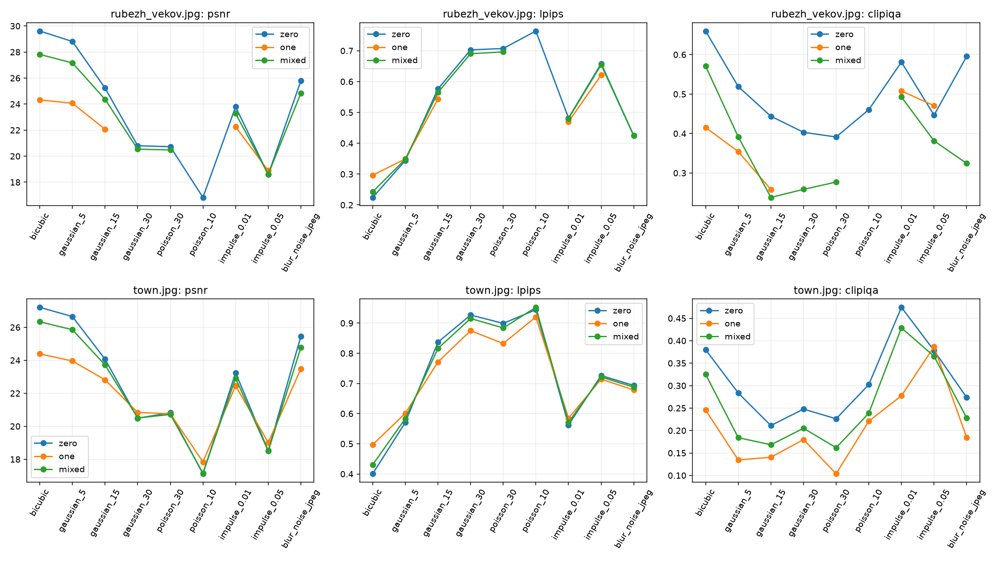

В серии one/mixed при strength=0.35 из 36 попыток 31 дала измеряемый результат, 5 отклонены. Среди успешных сравнений с baseline:

| Показатель улучшился | rubezh_vekov | town | Вместе |
|---|---:|---:|---:|
| PSNR | 2 / 13 | 5 / 18 | 7 / 31 |
| LPIPS | 9 / 13 | 11 / 18 | 20 / 31 |
| CLIP-IQA | 1 / 13 | 1 / 18 | 2 / 31 |

Знаменатели отличаются из-за отклонений, а не из-за разного количества запланированных опытов. Подсчёты описывают только эту выборку и не компенсируют возможное смещение из-за отсутствующих результатов.

### 9.4. Strength и seed

Для полной маски при Gaussian σ=15:

| Фото | Strength | PSNR ↑ | LPIPS ↓ | CLIP-IQA ↑ |
|---|---:|---:|---:|---:|
| rubezh_vekov | 0.2 | 23.793 | 0.5222 | 0.2244 |
| rubezh_vekov | 0.35 | 22.071 | 0.5434 | 0.2581 |
| rubezh_vekov | 0.5 | 19.869 | 0.4965 | 0.6344 |
| town | 0.2 | 23.641 | 0.7577 | 0.1200 |
| town | 0.35 | 22.816 | 0.7711 | 0.1404 |
| town | 0.5 | 20.977 | 0.6480 | 0.4436 |

На этих фотографиях сильное уточнение повышает CLIP-IQA полной маски, но уменьшает точность относительно эталона. LPIPS нового изображения даже не монотонна на всех трёх значениях. Выбирать strength нужно с учётом задачи, а не только по одному максимуму score.

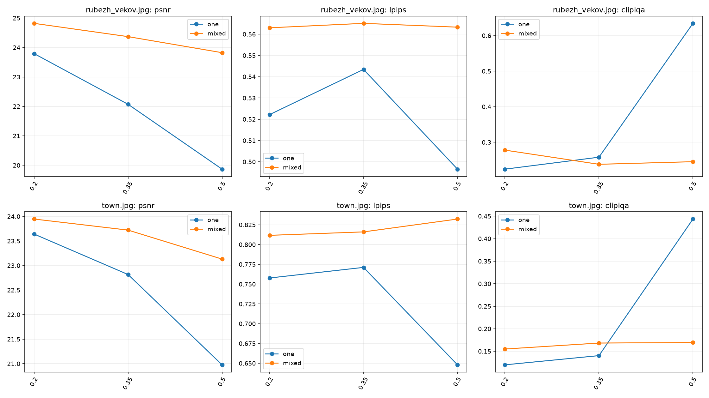

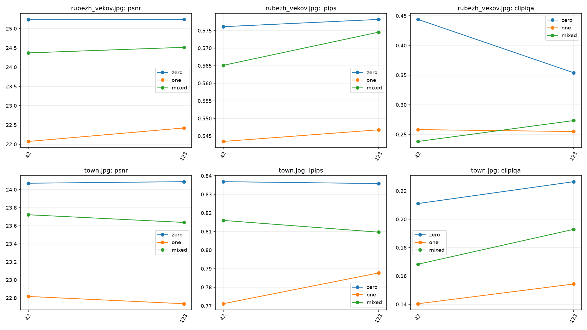

Seed применяется отдельно к NumPy-генератору деградации и PyTorch-генератору латентного шума. Одинаковое число seed не означает одинаковые последовательности этих двух генераторов. Смена seed в текущем протоколе меняет **оба** источника случайности. Для изолированного исследования сэмплера нужно было бы зафиксировать деградированный PNG и менять только PyTorch seed — это отдельный, не выполненный здесь эксперимент.

## 10. Ограничения, проверки и источники

### 10.1. Что установлено, а что не доказано

| Утверждение | Основание / ограничение |
|---|---|
| Фон вне ROI сохранён точно | Формула композиции, тесты и `outside_max_error=0` |
| Zero совпадает с baseline | 20 точных совпадений троек метрик и обход нейросети |
| Маска участвует в сэмплинге | Проекция латента внутри каждого шага цикла |
| Все 104 случая учтены | 99 успешных строк и 5 `safety_rejected` |
| SD универсально улучшает SR | Не подтверждено: показатели часто ухудшаются |
| Одна форма маски лучше другой | Не изолировано: различаются площадь и содержимое ROI |
| Результаты распространяются на любые фотографии | Не доказано: только два JPEG и искусственные деградации |
| Два seed дают статистическую надёжность | Нет: недостаточно повторов для уверенных обобщений |

Отдельные важные границы применимости:

- Опорные изображения уменьшены до длинной стороны 512 px; метрики не относятся к оригинальным 4000×5328 пикселям.
- JPEG пользователя не является гарантированно чистым сенсорным эталоном.
- Деградации не воспроизводят полный физический процесс камеры или официальный протокол DIV2K unknown / RealESRGAN.
- SD 1.5 не обучалась здесь как специализированная SR-система; результат может содержать вымышленные детали.
- Низкий LPIPS и высокий CLIP-IQA не доказывают, что восстановленные детали реально присутствовали в сцене.
- Конечная вычислительная воспроизводимость зависит не только от seed, но и от весов, библиотек, устройства, точности и алгоритмов GPU.

Девять тестов проверяют бинарность и размеры маски, сохранение областей, нулевую маску, воспроизводимость девяти деградаций, реакцию на силу/seed шума, структуру плана, PSNR и цикл с тестовыми компонентами. В том же цикле проверяются отбраковка NaN и освобождение hooks при отклонении safety checker. Эти тесты не заменяют интеграционный запуск настоящей модели; его результаты сохранены отдельно.

### 10.2. Источники и связь с реализацией

1. [DDPM: Denoising Diffusion Probabilistic Models](https://arxiv.org/abs/2006.11239) — прямой процесс и обучение предсказателя шума.
2. [DDIM: Denoising Diffusion Implicit Models](https://arxiv.org/abs/2010.02502) — не-марковский взгляд на сэмплинг и детерминированные шаги.
3. [LPIPS: The Unreasonable Effectiveness of Deep Features as a Perceptual Metric](https://arxiv.org/abs/1801.03924) — признаки и перцептивная калибровка.
4. [CLIP-IQA: Exploring CLIP for Assessing the Look and Feel of Images](https://arxiv.org/abs/2207.12396) — оценка качества через визуально-языковые признаки.
5. [IQA-PyTorch](https://github.com/chaofengc/IQA-PyTorch) — конкретные используемые реализации LPIPS и CLIP-IQA.
6. [Diffusers: DDIMScheduler](https://huggingface.co/docs/diffusers/api/schedulers/ddim) — библиотечный scheduler и его параметры.
7. [Модель SD 1.5](https://huggingface.co/stable-diffusion-v1-5/stable-diffusion-v1-5) — предобученные веса и лицензия.
8. Локальные [конфигурация опыта](results/config.json), [версии и происхождение весов](results/runtime.json), [таблица измерений](results/metrics.csv) и исходный код — источники всех чисел и утверждений о выполненной программе.

Вывод проекции по маске и доказательство неизменности фона относятся к алгоритму этой лабораторной. Формулы обучения приведены для понимания предобученных моделей; обучающих запусков в программе нет.
