# Лабораторная работа №3: SR-inpainting с чистым фоном

**Отдельная версия `LW3_CORRECT`. Исходная `LW3` не изменяется.** В отличие от первоначальной версии, вне маски используются латенты и пиксели **чистой опорной фотографии до искусственного уменьшения ×4, шума и JPEG**. Внутри маски восстанавливается деградированное изображение.

## 1. Теоретическая база и постановка

Это эксперимент с известным чистым контекстом: алгоритм получает эталон для фона. Он отличается от восстановления полностью неизвестного чистого изображения. VAE кодирует весь эталон; его пространственный охват может переносить сведения из ROI в латентные значения снаружи. Это не строгая постановка неизвестной чистой ROI. Копирование чистого фона повышает полные метрики само по себе, поэтому качество нейросети нужно сравнивать с контролем с таким же фоном, а не только с полностью грязным входом.

Чистый эталон — исходная пользовательская фотография, приведённая к длинной стороне 512 px. Это «идеальное состояние» относительно искусственных деградаций: естественная дымка background.jpg и исходные JPEG-артефакты не удаляются.

Для входа y, чистой фотографии x и маски M (1 — восстанавливать) VAE кодирует два латента: z_y=E(y) и z_x=E(x). Перед первым шагом и после каждого шага DDIM вне ROI используется зашумлённая версия **z_x**, а не z_y:

```text
reference(t) = sqrt(alpha_bar[t])*z_x + sqrt(1-alpha_bar[t])*epsilon_fixed
z_next = M_latent*z_proposal + (1-M_latent)*reference(t_next)
result = M*generated + (1-M)*x
```

На последнем шаге reference=z_x без дополнительного диффузионного шума. Один фиксированный epsilon используется на всей траектории. Маска уменьшается nearest-neighbor до латентного размера; финальная композиция выполняется по исходной маске. Фон в начальном состоянии также ограничен чистым латентом. **Zero возвращает x без вызова модели; one не использует чистый фон.**

## 2. Разработанная система и запуск

| Файл | Назначение |
|---|---|
| [sr_inpainting.py](sr_inpainting.py) | Основной алгоритм и CLI с обязательным чистым эталоном |
| [experiment.py](experiment.py) | Маски, деградации, PSNR, LPIPS, CLIP-IQA |
| [run_all.py](run_all.py) | Единый план, возобновление, контроль фона и метрики |
| [report.py](report.py) | Все таблицы, панели и графики |
| [test_correct.py](test_correct.py) | Проверки чистого латента на каждом шаге и пикселей |
| [validate.py](validate.py) | Аудит всех PNG, метрик, средних и сохранности LW3 |
| [deduplicate.py](deduplicate.py) | Экономия диска для идентичных PNG внутри новой папки |
| [additions.md](additions.md) | Формулы метрик и объяснение контролей |

Веса SD 1.5, кэш метрик и Python читаются из уже подготовленной `LW3`; скрипты, входные копии, результаты и отчёт новой версии находятся в `LW3_CORRECT`. Это не SUPIR: здесь переделан основной вариант лабораторной на SD 1.5. Вычисления FP32, U-Net на GPU, VAE и текстовый энкодер переносятся по этапам; проверки NaN/Inf и штатный safety checker сохранены.

```powershell
.\LW3\.venv\Scripts\python.exe -m unittest discover -s LW3_CORRECT -p test_correct.py -v
.\LW3\.venv\Scripts\python.exe LW3_CORRECT/run_all.py --stage restore
.\LW3\.venv\Scripts\python.exe LW3_CORRECT/run_all.py --stage evaluate
.\LW3\.venv\Scripts\python.exe LW3_CORRECT/validate.py
# Только пересборка отчёта:
.\LW3\.venv\Scripts\python.exe LW3_CORRECT/run_all.py --stage report
```

Для одной фотографии: `python LW3_CORRECT/sr_inpainting.py dirty.png clean.png mask.npy result.png --model LW3/.cache/sd15`. Вход, эталон и маска должны иметь одинаковый размер.

## 3. Исследования

Выполнен план из **585 уникальных условий**: успешных **578**, отклонений **7**. Повторы шумов: 540 условий; формы масок: 48; seed: 60; strength: 18; размеры прямоугольника и круга: по 5. Одинаковые условия между исследованиями переиспользуются.

**Все частичные маски пересчитаны новым алгоритмом.** У 141 условий полной маски переиспользован проверенный результат/статус исходной версии: при M=1 фон математически не участвует. Источник указан в CSV и JSON каждого такого опыта; совпадение входа и SHA-256 проверено. Baseline — полностью деградированный вход; zero — чистый эталон. Это разные контроли, они больше не совпадают.

### Метрики и контроль

PSNR ↑, LPIPS ↓ и CLIP-IQA ↑ рассчитаны по полному кадру. Для каждого опыта дополнительно сохранён **контроль без нейросети**: `control=M*y+(1-M)*x`. Он содержит такую же ROI с повреждениями и такой же чистый фон. В таблицах и графиках парные изменения сравниваются именно с этим контролем. PSNR ROI оценивает только восстанавливаемые пиксели; у zero он отсутствует. У zero PSNR=∞ и LPIPS=0; CLIP-IQA равен оценке самого эталона, а не обязательно 1. Бесконечность в графиках отмечена символом ∞ и не заменяется конечным числом.

Для бесконечного PSNR нулевой маски SD не определено и отмечается прочерком; оно не подменяется числом 0. Для конечных одинаковых LPIPS и CLIP-IQA SD равно нулю.

### 3.1. Форма и площадь маски

Seed=42, strength=0.35, steps=30, guidance=5. Восемь вариантов: baseline и семь масок. В панелях результатов верхняя строка — bicubic, нижняя — Gaussian σ=15; для background каждая деградация занимает два ряда по четыре картинки. Доля ROI и содержание изменяются вместе, поэтому это не изолированное сравнение геометрических форм.

На картах различий четыре ряда: результат; изменение относительно контроля с тем же чистым фоном; ошибка к эталону; уменьшение ошибки относительно контроля. В последнем ряду зелёный означает улучшение, красный — ухудшение. Шкалы одинаковы для всех трёх фотографий: абсолютные различия 0–100, уменьшение ошибки −50…50 уровней RGB.

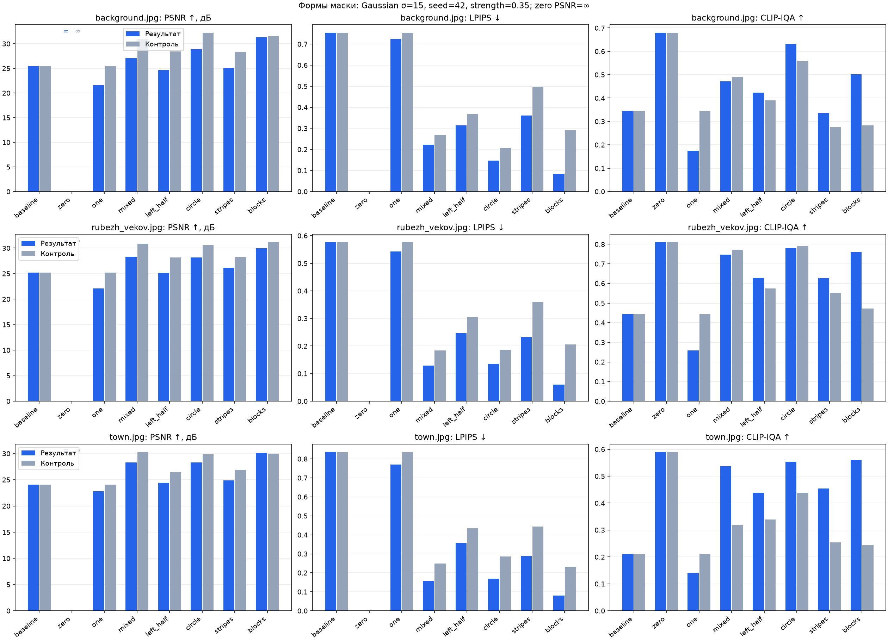

**background.jpg**

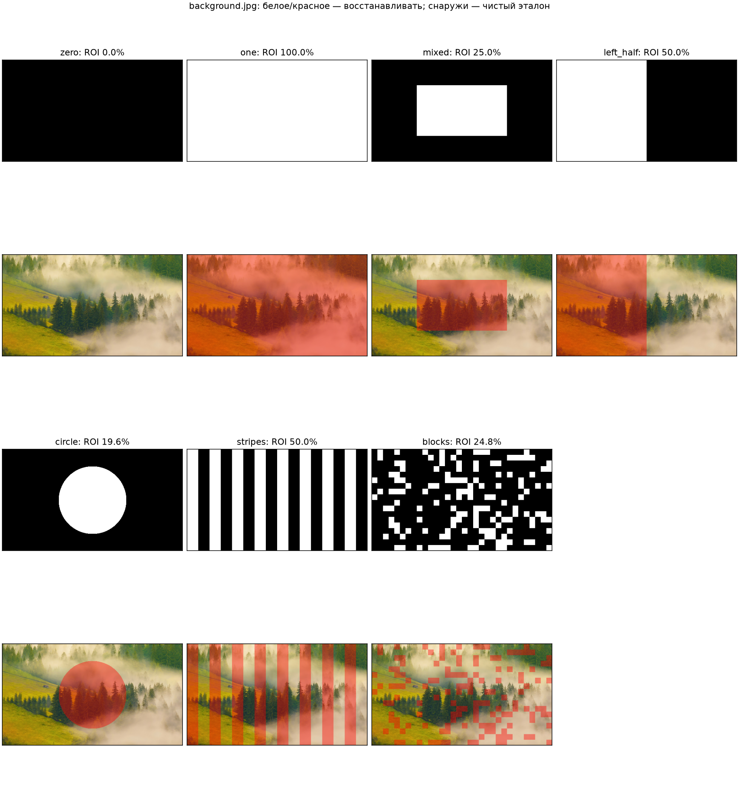

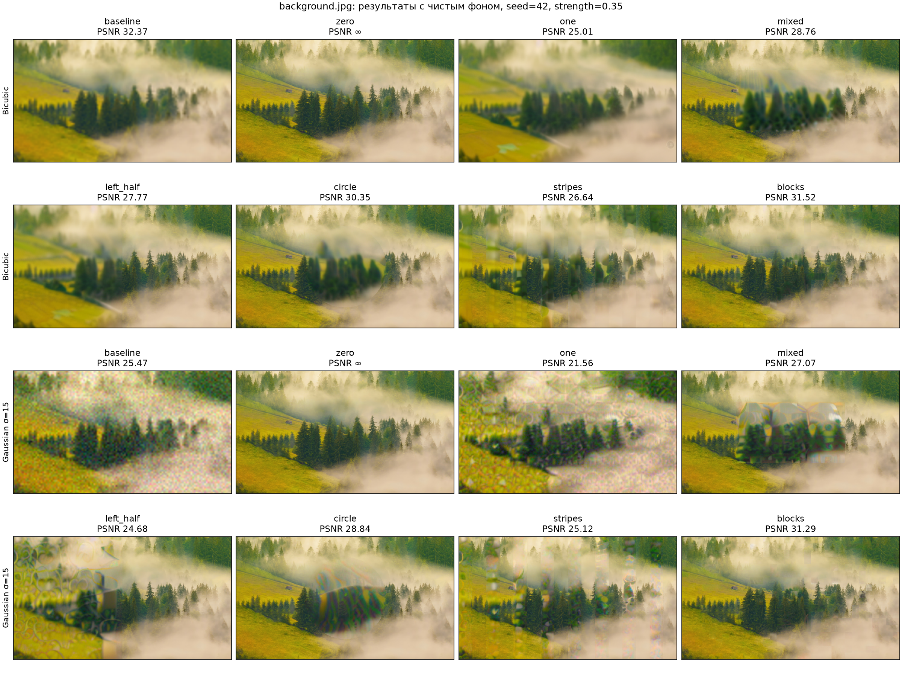

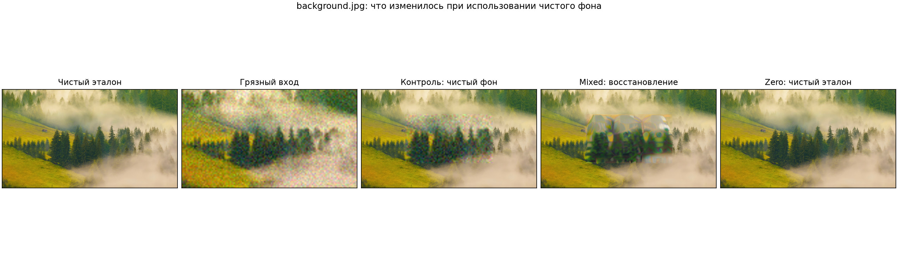

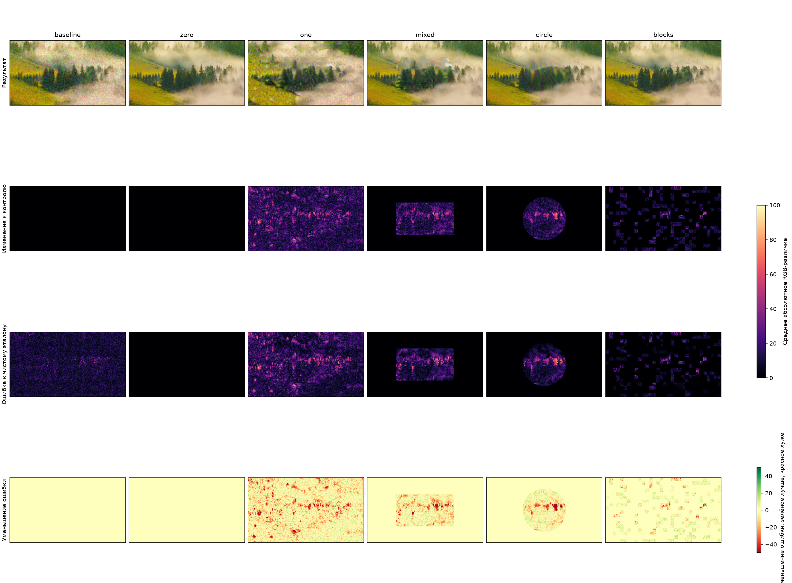

**rubezh_vekov.jpg**

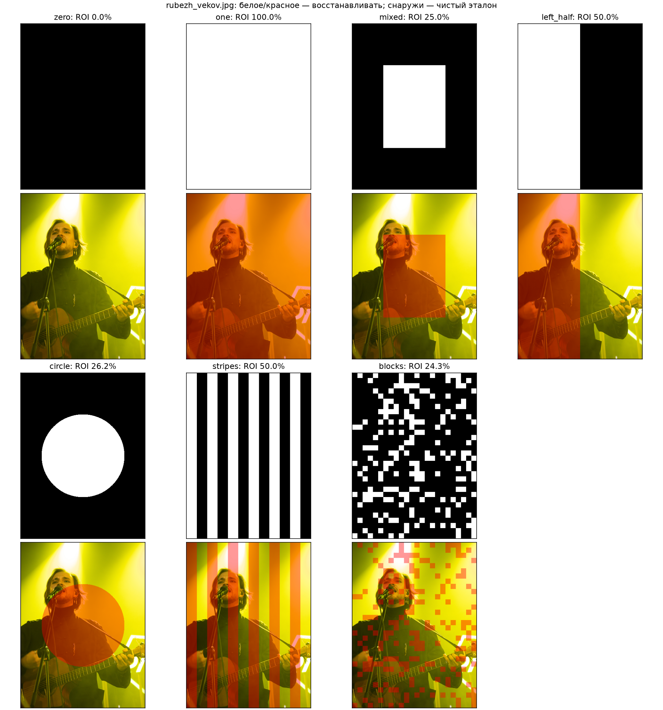

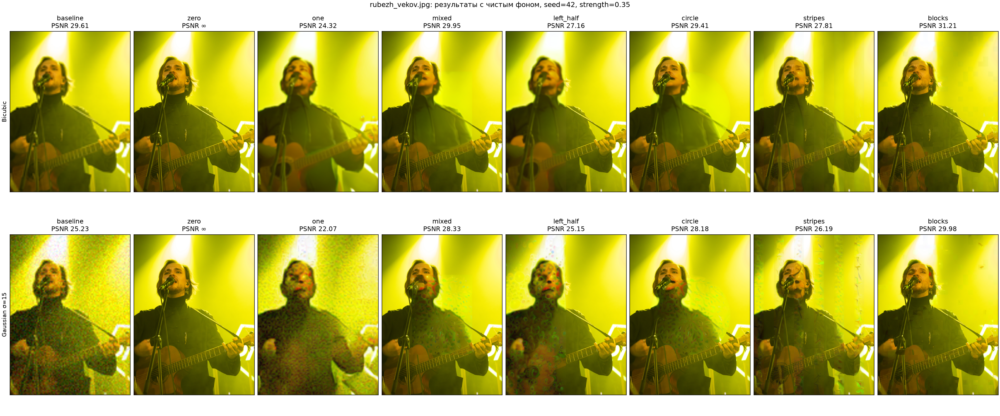

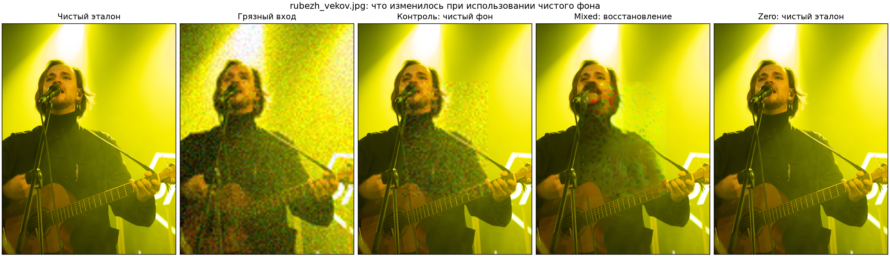

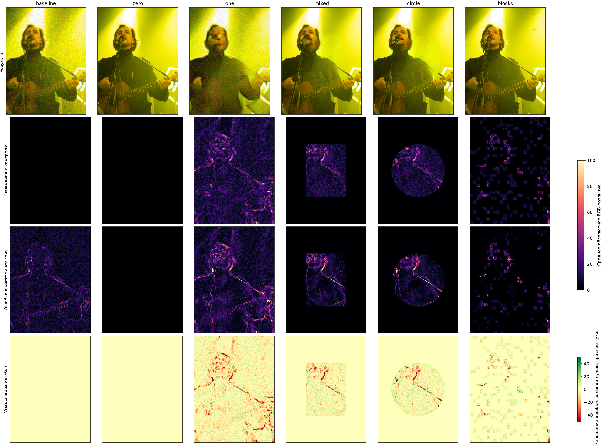

**town.jpg**

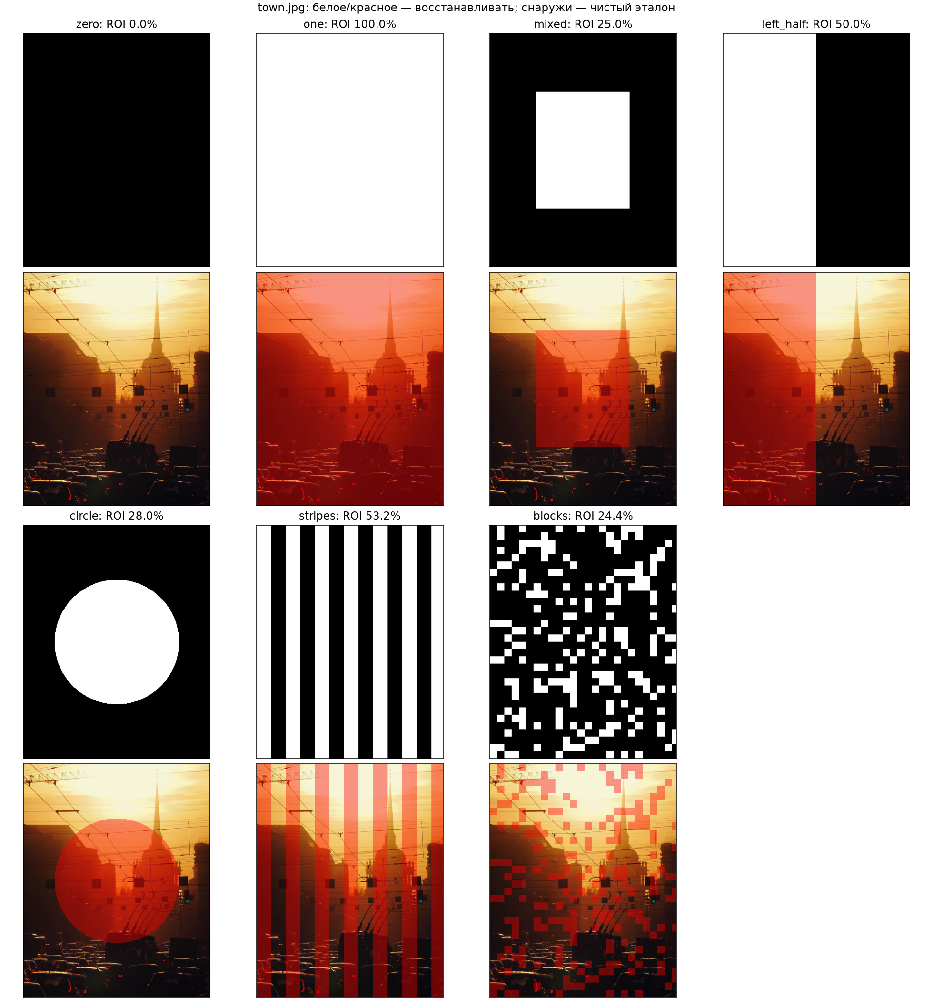

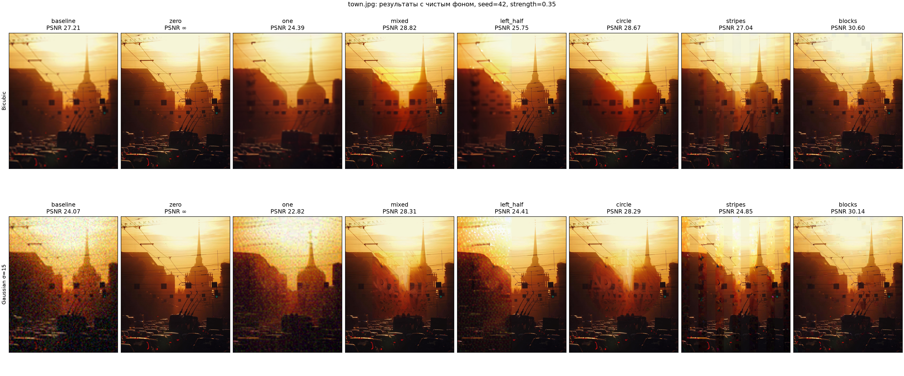

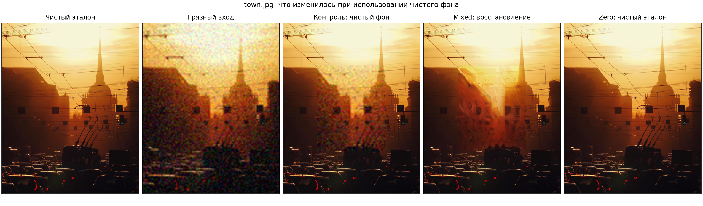

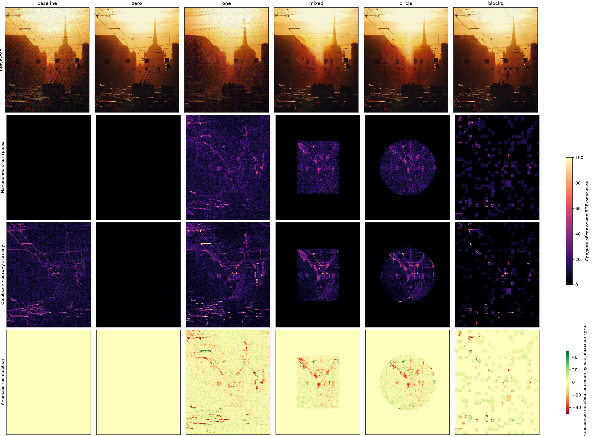

| Фото / условие | Маска | ROI | PSNR ↑ | LPIPS ↓ | CLIP-IQA ↑ | PSNR ROI ↑ |
|---|---|---:|---:|---:|---:|---:|
| background.jpg, gaussian_15, seed=42, strength=0.35 | baseline | 100.00% | 25.4716 | 0.7541 | 0.3450 | 25.4716 |
| background.jpg, gaussian_15, seed=42, strength=0.35 | zero | 0.00% | ∞ | 0.0000 | 0.6798 | — |
| background.jpg, gaussian_15, seed=42, strength=0.35 | one | 100.00% | 21.5563 | 0.7239 | 0.1742 | 21.5563 |
| ↳ контроль: та же ROI без нейросети | — | — | 25.4716 | 0.7541 | 0.3450 | 25.4716 |
| background.jpg, gaussian_15, seed=42, strength=0.35 | mixed | 25.00% | 27.0738 | 0.2220 | 0.4720 | 21.0532 |
| ↳ контроль: та же ROI без нейросети | — | — | 30.9349 | 0.2666 | 0.4919 | 24.9143 |
| background.jpg, gaussian_15, seed=42, strength=0.35 | left_half | 50.00% | 24.6830 | 0.3145 | 0.4235 | 21.6727 |
| ↳ контроль: та же ROI без нейросети | — | — | 28.4538 | 0.3670 | 0.3897 | 25.4435 |
| background.jpg, gaussian_15, seed=42, strength=0.35 | circle | 19.61% | 28.8446 | 0.1464 | 0.6316 | 21.7689 |
| ↳ контроль: та же ROI без нейросети | — | — | 32.2453 | 0.2064 | 0.5581 | 25.1696 |
| background.jpg, gaussian_15, seed=42, strength=0.35 | stripes | 50.00% | 25.1169 | 0.3616 | 0.3354 | 22.1066 |
| ↳ контроль: та же ROI без нейросети | — | — | 28.4002 | 0.4968 | 0.2756 | 25.3899 |
| background.jpg, gaussian_15, seed=42, strength=0.35 | blocks | 24.83% | 31.2861 | 0.0836 | 0.5010 | 25.2352 |
| ↳ контроль: та же ROI без нейросети | — | — | 31.5276 | 0.2917 | 0.2830 | 25.4767 |
| rubezh_vekov.jpg, gaussian_15, seed=42, strength=0.35 | baseline | 100.00% | 25.2315 | 0.5761 | 0.4438 | 25.2315 |
| rubezh_vekov.jpg, gaussian_15, seed=42, strength=0.35 | zero | 0.00% | ∞ | 0.0000 | 0.8098 | — |
| rubezh_vekov.jpg, gaussian_15, seed=42, strength=0.35 | one | 100.00% | 22.0713 | 0.5434 | 0.2581 | 22.0713 |
| ↳ контроль: та же ROI без нейросети | — | — | 25.2315 | 0.5761 | 0.4438 | 25.2315 |
| rubezh_vekov.jpg, gaussian_15, seed=42, strength=0.35 | mixed | 25.00% | 28.3301 | 0.1287 | 0.7460 | 22.3095 |
| ↳ контроль: та же ROI без нейросети | — | — | 30.8311 | 0.1840 | 0.7727 | 24.8105 |
| rubezh_vekov.jpg, gaussian_15, seed=42, strength=0.35 | left_half | 50.00% | 25.1485 | 0.2466 | 0.6283 | 22.1382 |
| ↳ контроль: та же ROI без нейросети | — | — | 28.1997 | 0.3049 | 0.5741 | 25.1894 |
| rubezh_vekov.jpg, gaussian_15, seed=42, strength=0.35 | circle | 26.16% | 28.1777 | 0.1351 | 0.7802 | 22.3538 |
| ↳ контроль: та же ROI без нейросети | — | — | 30.6045 | 0.1866 | 0.7910 | 24.7806 |
| rubezh_vekov.jpg, gaussian_15, seed=42, strength=0.35 | stripes | 50.00% | 26.1879 | 0.2323 | 0.6259 | 23.1776 |
| ↳ контроль: та же ROI без нейросети | — | — | 28.2209 | 0.3596 | 0.5531 | 25.2106 |
| rubezh_vekov.jpg, gaussian_15, seed=42, strength=0.35 | blocks | 24.35% | 29.9751 | 0.0600 | 0.7597 | 23.8399 |
| ↳ контроль: та же ROI без нейросети | — | — | 31.1417 | 0.2061 | 0.4719 | 25.0065 |
| town.jpg, gaussian_15, seed=42, strength=0.35 | baseline | 100.00% | 24.0707 | 0.8368 | 0.2111 | 24.0707 |
| town.jpg, gaussian_15, seed=42, strength=0.35 | zero | 0.00% | ∞ | 0.0000 | 0.5901 | — |
| town.jpg, gaussian_15, seed=42, strength=0.35 | one | 100.00% | 22.8164 | 0.7711 | 0.1404 | 22.8164 |
| ↳ контроль: та же ROI без нейросети | — | — | 24.0707 | 0.8368 | 0.2111 | 24.0707 |
| town.jpg, gaussian_15, seed=42, strength=0.35 | mixed | 25.00% | 28.3138 | 0.1567 | 0.5361 | 22.2932 |
| ↳ контроль: та же ROI без нейросети | — | — | 30.3149 | 0.2496 | 0.3176 | 24.2943 |
| town.jpg, gaussian_15, seed=42, strength=0.35 | left_half | 50.00% | 24.4100 | 0.3557 | 0.4382 | 21.3997 |
| ↳ контроль: та же ROI без нейросети | — | — | 26.4217 | 0.4337 | 0.3394 | 23.4114 |
| town.jpg, gaussian_15, seed=42, strength=0.35 | circle | 27.95% | 28.2939 | 0.1689 | 0.5531 | 22.7584 |
| ↳ контроль: та же ROI без нейросети | — | — | 29.8704 | 0.2867 | 0.4380 | 24.3348 |
| town.jpg, gaussian_15, seed=42, strength=0.35 | stripes | 53.17% | 24.8508 | 0.2883 | 0.4537 | 22.1076 |
| ↳ контроль: та же ROI без нейросети | — | — | 26.8851 | 0.4434 | 0.2534 | 24.1419 |
| town.jpg, gaussian_15, seed=42, strength=0.35 | blocks | 24.39% | 30.1370 | 0.0793 | 0.5599 | 24.0092 |
| ↳ контроль: та же ROI без нейросети | — | — | 29.9766 | 0.2317 | 0.2437 | 23.8488 |

### 3.2. Разные деградации: пять повторов

Во всех девяти условиях и на трёх фотографиях использованы seed **42, 123, 204, 285, 366**. Меняются входной и диффузионный шум; внутри одного seed вход одинаков для всех масок. Показаны средние ± выборочные SD (ddof=1), не доверительные интервалы. При отклонениях усредняются только успешные результаты и указывается n/5. При n=1 SD не оценивается, полоса разброса отсутствует. У bicubic нет случайного входного шума, его baseline одинаков в пяти повторах. Zero одинаков при всех деградациях.

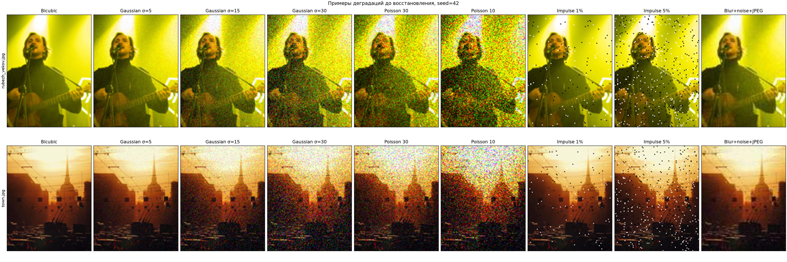

**background.jpg**

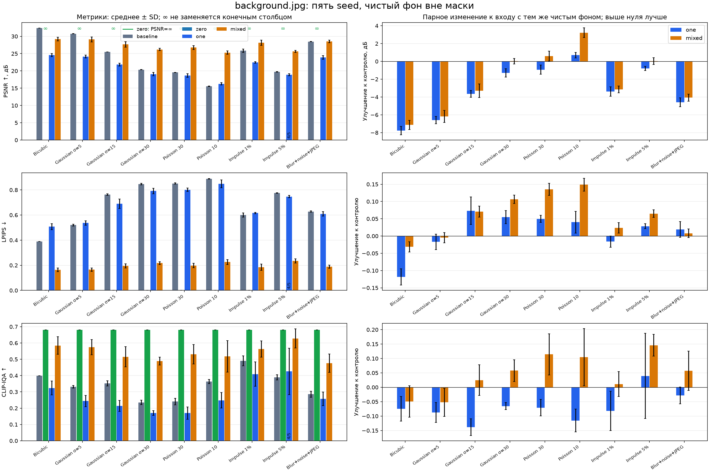

В ячейке: PSNR / LPIPS / CLIP-IQA, каждое среднее ± SD.

| Деградация | Baseline | Zero | One | Mixed |
|---|---|---|---|---|
| Bicubic | 32.3690 ± 0.0000 / 0.3896 ± 0.0000 / 0.3988 ± 0.0000 (n=5/5) | ∞ (SD не опр.) / 0.0000 ± 0.0000 / 0.6798 ± 0.0000 (n=5/5) | 24.6003 ± 0.4637 / 0.5079 ± 0.0238 / 0.3241 ± 0.0429 (n=5/5) | 29.2029 ± 0.5074 / 0.1633 ± 0.0150 / 0.5848 ± 0.0544 (n=5/5) |
| Gaussian σ=5 | 30.7614 ± 0.0102 / 0.5199 ± 0.0070 / 0.3315 ± 0.0077 (n=5/5) | ∞ (SD не опр.) / 0.0000 ± 0.0000 / 0.6798 ± 0.0000 (n=5/5) | 24.1585 ± 0.4192 / 0.5369 ± 0.0172 / 0.2439 ± 0.0340 (n=5/5) | 29.1036 ± 0.6927 / 0.1655 ± 0.0139 / 0.5742 ± 0.0460 (n=5/5) |
| Gaussian σ=15 | 25.4747 ± 0.0193 / 0.7630 ± 0.0061 / 0.3524 ± 0.0155 (n=5/5) | ∞ (SD не опр.) / 0.0000 ± 0.0000 / 0.6798 ± 0.0000 (n=5/5) | 21.8227 ± 0.4056 / 0.6900 ± 0.0383 / 0.2142 ± 0.0333 (n=5/5) | 27.6757 ± 0.8028 / 0.1945 ± 0.0166 / 0.5156 ± 0.0614 (n=5/5) |
| Gaussian σ=30 | 20.3582 ± 0.0158 / 0.8459 ± 0.0067 / 0.2356 ± 0.0135 (n=5/5) | ∞ (SD не опр.) / 0.0000 ± 0.0000 / 0.6798 ± 0.0000 (n=5/5) | 19.0615 ± 0.4777 / 0.7913 ± 0.0227 / 0.1704 ± 0.0149 (n=5/5) | 26.1968 ± 0.3403 / 0.2175 ± 0.0119 / 0.4890 ± 0.0237 (n=5/5) |
| Poisson 30 | 19.5593 ± 0.0228 / 0.8513 ± 0.0049 / 0.2405 ± 0.0208 (n=5/5) | ∞ (SD не опр.) / 0.0000 ± 0.0000 / 0.6798 ± 0.0000 (n=5/5) | 18.6335 ± 0.5260 / 0.8014 ± 0.0137 / 0.1700 ± 0.0377 (n=5/5) | 26.7509 ± 0.5785 / 0.1982 ± 0.0174 / 0.5308 ± 0.0600 (n=5/5) |
| Poisson 10 | 15.5499 ± 0.0451 / 0.8882 ± 0.0028 / 0.3636 ± 0.0127 (n=5/5) | ∞ (SD не опр.) / 0.0000 ± 0.0000 / 0.6798 ± 0.0000 (n=5/5) | 16.2565 ± 0.3395 / 0.8480 ± 0.0313 / 0.2483 ± 0.0480 (n=5/5) | 25.2999 ± 0.5237 / 0.2258 ± 0.0198 / 0.5179 ± 0.0963 (n=5/5) |
| Impulse 1% | 25.8447 ± 0.4816 / 0.6000 ± 0.0170 / 0.4910 ± 0.0308 (n=5/5) | ∞ (SD не опр.) / 0.0000 ± 0.0000 / 0.6798 ± 0.0000 (n=5/5) | 22.4579 ± 0.2344 / 0.6162 ± 0.0051 / 0.4094 ± 0.0743 (n=5/5) | 28.1227 ± 0.7682 / 0.1849 ± 0.0257 / 0.5634 ± 0.0504 (n=5/5) |
| Impulse 5% | 19.7148 ± 0.0842 / 0.7752 ± 0.0021 / 0.3893 ± 0.0157 (n=5/5) | ∞ (SD не опр.) / 0.0000 ± 0.0000 / 0.6798 ± 0.0000 (n=5/5) | 18.8894 ± 0.2685 / 0.7474 ± 0.0085 / 0.4256 ± 0.1421 (n=4/5) | 25.6481 ± 0.3010 / 0.2349 ± 0.0157 / 0.6283 ± 0.0585 (n=5/5) |
| Blur+noise+JPEG | 28.4739 ± 0.0191 / 0.6281 ± 0.0054 / 0.2857 ± 0.0188 (n=5/5) | ∞ (SD не опр.) / 0.0000 ± 0.0000 / 0.6798 ± 0.0000 (n=5/5) | 23.8835 ± 0.5084 / 0.6091 ± 0.0179 / 0.2575 ± 0.0412 (n=5/5) | 28.5090 ± 0.3983 / 0.1893 ± 0.0122 / 0.4766 ± 0.0561 (n=5/5) |

**rubezh_vekov.jpg**

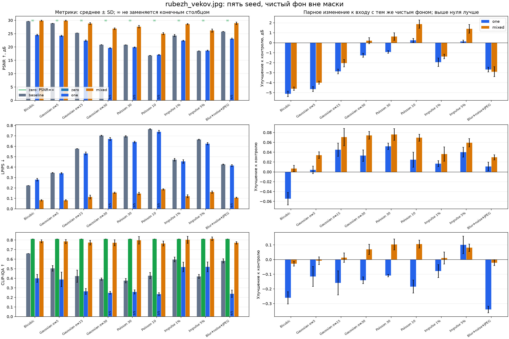

В ячейке: PSNR / LPIPS / CLIP-IQA, каждое среднее ± SD.

| Деградация | Baseline | Zero | One | Mixed |
|---|---|---|---|---|
| Bicubic | 29.6141 ± 0.0000 / 0.2244 ± 0.0000 / 0.6599 ± 0.0000 (n=5/5) | ∞ (SD не опр.) / 0.0000 ± 0.0000 / 0.8098 ± 0.0000 (n=5/5) | 24.4947 ± 0.2702 / 0.2790 ± 0.0127 / 0.3991 ± 0.0415 (n=5/5) | 29.8544 ± 0.1716 / 0.0820 ± 0.0062 / 0.7873 ± 0.0161 (n=5/5) |
| Gaussian σ=5 | 28.8130 ± 0.0087 / 0.3451 ± 0.0027 / 0.5035 ± 0.0287 (n=5/5) | ∞ (SD не опр.) / 0.0000 ± 0.0000 / 0.8098 ± 0.0000 (n=5/5) | 24.1762 ± 0.2518 / 0.3410 ± 0.0080 / 0.3883 ± 0.0751 (n=5/5) | 29.8602 ± 0.1541 / 0.0816 ± 0.0065 / 0.7847 ± 0.0207 (n=5/5) |
| Gaussian σ=15 | 25.2525 ± 0.0169 / 0.5768 ± 0.0015 / 0.4221 ± 0.0638 (n=5/5) | ∞ (SD не опр.) / 0.0000 ± 0.0000 / 0.8098 ± 0.0000 (n=5/5) | 22.3765 ± 0.2514 / 0.5317 ± 0.0133 / 0.2631 ± 0.0305 (n=5/5) | 28.7645 ± 0.3629 / 0.1134 ± 0.0173 / 0.7728 ± 0.0245 (n=5/5) |
| Gaussian σ=30 | 20.8342 ± 0.0190 / 0.7034 ± 0.0035 / 0.3917 ± 0.0125 (n=5/5) | ∞ (SD не опр.) / 0.0000 ± 0.0000 / 0.8098 ± 0.0000 (n=5/5) | 19.5821 ± 0.1960 / 0.6705 ± 0.0139 / 0.2481 ± 0.0148 (n=4/5) | 26.8462 ± 0.2987 / 0.1543 ± 0.0067 / 0.7716 ± 0.0317 (n=5/5) |
| Poisson 30 | 20.7748 ± 0.0549 / 0.6956 ± 0.0068 / 0.3752 ± 0.0227 (n=5/5) | ∞ (SD не опр.) / 0.0000 ± 0.0000 / 0.8098 ± 0.0000 (n=5/5) | 19.8540 ± 0.1925 / 0.6408 ± 0.0077 / 0.2582 ± 0.0214 (n=3/5) | 27.5905 ± 0.4456 / 0.1462 ± 0.0121 / 0.7973 ± 0.0389 (n=5/5) |
| Poisson 10 | 16.8129 ± 0.0421 / 0.7651 ± 0.0046 / 0.4278 ± 0.0327 (n=5/5) | ∞ (SD не опр.) / 0.0000 ± 0.0000 / 0.8098 ± 0.0000 (n=5/5) | 17.0521 ± 0.1794 / 0.7394 ± 0.0131 / 0.2335 ± 0.0154 (n=3/5) | 24.9791 ± 0.3911 / 0.1870 ± 0.0064 / 0.7636 ± 0.0248 (n=5/5) |
| Impulse 1% | 24.2885 ± 0.3885 / 0.4712 ± 0.0127 / 0.5966 ± 0.0245 (n=5/5) | ∞ (SD не опр.) / 0.0000 ± 0.0000 / 0.8098 ± 0.0000 (n=5/5) | 22.3319 ± 0.1920 / 0.4545 ± 0.0176 / 0.5182 ± 0.0506 (n=5/5) | 28.5660 ± 0.1950 / 0.1205 ± 0.0150 / 0.8020 ± 0.0358 (n=5/5) |
| Impulse 5% | 18.5111 ± 0.0531 / 0.6648 ± 0.0037 / 0.4199 ± 0.0201 (n=5/5) | ∞ (SD не опр.) / 0.0000 ± 0.0000 / 0.8098 ± 0.0000 (n=5/5) | 18.6457 ± 0.1551 / 0.6248 ± 0.0103 / 0.5199 ± 0.0509 (n=5/5) | 26.1513 ± 0.5969 / 0.1604 ± 0.0111 / 0.8135 ± 0.0185 (n=5/5) |
| Blur+noise+JPEG | 25.7759 ± 0.0217 / 0.4253 ± 0.0037 / 0.5826 ± 0.0214 (n=5/5) | ∞ (SD не опр.) / 0.0000 ± 0.0000 / 0.8098 ± 0.0000 (n=5/5) | 23.0873 ± 0.2515 / 0.4147 ± 0.0087 / 0.2387 ± 0.0390 (n=4/5) | 28.8867 ± 0.4798 / 0.1068 ± 0.0038 / 0.7703 ± 0.0137 (n=5/5) |

**town.jpg**

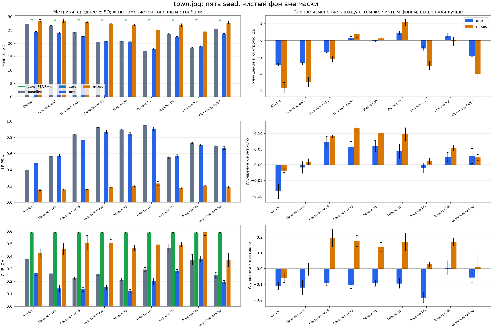

В ячейке: PSNR / LPIPS / CLIP-IQA, каждое среднее ± SD.

| Деградация | Baseline | Zero | One | Mixed |
|---|---|---|---|---|
| Bicubic | 27.2129 ± 0.0000 / 0.4007 ± 0.0000 / 0.3800 ± 0.0000 (n=5/5) | ∞ (SD не опр.) / 0.0000 ± 0.0000 / 0.5901 ± 0.0000 (n=5/5) | 24.3165 ± 0.1308 / 0.4857 ± 0.0232 / 0.2690 ± 0.0213 (n=5/5) | 28.3018 ± 0.6240 / 0.1495 ± 0.0059 / 0.4257 ± 0.0312 (n=5/5) |
| Gaussian σ=5 | 26.6565 ± 0.0043 / 0.5666 ± 0.0040 / 0.2624 ± 0.0191 (n=5/5) | ∞ (SD не опр.) / 0.0000 ± 0.0000 / 0.5901 ± 0.0000 (n=5/5) | 23.9157 ± 0.1624 / 0.5751 ± 0.0182 / 0.1424 ± 0.0284 (n=5/5) | 28.3535 ± 0.5781 / 0.1566 ± 0.0091 / 0.4575 ± 0.0470 (n=5/5) |
| Gaussian σ=15 | 24.0882 ± 0.0142 / 0.8355 ± 0.0025 / 0.2245 ± 0.0089 (n=5/5) | ∞ (SD не опр.) / 0.0000 ± 0.0000 / 0.5901 ± 0.0000 (n=5/5) | 22.7100 ± 0.0743 / 0.7636 ± 0.0176 / 0.1356 ± 0.0164 (n=5/5) | 28.1046 ± 0.3080 / 0.1625 ± 0.0045 / 0.5083 ± 0.0574 (n=5/5) |
| Gaussian σ=30 | 20.5369 ± 0.0307 / 0.9270 ± 0.0029 / 0.2546 ± 0.0098 (n=5/5) | ∞ (SD не опр.) / 0.0000 ± 0.0000 / 0.5901 ± 0.0000 (n=5/5) | 20.7774 ± 0.1847 / 0.8694 ± 0.0194 / 0.1524 ± 0.0194 (n=5/5) | 27.1610 ± 0.3541 / 0.1903 ± 0.0104 / 0.5042 ± 0.0304 (n=5/5) |
| Poisson 30 | 20.8014 ± 0.0243 / 0.8956 ± 0.0059 / 0.2132 ± 0.0079 (n=5/5) | ∞ (SD не опр.) / 0.0000 ± 0.0000 / 0.5901 ± 0.0000 (n=5/5) | 20.6949 ± 0.1204 / 0.8366 ± 0.0220 / 0.1211 ± 0.0148 (n=5/5) | 26.8706 ± 0.2610 / 0.1953 ± 0.0087 / 0.4677 ± 0.0231 (n=5/5) |
| Poisson 10 | 17.1683 ± 0.0643 / 0.9475 ± 0.0051 / 0.2949 ± 0.0156 (n=5/5) | ∞ (SD не опр.) / 0.0000 ± 0.0000 / 0.5901 ± 0.0000 (n=5/5) | 18.0241 ± 0.2348 / 0.9044 ± 0.0208 / 0.2002 ± 0.0255 (n=5/5) | 25.0814 ± 0.3635 / 0.2325 ± 0.0229 / 0.4946 ± 0.0521 (n=5/5) |
| Impulse 1% | 23.4341 ± 0.3244 / 0.5561 ± 0.0165 / 0.4661 ± 0.0335 (n=5/5) | ∞ (SD не опр.) / 0.0000 ± 0.0000 / 0.5901 ± 0.0000 (n=5/5) | 22.4519 ± 0.1365 / 0.5661 ± 0.0211 / 0.2813 ± 0.0133 (n=5/5) | 26.8682 ± 0.4876 / 0.1717 ± 0.0082 / 0.4928 ± 0.0187 (n=5/5) |
| Impulse 5% | 18.3505 ± 0.1065 / 0.7320 ± 0.0055 / 0.3727 ± 0.0415 (n=5/5) | ∞ (SD не опр.) / 0.0000 ± 0.0000 / 0.5901 ± 0.0000 (n=5/5) | 18.8535 ± 0.2477 / 0.7074 ± 0.0092 / 0.3774 ± 0.0240 (n=5/5) | 24.4178 ± 0.5529 / 0.2052 ± 0.0045 / 0.5925 ± 0.0258 (n=5/5) |
| Blur+noise+JPEG | 25.4557 ± 0.0053 / 0.6977 ± 0.0045 / 0.2500 ± 0.0197 (n=5/5) | ∞ (SD не опр.) / 0.0000 ± 0.0000 / 0.5901 ± 0.0000 (n=5/5) | 23.6274 ± 0.0836 / 0.6695 ± 0.0196 / 0.1933 ± 0.0135 (n=5/5) | 27.7099 ± 0.5446 / 0.1867 ± 0.0086 / 0.3689 ± 0.0551 (n=5/5) |

#### Каждый тип деградации

**Bicubic**

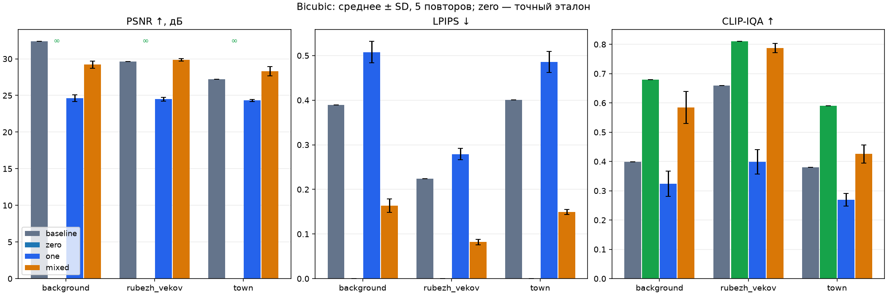


**Gaussian σ=5**

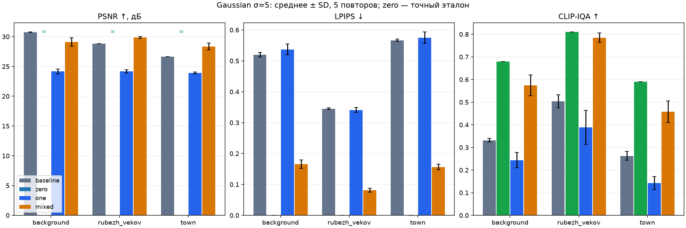


**Gaussian σ=15**

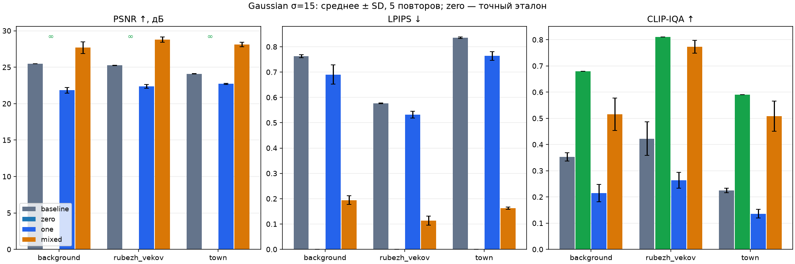


**Gaussian σ=30**

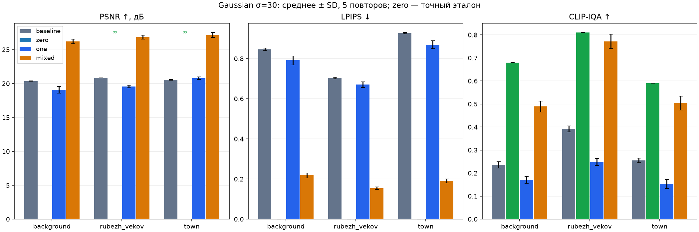


**Poisson 30**

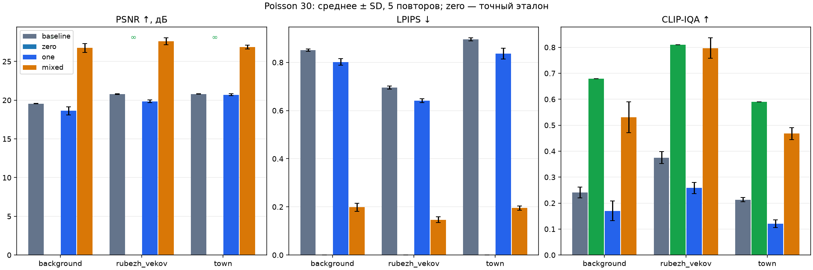

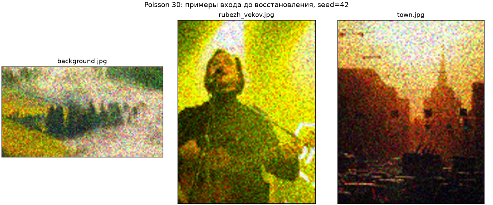

**Poisson 10**

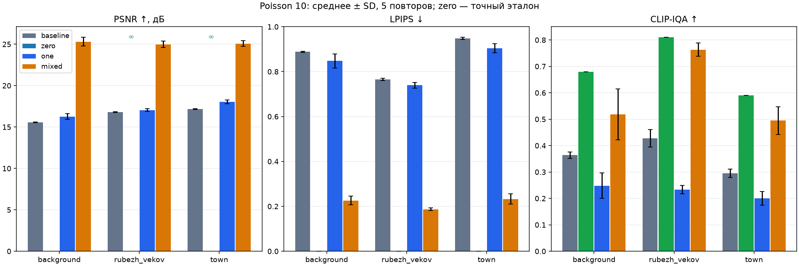

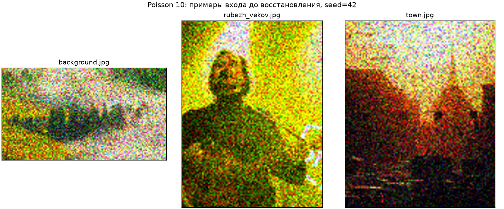

**Impulse 1%**

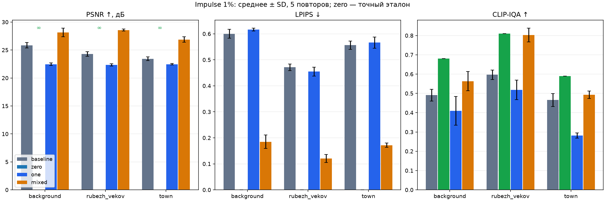

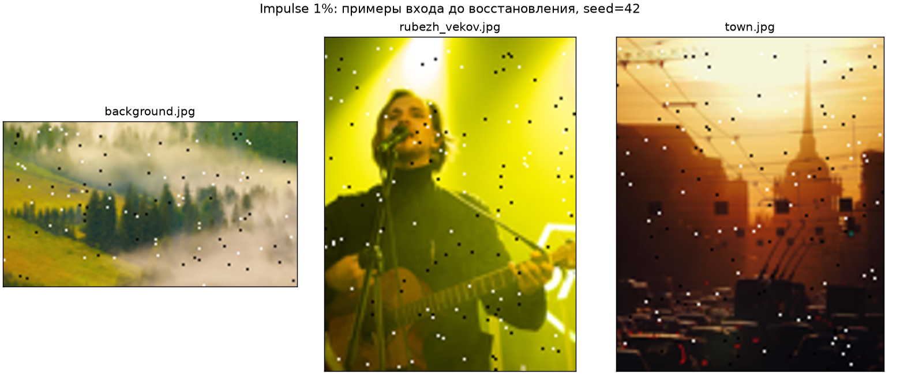

**Impulse 5%**

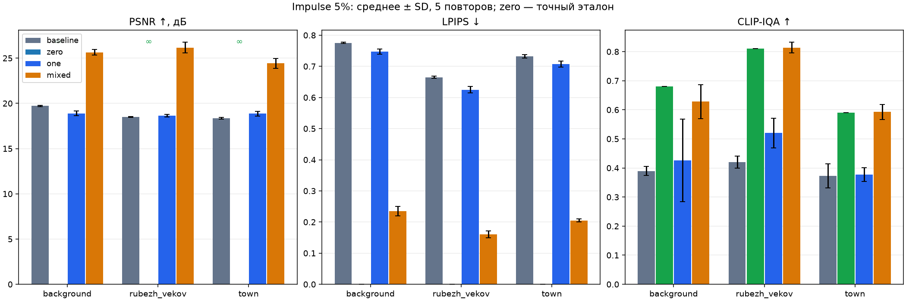


**Blur+noise+JPEG**

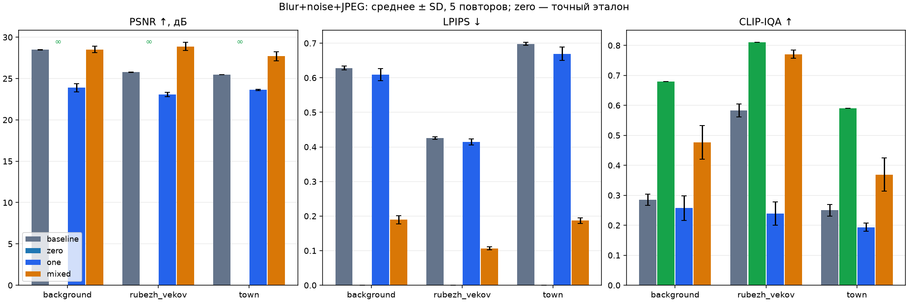


### 3.3. Чувствительность к seed

Gaussian σ=15, one/mixed, пять seed. Пунктир — соответствующий контроль с чистым фоном; он тоже меняется из-за новой реализации входного шума. Zero остаётся чистым эталоном.

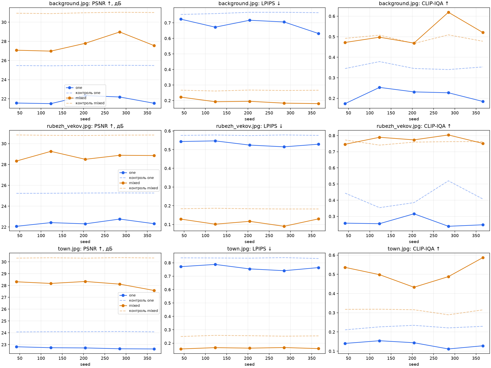

| Фото / условие | Маска | ROI | PSNR ↑ | LPIPS ↓ | CLIP-IQA ↑ | PSNR ROI ↑ |
|---|---|---:|---:|---:|---:|---:|
| background.jpg, gaussian_15, seed=42, strength=0.35 | one | 100.00% | 21.5563 | 0.7239 | 0.1742 | 21.5563 |
| ↳ контроль: та же ROI без нейросети | — | — | 25.4716 | 0.7541 | 0.3450 | 25.4716 |
| background.jpg, gaussian_15, seed=42, strength=0.35 | mixed | 25.00% | 27.0738 | 0.2220 | 0.4720 | 21.0532 |
| ↳ контроль: та же ROI без нейросети | — | — | 30.9349 | 0.2666 | 0.4919 | 24.9143 |
| background.jpg, gaussian_15, seed=123, strength=0.35 | one | 100.00% | 21.4971 | 0.6723 | 0.2532 | 21.4971 |
| ↳ контроль: та же ROI без нейросети | — | — | 25.4456 | 0.7596 | 0.3788 | 25.4456 |
| background.jpg, gaussian_15, seed=123, strength=0.35 | mixed | 25.00% | 26.9776 | 0.1923 | 0.4975 | 20.9570 |
| ↳ контроль: та же ROI без нейросети | — | — | 30.8945 | 0.2612 | 0.5078 | 24.8739 |
| background.jpg, gaussian_15, seed=204, strength=0.35 | one | 100.00% | 22.3354 | 0.7168 | 0.2313 | 22.3354 |
| ↳ контроль: та же ROI без нейросети | — | — | 25.4822 | 0.7680 | 0.3454 | 25.4822 |
| background.jpg, gaussian_15, seed=204, strength=0.35 | mixed | 25.00% | 27.7952 | 0.1949 | 0.4690 | 21.7746 |
| ↳ контроль: та же ROI без нейросети | — | — | 30.9843 | 0.2674 | 0.4672 | 24.9637 |
| background.jpg, gaussian_15, seed=285, strength=0.35 | one | 100.00% | 22.1902 | 0.7058 | 0.2271 | 22.1902 |
| ↳ контроль: та же ROI без нейросети | — | — | 25.4987 | 0.7680 | 0.3400 | 25.4987 |
| background.jpg, gaussian_15, seed=285, strength=0.35 | mixed | 25.00% | 28.9791 | 0.1831 | 0.6189 | 22.9585 |
| ↳ контроль: та же ROI без нейросети | — | — | 31.0325 | 0.2646 | 0.5091 | 25.0119 |
| background.jpg, gaussian_15, seed=366, strength=0.35 | one | 100.00% | 21.5343 | 0.6314 | 0.1849 | 21.5343 |
| ↳ контроль: та же ROI без нейросети | — | — | 25.4753 | 0.7655 | 0.3528 | 25.4753 |
| background.jpg, gaussian_15, seed=366, strength=0.35 | mixed | 25.00% | 27.5530 | 0.1800 | 0.5204 | 21.5324 |
| ↳ контроль: та же ROI без нейросети | — | — | 31.0075 | 0.2662 | 0.4779 | 24.9869 |
| rubezh_vekov.jpg, gaussian_15, seed=42, strength=0.35 | one | 100.00% | 22.0713 | 0.5434 | 0.2581 | 22.0713 |
| ↳ контроль: та же ROI без нейросети | — | — | 25.2315 | 0.5761 | 0.4438 | 25.2315 |
| rubezh_vekov.jpg, gaussian_15, seed=42, strength=0.35 | mixed | 25.00% | 28.3301 | 0.1287 | 0.7460 | 22.3095 |
| ↳ контроль: та же ROI без нейросети | — | — | 30.8311 | 0.1840 | 0.7727 | 24.8105 |
| rubezh_vekov.jpg, gaussian_15, seed=123, strength=0.35 | one | 100.00% | 22.4216 | 0.5468 | 0.2548 | 22.4216 |
| ↳ контроль: та же ROI без нейросети | — | — | 25.2376 | 0.5782 | 0.3539 | 25.2376 |
| rubezh_vekov.jpg, gaussian_15, seed=123, strength=0.35 | mixed | 25.00% | 29.2583 | 0.1014 | 0.7894 | 23.2377 |
| ↳ контроль: та же ROI без нейросети | — | — | 30.7943 | 0.1865 | 0.7408 | 24.7737 |
| rubezh_vekov.jpg, gaussian_15, seed=204, strength=0.35 | one | 100.00% | 22.3073 | 0.5243 | 0.3160 | 22.3073 |
| ↳ контроль: та же ROI без нейросети | — | — | 25.2601 | 0.5751 | 0.3851 | 25.2601 |
| rubezh_vekov.jpg, gaussian_15, seed=204, strength=0.35 | mixed | 25.00% | 28.4961 | 0.1167 | 0.7733 | 22.4755 |
| ↳ контроль: та же ROI без нейросети | — | — | 30.7775 | 0.1840 | 0.7593 | 24.7569 |
| rubezh_vekov.jpg, gaussian_15, seed=285, strength=0.35 | one | 100.00% | 22.7632 | 0.5150 | 0.2387 | 22.7632 |
| ↳ контроль: та же ROI без нейросети | — | — | 25.2704 | 0.5785 | 0.5200 | 25.2704 |
| rubezh_vekov.jpg, gaussian_15, seed=285, strength=0.35 | mixed | 25.00% | 28.8799 | 0.0902 | 0.8037 | 22.8593 |
| ↳ контроль: та же ROI без нейросети | — | — | 30.8119 | 0.1827 | 0.7623 | 24.7913 |
| rubezh_vekov.jpg, gaussian_15, seed=366, strength=0.35 | one | 100.00% | 22.3189 | 0.5290 | 0.2480 | 22.3189 |
| ↳ контроль: та же ROI без нейросети | — | — | 25.2627 | 0.5760 | 0.4076 | 25.2627 |
| rubezh_vekov.jpg, gaussian_15, seed=366, strength=0.35 | mixed | 25.00% | 28.8579 | 0.1298 | 0.7515 | 22.8373 |
| ↳ контроль: та же ROI без нейросети | — | — | 30.8228 | 0.1828 | 0.7628 | 24.8022 |
| town.jpg, gaussian_15, seed=42, strength=0.35 | one | 100.00% | 22.8164 | 0.7711 | 0.1404 | 22.8164 |
| ↳ контроль: та же ROI без нейросети | — | — | 24.0707 | 0.8368 | 0.2111 | 24.0707 |
| town.jpg, gaussian_15, seed=42, strength=0.35 | mixed | 25.00% | 28.3138 | 0.1567 | 0.5361 | 22.2932 |
| ↳ контроль: та же ROI без нейросети | — | — | 30.3149 | 0.2496 | 0.3176 | 24.2943 |
| town.jpg, gaussian_15, seed=123, strength=0.35 | one | 100.00% | 22.7359 | 0.7877 | 0.1543 | 22.7359 |
| ↳ контроль: та же ROI без нейросети | — | — | 24.0878 | 0.8358 | 0.2265 | 24.0878 |
| town.jpg, gaussian_15, seed=123, strength=0.35 | mixed | 25.00% | 28.1743 | 0.1665 | 0.4982 | 22.1537 |
| ↳ контроль: та же ROI без нейросети | — | — | 30.3460 | 0.2583 | 0.3184 | 24.3254 |
| town.jpg, gaussian_15, seed=204, strength=0.35 | one | 100.00% | 22.7186 | 0.7544 | 0.1439 | 22.7186 |
| ↳ контроль: та же ROI без нейросети | — | — | 24.0943 | 0.8345 | 0.2345 | 24.0943 |
| town.jpg, gaussian_15, seed=204, strength=0.35 | mixed | 25.00% | 28.3391 | 0.1628 | 0.4327 | 22.3185 |
| ↳ контроль: та же ROI без нейросети | — | — | 30.3127 | 0.2557 | 0.3157 | 24.2921 |
| town.jpg, gaussian_15, seed=285, strength=0.35 | one | 100.00% | 22.6474 | 0.7409 | 0.1115 | 22.6474 |
| ↳ контроль: та же ROI без нейросети | — | — | 24.1082 | 0.8385 | 0.2212 | 24.1082 |
| town.jpg, gaussian_15, seed=285, strength=0.35 | mixed | 25.00% | 28.1160 | 0.1673 | 0.4879 | 22.0954 |
| ↳ контроль: та же ROI без нейросети | — | — | 30.3582 | 0.2521 | 0.2893 | 24.3376 |
| town.jpg, gaussian_15, seed=366, strength=0.35 | one | 100.00% | 22.6318 | 0.7640 | 0.1280 | 22.6318 |
| ↳ контроль: та же ROI без нейросети | — | — | 24.0801 | 0.8318 | 0.2294 | 24.0801 |
| town.jpg, gaussian_15, seed=366, strength=0.35 | mixed | 25.00% | 27.5796 | 0.1594 | 0.5869 | 21.5590 |
| ↳ контроль: та же ROI без нейросети | — | — | 30.3285 | 0.2543 | 0.3150 | 24.3079 |

### 3.4. Влияние strength

Gaussian σ=15, seed=42, one/mixed; strength=0.2/0.35/0.5 даёт 6/10/15 шагов DDIM. Пунктирные контроли не зависят от strength: без нейросети их пиксели одинаковы.

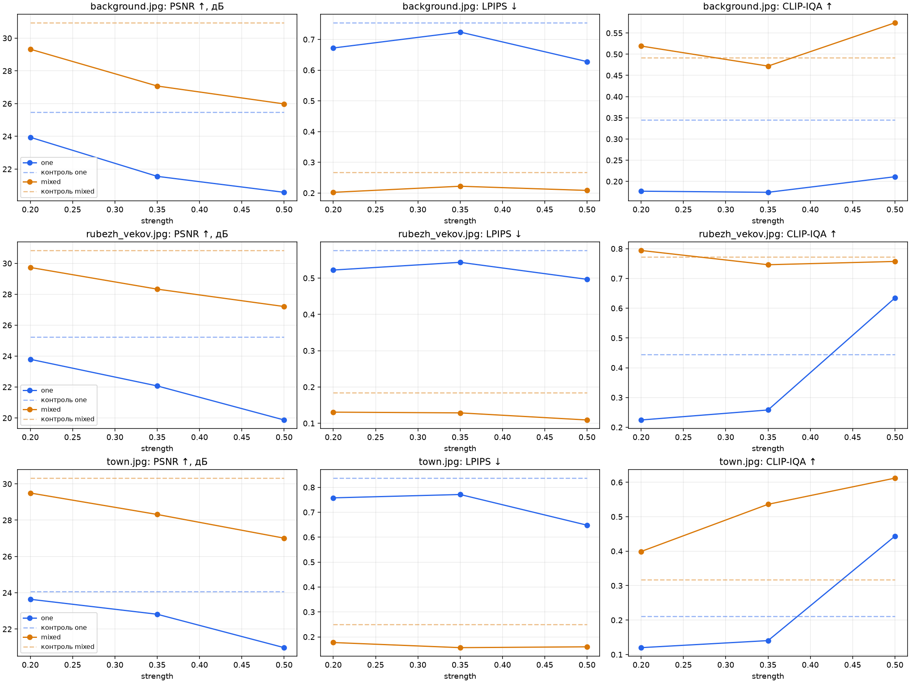

| Фото / условие | Маска | ROI | PSNR ↑ | LPIPS ↓ | CLIP-IQA ↑ | PSNR ROI ↑ |
|---|---|---:|---:|---:|---:|---:|
| background.jpg, gaussian_15, seed=42, strength=0.35 | one | 100.00% | 21.5563 | 0.7239 | 0.1742 | 21.5563 |
| ↳ контроль: та же ROI без нейросети | — | — | 25.4716 | 0.7541 | 0.3450 | 25.4716 |
| background.jpg, gaussian_15, seed=42, strength=0.35 | mixed | 25.00% | 27.0738 | 0.2220 | 0.4720 | 21.0532 |
| ↳ контроль: та же ROI без нейросети | — | — | 30.9349 | 0.2666 | 0.4919 | 24.9143 |
| background.jpg, gaussian_15, seed=42, strength=0.2 | one | 100.00% | 23.9418 | 0.6721 | 0.1769 | 23.9418 |
| ↳ контроль: та же ROI без нейросети | — | — | 25.4716 | 0.7541 | 0.3450 | 25.4716 |
| background.jpg, gaussian_15, seed=42, strength=0.2 | mixed | 25.00% | 29.3212 | 0.2022 | 0.5193 | 23.3006 |
| ↳ контроль: та же ROI без нейросети | — | — | 30.9349 | 0.2666 | 0.4919 | 24.9143 |
| background.jpg, gaussian_15, seed=42, strength=0.5 | one | 100.00% | 20.5812 | 0.6277 | 0.2110 | 20.5812 |
| ↳ контроль: та же ROI без нейросети | — | — | 25.4716 | 0.7541 | 0.3450 | 25.4716 |
| background.jpg, gaussian_15, seed=42, strength=0.5 | mixed | 25.00% | 25.9802 | 0.2083 | 0.5741 | 19.9596 |
| ↳ контроль: та же ROI без нейросети | — | — | 30.9349 | 0.2666 | 0.4919 | 24.9143 |
| rubezh_vekov.jpg, gaussian_15, seed=42, strength=0.35 | one | 100.00% | 22.0713 | 0.5434 | 0.2581 | 22.0713 |
| ↳ контроль: та же ROI без нейросети | — | — | 25.2315 | 0.5761 | 0.4438 | 25.2315 |
| rubezh_vekov.jpg, gaussian_15, seed=42, strength=0.35 | mixed | 25.00% | 28.3301 | 0.1287 | 0.7460 | 22.3095 |
| ↳ контроль: та же ROI без нейросети | — | — | 30.8311 | 0.1840 | 0.7727 | 24.8105 |
| rubezh_vekov.jpg, gaussian_15, seed=42, strength=0.2 | one | 100.00% | 23.7926 | 0.5222 | 0.2244 | 23.7926 |
| ↳ контроль: та же ROI без нейросети | — | — | 25.2315 | 0.5761 | 0.4438 | 25.2315 |
| rubezh_vekov.jpg, gaussian_15, seed=42, strength=0.2 | mixed | 25.00% | 29.7314 | 0.1307 | 0.7940 | 23.7108 |
| ↳ контроль: та же ROI без нейросети | — | — | 30.8311 | 0.1840 | 0.7727 | 24.8105 |
| rubezh_vekov.jpg, gaussian_15, seed=42, strength=0.5 | one | 100.00% | 19.8689 | 0.4965 | 0.6344 | 19.8689 |
| ↳ контроль: та же ROI без нейросети | — | — | 25.2315 | 0.5761 | 0.4438 | 25.2315 |
| rubezh_vekov.jpg, gaussian_15, seed=42, strength=0.5 | mixed | 25.00% | 27.2059 | 0.1091 | 0.7571 | 21.1853 |
| ↳ контроль: та же ROI без нейросети | — | — | 30.8311 | 0.1840 | 0.7727 | 24.8105 |
| town.jpg, gaussian_15, seed=42, strength=0.35 | one | 100.00% | 22.8164 | 0.7711 | 0.1404 | 22.8164 |
| ↳ контроль: та же ROI без нейросети | — | — | 24.0707 | 0.8368 | 0.2111 | 24.0707 |
| town.jpg, gaussian_15, seed=42, strength=0.35 | mixed | 25.00% | 28.3138 | 0.1567 | 0.5361 | 22.2932 |
| ↳ контроль: та же ROI без нейросети | — | — | 30.3149 | 0.2496 | 0.3176 | 24.2943 |
| town.jpg, gaussian_15, seed=42, strength=0.2 | one | 100.00% | 23.6408 | 0.7577 | 0.1200 | 23.6408 |
| ↳ контроль: та же ROI без нейросети | — | — | 24.0707 | 0.8368 | 0.2111 | 24.0707 |
| town.jpg, gaussian_15, seed=42, strength=0.2 | mixed | 25.00% | 29.4950 | 0.1773 | 0.3991 | 23.4744 |
| ↳ контроль: та же ROI без нейросети | — | — | 30.3149 | 0.2496 | 0.3176 | 24.2943 |
| town.jpg, gaussian_15, seed=42, strength=0.5 | one | 100.00% | 20.9767 | 0.6480 | 0.4436 | 20.9767 |
| ↳ контроль: та же ROI без нейросети | — | — | 24.0707 | 0.8368 | 0.2111 | 24.0707 |
| town.jpg, gaussian_15, seed=42, strength=0.5 | mixed | 25.00% | 27.0089 | 0.1601 | 0.6120 | 20.9883 |
| ↳ контроль: та же ROI без нейросети | — | — | 30.3149 | 0.2496 | 0.3176 | 24.2943 |

### 3.5. Размер горизонтальной прямоугольной маски

Background 512×288, Gaussian σ=15, seed=42, strength=0.35. Маски вложенные центральные: обе стороны уменьшаются пропорционально 100/80/60/40/20%, начиная со всего кадра. Вверху маски, затем контроль с чистым фоном и результаты восстановления.

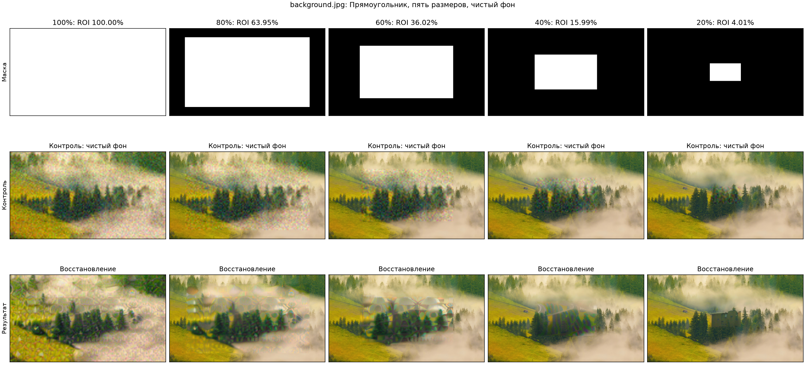

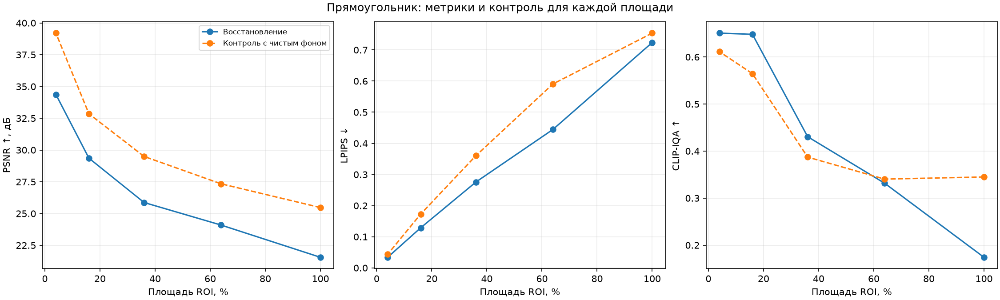

| Фото / условие | Маска | ROI | PSNR ↑ | LPIPS ↓ | CLIP-IQA ↑ | PSNR ROI ↑ |
|---|---|---:|---:|---:|---:|---:|
| background.jpg, gaussian_15, seed=42, strength=0.35 | one | 100.00% | 21.5563 | 0.7239 | 0.1742 | 21.5563 |
| ↳ контроль: та же ROI без нейросети | — | — | 25.4716 | 0.7541 | 0.3450 | 25.4716 |
| background.jpg, gaussian_15, seed=42, strength=0.35 | rectangle_080 | 63.95% | 24.0944 | 0.4445 | 0.3317 | 22.1529 |
| ↳ контроль: та же ROI без нейросети | — | — | 27.3406 | 0.5906 | 0.3404 | 25.3991 |
| background.jpg, gaussian_15, seed=42, strength=0.35 | rectangle_060 | 36.02% | 25.8682 | 0.2756 | 0.4305 | 21.4335 |
| ↳ контроль: та же ROI без нейросети | — | — | 29.4934 | 0.3602 | 0.3872 | 25.0587 |
| background.jpg, gaussian_15, seed=42, strength=0.35 | rectangle_040 | 15.99% | 29.3610 | 0.1287 | 0.6481 | 21.3989 |
| ↳ контроль: та же ROI без нейросети | — | — | 32.8530 | 0.1727 | 0.5645 | 24.8909 |
| background.jpg, gaussian_15, seed=42, strength=0.35 | rectangle_020 | 4.01% | 34.3728 | 0.0339 | 0.6507 | 20.4065 |
| ↳ контроль: та же ROI без нейросети | — | — | 39.2017 | 0.0436 | 0.6112 | 25.2354 |

### 3.6. Размер круглой маски

Те же параметры. Диаметры 288/230/173/115/58 px; максимальный круг вписан по высоте изображения. Вне круга берётся чистый эталон.

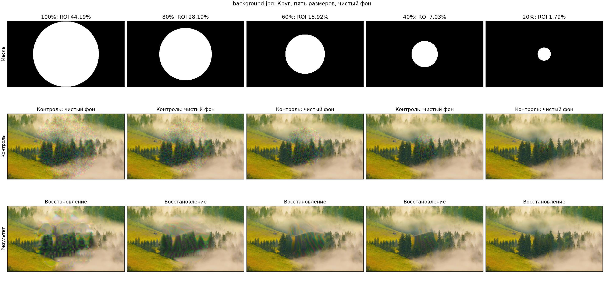

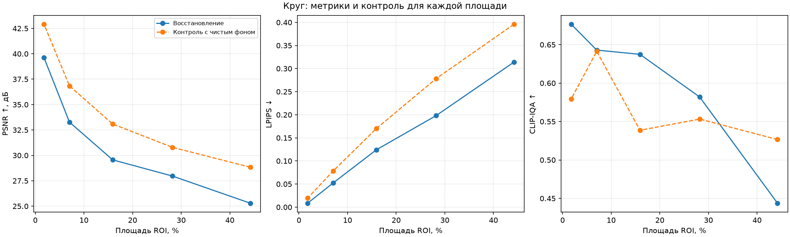

| Фото / условие | Маска | ROI | PSNR ↑ | LPIPS ↓ | CLIP-IQA ↑ | PSNR ROI ↑ |
|---|---|---:|---:|---:|---:|---:|
| background.jpg, gaussian_15, seed=42, strength=0.35 | disk_100 | 44.19% | 25.2935 | 0.3138 | 0.4438 | 21.7472 |
| ↳ контроль: та же ROI без нейросети | — | — | 28.8331 | 0.3958 | 0.5266 | 25.2868 |
| background.jpg, gaussian_15, seed=42, strength=0.35 | disk_080 | 28.19% | 27.9659 | 0.1980 | 0.5820 | 22.4664 |
| ↳ контроль: та же ROI без нейросети | — | — | 30.7937 | 0.2781 | 0.5532 | 25.2942 |
| background.jpg, gaussian_15, seed=42, strength=0.35 | disk_060 | 15.92% | 29.5553 | 0.1241 | 0.6374 | 21.5749 |
| ↳ контроль: та же ROI без нейросети | — | — | 33.0803 | 0.1701 | 0.5387 | 25.0999 |
| background.jpg, gaussian_15, seed=42, strength=0.35 | disk_040 | 7.03% | 33.2687 | 0.0523 | 0.6430 | 21.7373 |
| ↳ контроль: та же ROI без нейросети | — | — | 36.8379 | 0.0781 | 0.6414 | 25.3066 |
| background.jpg, gaussian_15, seed=42, strength=0.35 | disk_020 | 1.79% | 39.6179 | 0.0085 | 0.6765 | 22.1539 |
| ↳ контроль: та же ROI без нейросети | — | — | 42.9003 | 0.0196 | 0.5795 | 25.4363 |

## 4. Выводы по новым измерениям

**Прямоугольники:** при переходе от ROI 100.00% к 4.01% PSNR меняется 21.556→34.373 дБ, LPIPS 0.7239→0.0339, CLIP-IQA 0.1742→0.6507. Контроль без нейросети на этих же площадях имеет PSNR 25.472→39.202 дБ.

**Круги:** при переходе от ROI 44.19% к 1.79% PSNR меняется 25.293→39.618 дБ, LPIPS 0.3138→0.0085, CLIP-IQA 0.4438→0.6765. Контроль без нейросети на этих же площадях имеет PSNR 28.833→42.900 дБ.

Среди **263 успешных** восстановлений one/mixed в исследовании шумов по сравнению с контролем той же ROI PSNR улучшился в **74**, LPIPS — в **210**, CLIP-IQA — в **105** случаях. Это описательные подсчёты отдельных повторов, не тест статистической значимости.

Zero имеет идеальное совпадение с эталоном по определению, а не благодаря нейросети. При уменьшении ROI чистый фон занимает всё большую часть кадра, поэтому улучшение полных метрик нельзя целиком приписывать восстановлению. Для оценки модели нужны парный контроль и PSNR ROI. Нельзя напрямую сравнивать частичные маски этой версии с прежней, не учитывая изменение доступной модели информации.

Все успешные результаты вне ROI совпадают с чистым эталоном пиксель в пиксель. Отклонения модели не заменяются чёрными изображениями или нулевыми метриками. Одна фотография background уже содержит дымку; эксперименты не доказывают её удаление.

## 5. Данные, воспроизводимость и источники

[Все измерения](results/metrics.csv), [средние по пяти повторам](results/noise_summary.csv), [план 585 условий](results/plan.json), [конфигурация и SHA-256](results/config.json), [проверка результатов](results/validation.json).

- [Задание](../LW3-2.pdf).
- [Stable Diffusion 1.5](https://huggingface.co/stable-diffusion-v1-5/stable-diffusion-v1-5).
- [DDIM](https://arxiv.org/abs/2010.02502).
- [LPIPS](https://arxiv.org/abs/1801.03924).
- [IQA-PyTorch](https://github.com/chaofengc/IQA-PyTorch).
