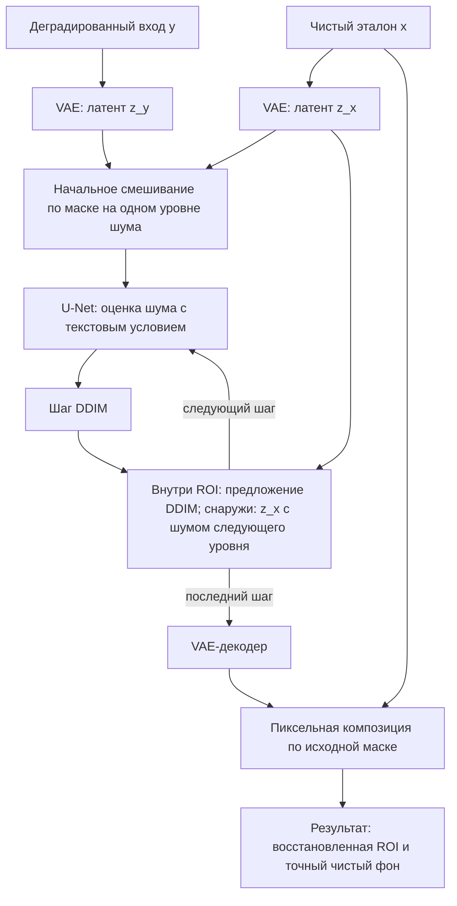

# Дополнение: восстановление с чистым контекстом

## Что дано алгоритму

- `image` / y — фотография после уменьшения ×4, выбранной деградации и увеличения bicubic.
- `clean_image` / x — фотография до этих искусственных искажений, приведённая к рабочему размеру.
- `mask` / M — бинарный массив H×W: единица разрешает восстановление, ноль выбирает чистый контекст.

Это дополнительная информация относительно первоначальной задачи: чистый фон известен. Нельзя выдавать скопированные чистые пиксели за восстановленные нейросетью.

В этой реализации VAE кодирует **весь** чистый эталон, после чего его латент выбирается вне маски. Пространственный охват энкодера означает, что латенты вне ROI могут зависеть и от чистого содержимого внутри ROI. Поэтому это эксперимент с доступным эталоном, а не доказательство восстановления неизвестной чистой области исключительно по внешнему контексту.

## Как работает основной файл

В [sr_inpainting.py](sr_inpainting.py) загружаются предобученные VAE, U-Net и текстовый энкодер SD 1.5. U-Net и веса VAE не переобучаются. Изменён процесс сэмплирования, а не формула шага DDIM.

1. `validate_mask` проверяет размер H×W и значения 0/1; отдельно проверяется размер чистой фотографии.
2. При нулевой маске возвращается копия `clean_image` без нейросети.
3. VAE кодирует грязный вход в `original`; `.mode()` берёт среднее гауссовского распределения латентов без случайной выборки.
4. Для частичной маски VAE отдельно кодирует чистую фотографию в `clean_latent`. При полной маске второй латент не нужен, так как его доля равна нулю.
5. Создаётся один гауссовский шум `noise` с фиксированным seed. Он добавляется к латентам в соответствии с уровнем t, а не накапливается бесконечно.
6. Начальное состояние собирается из зашумлённого грязного латента внутри маски и зашумлённого чистого снаружи.
7. U-Net предсказывает шум; CFG объединяет предсказания с положительным и отрицательным текстом; DDIM рассчитывает `proposal` следующего уровня.
8. После каждого шага `blend_latents` принимает `proposal` внутри ROI и `clean_latent`, зашумлённый на **следующем** уровне, вне ROI. На последнем шаге используется чистый `clean_latent`.
9. VAE декодирует результат. `composite(clean_image, generated, mask)` точно возвращает чистые пиксели вне исходной пиксельной маски.



Если для смешивания брать чистый латент без соответствующего уровня диффузионного шума на промежуточных шагах, внутри и снаружи ROI возникнут разные уровни шума. Поэтому термин «чистый фон» относится к источнику содержимого, а на промежуточном шаге к нему всё ещё добавляется предусмотренный диффузионный шум.

## Маска в пикселях и латентах

Пиксельная маска остаётся в исходном разрешении для финальной композиции. Её латентная копия уменьшается nearest-neighbor примерно в восемь раз по ширине и высоте. Значения остаются бинарными, но узкие участки могут исчезать. Края изображений дополняются до кратности 8 без изменения координат; в конце дополнение обрезается.

Вне ROI неизменность латентов сама по себе не обеспечивает неизменность пикселей из-за потерь VAE. Финальная композиция обязательна. На границе ROI возможны швы; маска остаётся бинарной.

## Зачем нужен отдельный контроль

Глобальный baseline — полностью испорченный вход y. Однако результат частичной маски содержит много заведомо правильных пикселей x снаружи. Поэтому сравнение только с y смешивает два эффекта: копирование чистого фона и работу нейросети.

Для каждой маски сохраняется:

```text
control = M*y + (1-M)*x
```

В control чистый фон уже подставлен, но внутри ROI нейросеть ничего не восстанавливала. Результат сравнивается с таким же контролем по полным метрикам и по PSNR ROI. Это позволяет увидеть вклад восстановления при фиксированной маске. Доступный во время диффузии чистый контекст всё равно остаётся дополнительной информацией — его нельзя игнорировать при сравнении со старым методом.

## Метрики

Для RGB в шкале 0–255:

$$MSE=\frac{1}{3HW}\sum_{i,j,c}(x_{ijc}-\hat x_{ijc})^2,$$

$$PSNR=10\log_{10}\frac{255^2}{MSE}.$$

PSNR больше — точнее совпадение пикселей. PSNR ROI считает ту же ошибку только по пикселям маски. У пустой ROI значение отсутствует.

LPIPS сравнивает признаки восстановленного изображения и эталона: меньше — лучше. CLIP-IQA оценивает воспринимаемое качество без эталона: больше — лучше; она не проверяет достоверность деталей. Обе метрики получают RGB [0,1] через PyIQA.

При нулевой маске результат равен x: MSE=0, PSNR=∞, LPIPS=0. CLIP-IQA равна оценке самой исходной фотографии и не обязана равняться единице. Нельзя заменять бесконечный PSNR условным значением 100 дБ: в отчёте он отображается как ∞.

Стандартное отклонение бесконечного PSNR математически не определено, поэтому для него в CSV и таблицах SD отсутствует. Для конечных одинаковых значений LPIPS и CLIP-IQA стандартное отклонение равно нулю.

## Пять повторов

Seed 42/123/204/285/366 меняет входной и диффузионный шум. Для каждой деградации внутри одного повтора вход общий для всех масок. Арифметически усредняются значения метрик, не изображения и не MSE с последующим пересчётом в PSNR.

Полосы разброса — выборочное SD с ddof=1. При отклонении safety checker результат не сохраняется и метрики отсутствуют; среднее считается по успешным повторам с указанием n/5. Отсутствующие результаты не равны нулевому качеству. При единственном успешном повторе SD не оценивается. У zero и baseline bicubic нет соответствующей случайности: одинаковые результаты не являются пятью независимыми наблюдениями качества.

## Ограничения

Все исходники — три пользовательские JPEG, не DIV2K. Шумы контролируемые: Gaussian, Poisson, salt-and-pepper, blur+noise+JPEG. Их параметры не задают общую шкалу силы. Составная деградация не позволяет разделить вклад компонентов.

SD 1.5 не специализирована на точном SR. Большой PSNR маленькой ROI может объясняться большой долей скопированного чистого фона. Размеры масок меняют и площадь, и содержание выбранной области. Пять seed на трёх фотографиях не дают обобщения на большой набор изображений.
